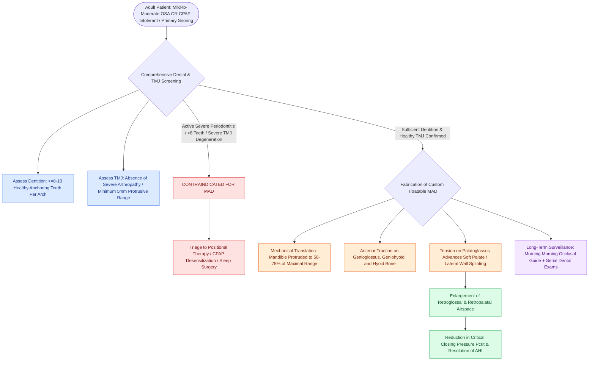

# Mandibular advancement oral appliances enlarge the retroglossal airway through anterior mandibular translation for mild-to-moderate obstructive sleep apnea

## Active Recall

> [!question]- What biomechanical mechanism allows a mandibular advancement device (MAD) to enlarge both the retroglossal and retropalatal airspaces?
> *Answer / Clinical Rationale*: A mandibular advancement device anchors to the maxillary and mandibular dental arches to mechanically translate the **mandible anteriorly and inferiorly**. Anterior displacement of the mandible advances the mandibular insertion of the **genioglossus** and **geniohyoid** muscles, drawing the tongue base forward and away from the posterior pharyngeal wall. Concurrently, anterior traction on the tongue base and hyoid puts tension on the **palatoglossus muscles** and soft palate, pulling the velum anteriorly and significantly enlarging both the **retroglossal anteroposterior caliber** and the **retropalatal cross-sectional area**, while stabilizing lateral pharyngeal walls via stretch of the pharyngeal constrictors.

> [!question]- What are the primary clinical indications and strict dental contraindications for mandibular advancement oral appliance therapy?
> *Answer / Clinical Rationale*: - **Indications**: First-line alternative for patients with **mild-to-moderate OSA (AHI 5–30)** who prefer oral appliances or fail/cannot tolerate CPAP; primary snoring; and adjunctive therapy for positional OSA or travel. - **Contraindications**: **Insufficient dentition** (fewer than **8 to 10 sound, unrestored teeth per arch** necessary to distribute reciprocal protrusive forces); active or advanced **periodontal disease** with tooth mobility; severe **temporomandibular joint (TMJ) disorders** (arthralgia, internal derangement, severe arthritis); severe central sleep apnea; and inadequate protrusive range of motion ($<5\text{ mm}$).

> [!question]- What adverse dentofacial and occlusal changes occur with long-term nightly wear of mandibular advancement appliances?
> *Answer / Clinical Rationale*: While transient morning side effects include hypersalivation, xerostomia, transient occlusal dysesthesia, and mild TMJ soreness, long-term continuous wear generates continuous reciprocal forces that cause permanent dentoalveolar remodeling: **mesial tipping / migration of mandibular incisors and molars**, **retroclination / lingual tipping of maxillary incisors**, **reduction in overjet and overbite**, and a potential **anterior crossbite** or posterior open bite.

## Core Clinical & Mechanistic Principles

Oral appliance therapy represents the premier non-PAP treatment for adult obstructive sleep disordered breathing. Among custom dental appliances, **mandibular advancement devices (MADs)**, also termed mandibular repositioning appliances (MRAs), are vastly superior to tongue-retaining devices in clinical efficacy and patient compliance.

### Biomechanical Mechanics and Airway Dimensions

1. **Mandibular Protrusion Geometry**:
   - Appliances are constructed from dual full-coverage acrylic or nylon splints joined by an adjustable titratable screw or connector mechanism *(Fig 9.1)*.
   - Initial setting is typically set at **$50\%\text{ to }60\%$ of maximum voluntary mandibular protrusion**, with incremental titration of $0.5\text{ to }1.0\text{ mm}$ every 1 to 2 weeks up to $70\%\text{--}75\%$ based on resolution of snoring and daytime somnolence.
2. **Volumetric Upper Airway Expansion**:
   - Dynamic imaging and acoustic pharyngometry demonstrate that mandibular advancement produces a **$25\%\text{ to }40\%$ expansion in minimum retroglossal cross-sectional area**.
   - Concomitantly reduces upper airway critical closing pressure (**Pcrit**), shifting collapsibility from positive closing pressures toward negative, stable closing pressures.
3. **Efficacy Benchmarks**:
   - Achieves complete success (post-treatment $\text{AHI} < 5$) in $\sim 50\%\text{ to }60\%$ of mild-to-moderate OSA patients and partial response ($\ge 50\%$ reduction in AHI) in up to $70\%\text{ to }80\%$.
   - Patient adherence typically exceeds CPAP therapy ($>6.5\text{ hours/night}$ vs $4\text{ hours/night}$ for CPAP), frequently yielding comparable health outcomes (blood pressure reduction, daytime vigilance) due to superior composite compliance.

### Side Effect Profile & Management Matrix

| Timeframe | Side Effect | Pathophysiologic Mechanism | Preventive & Corrective Strategy |
| :--- | :--- | :--- | :--- |
| **Acute / Short-Term** (First 1–4 weeks) | Hypersalivation / Drooling | Trigeminal and gustatory salivary reflex from foreign body | Self-limiting within 2–4 weeks as oral mechanoreceptors habituate |
| **Acute / Short-Term** | Transient Morning Occlusal Dysesthesia | Retrodiscal tissue compression and pterygoid fatigue | Morning morning-repositioning splint / chewing exercise |
| **Subacute** (Months 1–6) | Masseter and Temporalis Myalgia | Sustained eccentric isometric muscle loading | Decrease protrusive advancement by 1–2 mm; physical therapy |
| **Chronic / Long-Term** (>1–2 years) | Dentoalveolar Changes (Decreased Overjet/Overbite) | Reciprocal retractive force on maxillary teeth, anterior force on mandibular teeth | Semi-annual dental follow-up; morning aligner splint wear |
| **Chronic / Long-Term** | Posterior Open Bite | Mesial drift of mandibular molars and forward mandibular posture | Full-coverage occlusal designs; consider orthodontic intervention |

Comprehensive anatomical and therapeutic integration links these principles directly to [[Modified uvulopalatopharyngoplasty UPPP resects redundant palatal tissue while preserving muscular function|Modified UPPP]].

## Connected Concepts & Graph Traversal
- **Physiological Basis**: [[The Starling resistor model explains upper airway collapsibility and critical closing pressure Pcrit|Upper Airway Collapsibility & Pcrit]]
- **Anatomical Dilators**: [[Geniohyoid and genioglossus muscles are primary upper airway dilators maintaining pharyngeal patency|Upper Airway Dilators]]
- **Adult PSG Thresholds**: [[Adult polysomnography criteria define obstructive sleep apnea severity by apnea-hypopnea index thresholds of five, fifteen, and thirty|Adult OSA Severity Stratification]]
- **Positional Therapy**: [[Positional obstructive sleep apnea is treated with sleep position trainers and positional avoidance devices|Positional OSA Management]]
- **Surgical Skeletal Alternative**: [[Maxillomandibular advancement MMA advances the skeletal framework by ten to twelve millimeters to expand the upper airway|Maxillomandibular Advancement]]
