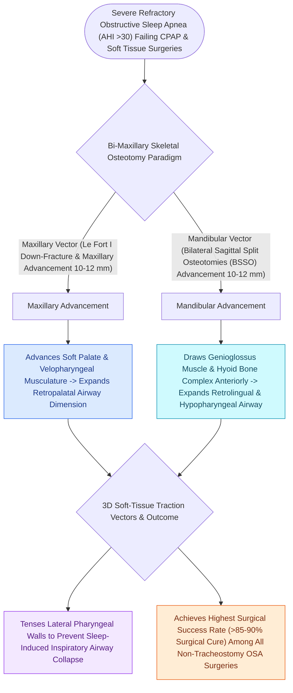

# Maxillomandibular advancement MMA advances the skeletal framework by ten to twelve millimeters to expand the upper airway

## Active Recall

> [!question]- What is the target skeletal advancement distance required during MMA to achieve optimal OSA cure rates?
> *Answer / Clinical Rationale*: An advancement of **$10\text{ to }12\text{ mm}$**.

> [!question]- What three pharyngeal airway levels are expanded simultaneously by maxillomandibular advancement?
> *Answer / Clinical Rationale*: The **retropalatal (nasopharynx/velum)**, **retroglossal (oropharynx/tongue base)**, and **hypopharyngeal** airway spaces.

## Core Clinical & Mechanistic Principles
**Maxillomandibular Advancement (MMA / Bimaxillary Surgery)** (pioneered by Riley, Powell, and Guilleminault in the 1980s) is the most effective surgical treatment for multi-level, severe obstructive sleep apnea:
- **Biomechanical Principle of Skeletal Expansion**:
  - The soft palate, lateral pharyngeal walls, tongue base, and suprahyoid musculature are all structurally anchored to the **maxilla, mandible, and hyoid bone**.
  - Advancing the facial skeletal framework forward by **$10\text{ to }12\text{ mm}$** mechanically pulls the entire soft-tissue envelope forward:
    - Advances the **levator/tensor veli palatini** $\r\r\rightarrow$ expands the **retropalatal airway**.
    - Advances the **[[Geniohyoid and genioglossus muscles are primary upper airway dilators maintaining pharyngeal patency|genioglossus muscle]]** $\r\r\rightarrow$ expands the **retroglossal airway**.
    - Advances the **lateral pharyngeal walls** $\r\r\rightarrow$ doubles lateral pharyngeal dimension.
    - Pulls the **hyoid bone anteriorly and superiorly** via the geniohyoid muscle.
- **Surgical Osteotomies**:
  1. **Le Fort I Maxillary Osteotomy**: Advances and counter-clockwise rotates the maxilla.
  2. **Bilateral Sagittal Split Osteotomy (BSSO)**: Advances the tooth-bearing segment of the mandible.
  3. Rigid internal fixation with titanium plates and screws.

### Surgical Technique & Critical Safety Checks
- **Target Skeletal Movement**: A minimum advancement of **$\ge 10\text{ mm}$** is required to achieve high-grade polysomnographic cure.

## Connected Concepts & Graph Traversal
- **Le Fort and BSSO**: [[Le Fort I osteotomy and bilateral sagittal split osteotomy BSSO achieve rigid skeletal advancement in MMA|Le Fort and BSSO]]
- **MMA Success Rates**: [[Maxillomandibular advancement achieves the highest surgical cure rate among all non-CPAP sleep apnea interventions|MMA Success Rates]]
- **Virtual Surgical Planning**: [[Virtual surgical planning and splint-guided fixation optimize dental occlusion and airway expansion in MMA|Virtual Surgical Planning]]
- **Embryological & Sleep Foundation**: [[Loop gain, arousal threshold, and muscle responsiveness represent the non-anatomical endotypes of obstructive sleep apnea]]
- **Sleep Endoscopy & Airway Dynamics**: [[Drug-induced sleep endoscopy DISE evaluates dynamic multi-level upper airway collapse under sedation|Drug-Induced Sleep Endoscopy (DISE)]] [[Severe secondary post-tonsillectomy hemorrhage requires urgent airway stabilization and surgical electrocautery]]
- **Congenital Airway Pathology**: [[Inspiratory, biphasic, and expiratory stridor localize pediatric airway obstruction to supraglottic, subglottic, and tracheobronchial subsites]]
- **Open Airway Reconstruction**: [[Single-stage and double-stage laryngotracheal reconstruction LTR repair mature high-grade subglottic stenosis]]
