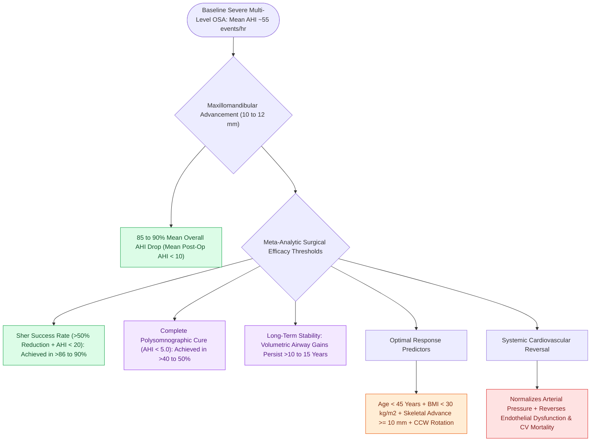

# Maxillomandibular advancement achieves the highest surgical cure rate among all non-CPAP sleep apnea interventions

## Active Recall

> [!question]- What is the mean percentage reduction in AHI achieved by maxillomandibular advancement in large meta-analyses?
> *Answer / Clinical Rationale*: An average **$85\text{ to }90\%$ reduction in AHI** (with a surgical success rate $>86\text{–}90\%$).

> [!question]- What patient factors predict the highest likelihood of complete cure ($\text{AHI} < 5$) following MMA?
> *Answer / Clinical Rationale*: **Younger age ($<45\text{ years}$)**, **lower BMI ($<30\text{ kg/m}^2$)**, and **greater skeletal advancement ($\ge 10\text{ mm}$)**.

## Core Clinical & Mechanistic Principles
[[Maxillomandibular advancement MMA advances the skeletal framework by ten to twelve millimeters to expand the upper airway|Maxillomandibular Advancement]] (MMA) is the most predictable and definitive surgical treatment for obstructive sleep apnea, with outcomes approaching CPAP efficacy:
- **Evidence-Based Surgical Metrics (Meta-Analyses: Holty & Guilleminault 2010, Zaghi et al. 2016)**:
  - **Mean AHI Reduction**: Decreases baseline AHI from a mean of **$55\text{ events/hr}$ down to $<10\text{ events/hr}$** (an average **$85\text{–}90\%$ reduction in AHI**).
  - **Surgical Success Rate (Sher Criteria - $\ge 50\%$ drop + $\text{AHI} < 20$)**: Achieved in **$>86\text{–}90\%$** of patients.
  - **Surgical Cure Rate ($\text{AHI} < 5\text{ events/hr}$)**: Achieved in **$>40\text{–}50\%$** of patients.
  - **Long-Term Stability**: Polysomnographic cure and airway dimensions remain stable at **$>10\text{ to }15\text{ years}$ postoperatively**.
- **Predictors of Outstanding MMA Success**:
  - Younger age ($<45$ years).
  - Lower baseline $\text{BMI} (<30\text{ kg/m}^2)$.
  - Greater degree of maxillary/mandibular advancement ($\ge 10\text{–}12\text{ mm}$).
  - Concomitant counter-clockwise rotation of the occlusal plane.

### Surgical Technique & Critical Safety Checks
- **Impact on Cardiovascular Mortality**: Successful MMA normalizes daytime blood pressure, reverses endothelial dysfunction, and significantly reduces long-term cardiovascular mortality to levels comparable to healthy controls.

## Connected Concepts & Graph Traversal
- **MMA Advancement**: [[Maxillomandibular advancement MMA advances the skeletal framework by ten to twelve millimeters to expand the upper airway|MMA Advancement]]
- **Le Fort and BSSO**: [[Le Fort I osteotomy and bilateral sagittal split osteotomy BSSO achieve rigid skeletal advancement in MMA|Le Fort and BSSO]]
- **Virtual Surgical Planning**: [[Virtual surgical planning and splint-guided fixation optimize dental occlusion and airway expansion in MMA|Virtual Surgical Planning]]
- **Embryological & Sleep Foundation**: [[Non-rapid eye movement and rapid eye movement sleep architecture dictate pharyngeal muscle tone]]
- **Sleep Endoscopy & Airway Dynamics**: [[Drug-induced sleep endoscopy DISE evaluates dynamic multi-level upper airway collapse under sedation|Drug-Induced Sleep Endoscopy (DISE)]] [[Nasal steroid sprays and montelukast provide medical therapy for mild pediatric sleep-disordered breathing]]
- **Congenital Airway Pathology**: [[Recurrent respiratory papillomatosis RRP is driven by HPV six and eleven causing recurrent laryngeal lesions]]
- **Open Airway Reconstruction**: [[Anterior costal cartilage grafts expand the thyroid and cricoid cartilage framework]]
