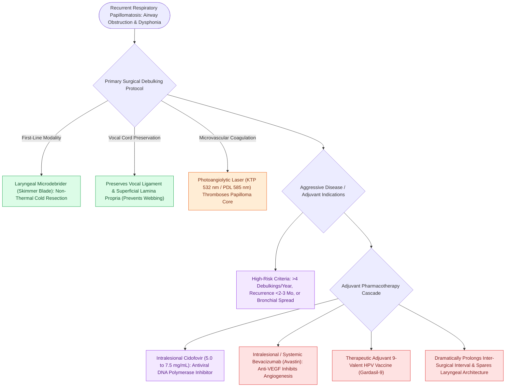

# Microdebrider debulking and intralesional cidofovir provide surgical and adjuvant control of RRP

## Active Recall

> [!question]- Why has the microdebrider largely replaced the CO2 laser as the primary surgical tool for RRP debulking?
> *Answer / Clinical Rationale*: Because it provides precise, rapid resection with **zero thermal collateral injury**, dramatically reducing the risk of vocal fold scarring and anterior commissure webs.

> [!question]- What are the clinical criteria for initiating adjuvant pharmacotherapy (e.g., Cidofovir or Bevacizumab) in RRP?
> *Answer / Clinical Rationale*: Disease requiring **$>4\text{ surgical debulkings per year}$**, rapid recurrence, or **distal tracheal/bronchopulmonary spread**.

## Core Clinical & Mechanistic Principles
The management of [[Recurrent respiratory papillomatosis RRP is driven by HPV six and eleven causing recurrent laryngeal lesions|Recurrent Respiratory Papillomatosis]] focuses on **airway clearance and voice preservation** while minimizing iatrogenic laryngeal scarring:
- **Surgical Debulking Modalities**:
  1. **Laryngeal Microdebrider (Skimmer Blade)**:
     - The gold standard surgical modality (replaces CO2 laser).
     - Continuous suction elevates papillomas into the oscillating blade, allowing precise resection while **sparing the underlying vocal ligament and vocalis muscle**.
     - Reduces surgical time, thermal collateral damage, and risk of **anterior commissure web formation**.
  2. **Photoangiolytic Lasers (KTP 532 nm / PDL 585 nm)**: Selectively absorbed by hemoglobin in the papilloma microvascular core, causing vascular thrombosis and sloughing.
- **Adjuvant Pharmacotherapy Indications**:
  - Indicated for aggressive disease requiring **$>4\text{ surgical debulkings per year}$**, rapid recurrence ($<2\text{–}3\text{ months}$), or distal bronchopulmonary spread.
  - **Intralesional Cidofovir ($5.0\text{–}7.5\text{ mg/mL}$)**: Acyclic nucleoside phosphonate antiviral; injected into papilloma beds every 2–4 weeks.
  - **Systemic / Intralesional Bevacizumab (Avastin - Anti-VEGF)**: Monoclonal antibody targeting VEGF; dramatically reduces recurrence and increases inter-surgical intervals in severe RRP.

### Surgical Technique & Critical Safety Checks
- **HPV 9-Valent Vaccine (Gardasil-9)**: Administered as therapeutic adjuvant immunotherapy to stimulate cell-mediated immune responses and reduce surgical frequency.

## Connected Concepts & Graph Traversal
- **RRP Overview**: [[Recurrent respiratory papillomatosis RRP is driven by HPV six and eleven causing recurrent laryngeal lesions|RRP Overview]]
- **Stridor Localization**: [[Inspiratory, biphasic, and expiratory stridor localize pediatric airway obstruction to supraglottic, subglottic, and tracheobronchial subsites|Stridor Localization]]
- **LTR Reconstruction**: [[Single-stage and double-stage laryngotracheal reconstruction LTR repair mature high-grade subglottic stenosis|LTR Reconstruction]]
- **Embryological & Sleep Foundation**: [[Low arousal threshold causes premature awakening before airway stabilization in obstructive sleep apnea]]
- **Sleep Endoscopy & Airway Dynamics**: [[Drug-induced sleep endoscopy DISE evaluates dynamic multi-level upper airway collapse under sedation|Drug-Induced Sleep Endoscopy (DISE)]] [[Rapid maxillary expansion widens the hard palate and nasal floor to improve pediatric nasal breathing and OSA]]
- **Congenital Airway Pathology**: [[Nebulized racemic epinephrine and oral dexamethasone provide rapid treatment for acute croup]]
- **Open Airway Reconstruction**: [[Posterior costal cartilage grafts with a carved flange split the posterior cricoid lamina to expand the glottic lumen]]
