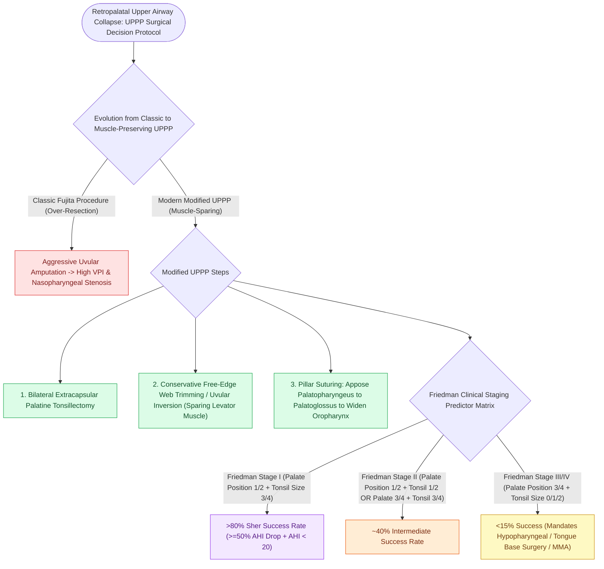

# Modified uvulopalatopharyngoplasty UPPP resects redundant palatal tissue while preserving muscular function

## Active Recall

> [!question]- What are the two components of the Sher surgical success criteria for sleep apnea surgery?
> *Answer / Clinical Rationale*: A **$\ge 50\%$ reduction in baseline AHI** AND a **postoperative AHI $<20\text{ events/hour}$**.

> [!question]- How does modern modified UPPP differ from classic Fujita UPPP?
> *Answer / Clinical Rationale*: Modified UPPP **preserves the muscular core of the soft palate and uvula**, focusing on tonsillectomy and lateral pillar repositioning to prevent VPI and stenosis.

## Core Clinical & Mechanistic Principles
**Modified Uvulopalatopharyngoplasty (UPPP)** (evolved from Fujita's 1981 classic procedure) is the most widely performed soft-tissue surgery for retropalatal obstructive sleep apnea:
- **Evolution from Classic to Modified UPPP**:
  - *Classic UPPP (Fujita)*: Aggressive amputation of the uvula, distal half of the soft palate, and wide mucosal stripping; caused high rates of **[[Velopharyngeal insufficiency VPI causes hypernasal resonance and nasal air emission during speech|velopharyngeal insufficiency]] (VPI), [[Postoperative palatopharyngeal stenosis is a severe complication of over-resection managed with local flaps|nasopharyngeal stenosis]], and persistent dry throat**.
  - *Modified UPPP (Modern Muscle-Preserving)*:
    1. Bilateral complete extracapsular **palatine tonsillectomy**.
    2. Minimal mucosal trimming of the redundant free palatal edge, **preserving the underlying muscular core of the levator and tensor veli palatini**.
    3. Amputation of only the distal tip of the uvula (or uvular inversion).
    4. **Posterior Pillar Closure**: Suture the posterior tonsillar pillar (palatopharyngeus) to the anterior pillar (palatoglossus) to widen the lateral and anteroposterior oropharynx.
- **Sher Success Criteria (1996)**:
  - **Surgical Success** is defined as:
    1. **$\ge 50\%$ reduction in baseline AHI**, AND
    2. **Postoperative $\text{AHI} < 20\text{ events/hour}$**.

### Surgical Technique & Critical Safety Checks
- **Friedman Staging System**: Predicts UPPP success based on Palatal Tongue Position (Friedman 1–4) and Tonsil Size (1–4); **Friedman Stage I (low tongue, large tonsils) achieves $>80\%$ success**, whereas Stage III achieves $<15\%$ with standard UPPP.

## Connected Concepts & Graph Traversal
- **Expansion Pharyngoplasty**: [[Expansion sphincter pharyngoplasty ESP rotates the palatopharyngeus muscle to stabilize lateral pharyngeal wall collapse|Expansion Pharyngoplasty]]
- **Palatopharyngeal Stenosis**: [[Postoperative palatopharyngeal stenosis is a severe complication of over-resection managed with local flaps|Palatopharyngeal Stenosis]]
- **VOTE Classification**: [[VOTE classification standardizes drug-induced sleep endoscopy findings across velum, oropharynx, tongue base, and epiglottis|VOTE Classification]]
- **Staging System**: [[Adult obstructive sleep apnea surgical staging synthesizes anatomical Fujita levels of collapse with the Friedman clinical staging system to predict surgical response|Fujita-Friedman Staging Predicts UPPP Success]]
