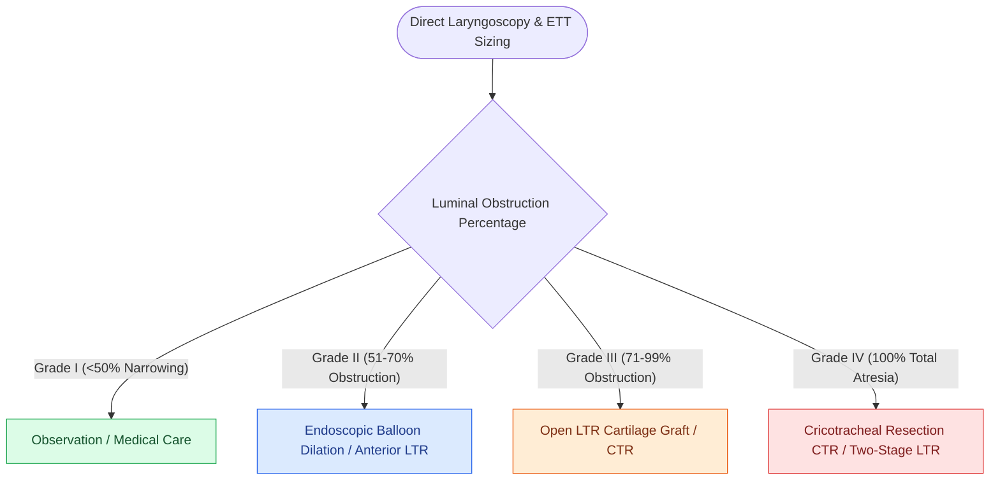

# Myer-Cotton grading system stratifies subglottic stenosis from Grade I less than fifty percent to Grade IV no lumen

## Active Recall

> [!question]- What are the cross-sectional lumen obstruction percentages for Myer-Cotton Grades I, II, III, and IV?
> *Answer / Clinical Rationale*: **Grade I: $<50\%$**; **Grade II: $51\text{–}70\%$**; **Grade III: $71\text{–}99\%$**; **Grade IV: $100\%$ (complete atresia)**.

> [!question]- What clinical method is used to determine the Myer-Cotton grade in the operating room?
> *Answer / Clinical Rationale*: Endotracheal tube (ETT) sizing with **air leak pressure measurement ($<20\text{ cm H}_2\text{O}$)** compared to age-expected ETT size.

## Core Clinical & Mechanistic Principles
The **Myer-Cotton Classification System (Myer, O'Connor, & Cotton, 1994)** is the international standard for grading the severity of subglottic stenosis:
- **Measurement Protocol**:
  - Performed under general anesthesia using sizing endotracheal tubes (ETTs).
  - The largest ETT that passes through the subglottis with an **air leak at $<20\text{ cm H}_2\text{O}$** is compared to the age-appropriate expected tube size.
- **The Four Myer-Cotton Grades**:
  - **Grade I**: **$<50\%$ cross-sectional lumen obstruction** (measured by ETT sizing).
  - **Grade II**: **$51\%\text{ to }70\%$ lumen obstruction**.
  - **Grade III**: **$71\%\text{ to }99\%$ lumen obstruction** (some identifiable lumen remains; probe or small ETT passes).
  - **Grade IV**: **$100\%$ obstruction (Complete / Total Atresia)**; zero detectable lumen; vocal cords and trachea are completely occluded by scar.
- **Surgical Management Strategy by Grade**:
  - *Grade I*: Observation or medical therapy; endoscopic dilation.
  - *Grade II*: Endoscopic [[Endoscopic balloon dilation with steroid injection manages early, soft, non-circumferential subglottic stenosis|balloon dilation]] $\pm$ [[Anterior costal cartilage grafts expand the thyroid and cricoid cartilage framework|anterior LTR]].
  - *Grade III*: Open **[[Single-stage and double-stage laryngotracheal reconstruction LTR repair mature high-grade subglottic stenosis|Laryngotracheal Reconstruction]] (LTR)** with anterior/posterior costal cartilage grafts OR **[[Cricotracheal resection CTR achieves primary end-to-end anastomosis for severe Grade III and IV subglottic stenosis|Cricotracheal Resection]] (CTR)**.
  - *Grade IV*: Cricotracheal Resection (CTR) or [[Double-stage LTR maintains a tracheostomy and utilizes an endolaryngeal LT-Mold or Montgomery T-tube stent|double-stage LTR]].

### Surgical Technique & Critical Safety Checks
- **Prognostic Impact**: Grade I/II achieve $>90\%$ decannulation rates with endoscopic or single-stage procedures; Grade III/IV require complex open reconstructions.

## Connected Concepts & Graph Traversal
- **Subglottic Stenosis**: [[Congenital subglottic stenosis results from incomplete recanalization of the laryngeal lumen during embryogenesis|Subglottic Stenosis]]
- **LTR Reconstruction**: [[Single-stage and double-stage laryngotracheal reconstruction LTR repair mature high-grade subglottic stenosis|LTR Reconstruction]]
- **CTR Resection**: [[Cricotracheal resection CTR achieves primary end-to-end anastomosis for severe Grade III and IV subglottic stenosis|CTR Resection]]
- **Embryological & Sleep Foundation**: [[Nocturnal pulse oximetry McGill score stratifies pediatric obstructive sleep apnea severity]]
- **Sleep Endoscopy & Airway Dynamics**: [[Drug-induced sleep endoscopy DISE evaluates dynamic multi-level upper airway collapse under sedation|Drug-Induced Sleep Endoscopy (DISE)]] [[Lingual tonsil hypertrophy causes persistent pediatric obstructive sleep apnea and base of tongue collapse]]
- **Congenital Airway Pathology**: [[Omega-shaped epiglottis, foreshortened aryepiglottic folds, and redundant arytenoid mucosa define laryngomalacia]]
- **Open Airway Reconstruction**: [[Tracheomalacia causes dynamic expiratory tracheal collapse and is managed with posterior tracheobronchopexy]]
