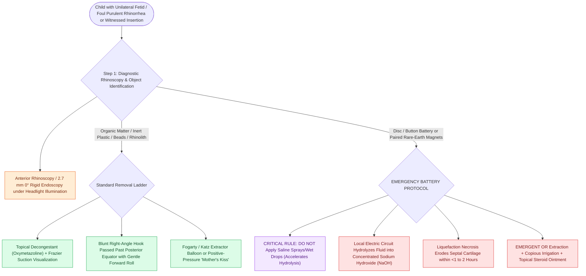

# Nasal foreign bodies presenting with unilateral foul-smelling rhinorrhea mandate urgent removal with particular vigilance for button batteries

## Active Recall

> [!question]- Why does a disc (button) battery in the nasal cavity cause devastating septal perforation much faster than an organic foreign body?
> *Answer / Clinical Rationale*: Button batteries generate a continuous direct electrical circuit with moist nasal mucosal tissues, producing concentrated **hydroxide ions ($OH^-$)** at the negative terminal (anode). This causes rapid **alkaline liquefaction necrosis** that dissolves protein, fat, and vascular architecture, eroding through mucosal layers and the cartilaginous nasal septum in **under 2 hours**.

> [!question]- What is the hallmark clinical presentation of a long-standing, neglected nasal foreign body in a young child?
> *Answer / Clinical Rationale*: **Unilateral foul-smelling, purulent rhinorrhea** and ipsilateral nasal obstruction, often accompanied by excoriation of the anterior nares or intermittent unilateral epistaxis.

## Core Clinical & Mechanistic Principles

**Nasal foreign bodies (NFBs)** are predominantly encountered in toddlers and young children aged 1 to 5 years. In pediatric medicine, **unilateral purulent, foul-smelling (fetid) rhinorrhea and nasal obstruction** is considered a retained nasal foreign body until proven otherwise. Common objects include organic matter (nuts, beans, paper), synthetic beads, toys, and mineralized stones (**rhinoliths** formed by chronic calcium and magnesium salt deposition around a neglected nidus).

The most hazardous nasal foreign object is the **disc (button) battery**. When lodged against moist nasal mucosal membranes, battery electrolyte discharge creates an electrical current that hydrolyzes local fluids into **sodium hydroxide (NaOH)** at the negative anode pole. This alkaline caustic production induces rapid **liquefaction necrosis** of the septal mucoperichondrium and quadrangular cartilage within **<1 to 2 hours**, resulting in permanent septal perforation, saddle nose deformity, atrophic rhinitis, and severe synechiae. **Paired button batteries / rare-earth magnets** placed across the septum compress the cartilage between opposite magnetic poles, causing ischemic pressure necrosis and bilateral perforation.

### Surgical Technique & Craft Nuance: Extraction Methods & Battery Protocol

### Key Consultation Supplies
- Coaxial surgical headlight
- Rigid $0^\circ$ or $30^\circ$ Hopkins rod endoscope ($2.7\text{ mm}$ or $4.0\text{ mm}$) with camera tower and anti-fog solution (Fred™)
- Pediatric nasal speculums (short and medium blade)
- Topical anesthetic/decongestant spray (0.05% oxymetazoline + 1% lidocaine; *avoid in button batteries*)
- 8 Fr or 10 Fr Frazier suction tips
- Alligator grasping forceps with large textured jaws
- Bayonet forceps and Hartmann forceps
- Blunt right-angle micro-hook and large Billeau ear loop / Day curette
- Katz extractor or 5–6 Fr Fogarty balloon catheter with 3 mL syringe
- Silver nitrate cautery applicator sticks (for post-extraction hemostasis)

> [!example]- **Operative Note Template: Bedside endoscopic extraction of nasal foreign body**
> **PROCEDURE**: Bedside endoscopic extraction of nasal foreign body
> **PRE-PROCEDURAL DIAGNOSIS**: Retained foreign body of the [right/left] nasal cavity
> **POST-PROCEDURAL DIAGNOSIS**: Retained foreign body of the [right/left] nasal cavity status-post endoscopic removal
> **SURGEON**: [Surgeon Name, MD]
> **ASSISTANT**: [Resident/Fellow Name, MD]
>
> **PROCEDURE IN DETAIL**:
> Informed consent was obtained. The pediatric patient was positioned safely in the parent's lap using a supportive comfort hold with head stabilization. Illumination was provided via a coaxial headlight and a 2.7 mm 0-degree Hopkins rod rigid endoscope.
>
> Pre-procedural examination revealed a foreign object lodged in the anterior-to-middle meatus surrounded by mild purulent secretions and mucosal erythema. Obstructing secretions were gently suctioned with an 8 Fr Frazier tip. A blunt right-angle hook was passed smoothly superior and medial to the object, rotated 90 degrees behind the posterior equator, and with gentle continuous anterior traction, the foreign body ([describe object, e.g., spherical plastic bead]) was delivered atraumatically out through the anterior naris.
>
> Post-extraction endoscopic rhinoscopy confirmed complete removal of the object. The nasal septum and turbinates were meticulously inspected, confirming intact mucosa, absence of septal perforation, and no active epistaxis or secondary retained foreign objects. The patient tolerated the procedure well without complication.

## References
1. Baranowski, K., Al-Aaraj, M.S., Sinha, V. (2020). Nasal Foreign Body. In: *StatPearls*. Treasure Island, FL: StatPearls Publishing.
2. Friedman, E.M. (2016). Videos in Clinical Medicine: Removal of Foreign Bodies from the Ear and Nose. *N Engl J Med*, 374(7):e7.
3. Kiger, J.R., et al. (2008). Nasal foreign bodies in children. *Pediatr Emerg Care*, 24(11):785-792 (see [[Tracheobronchial foreign body aspiration presents with choking and air trapping requiring rigid bronchoscopy|Button Battery & Esophageal FB]]).

## Connected Concepts & Graph Traversal

- **Critical Aerodigestive Emergency**: [[Tracheobronchial foreign body aspiration presents with choking and air trapping requiring rigid bronchoscopy|Button Battery & Esophageal FB]]
- **Aural Foreign Body Extraction**: [[External auditory canal foreign bodies require atraumatic extraction under microscopic guidance to protect the tympanic membrane|EAC Foreign Body]]
- **Anatomical Foundation**: [[The uncinate process superior attachment dictates the frontal sinus drainage pathway|Nasal Cavity Anatomy]]
- **Epistaxis Management**: [[Kiesselbach plexus anterior epistaxis is managed with cautery and anterior nasal packing|Epistaxis Protocols]]
- **Sinus Differential**: [[Orbital complications of acute sinusitis staged by the Chandler classification dictate medical versus surgical drainage|Pediatric Rhinosinusitis]]
