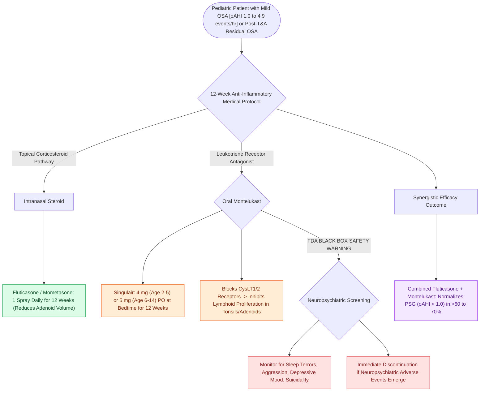

# Nasal steroid sprays and montelukast provide medical therapy for mild pediatric sleep-disordered breathing

## Active Recall

> [!question]- What pediatric OSA severity category is appropriate for a 12-week trial of intranasal steroids and montelukast?
> *Answer / Clinical Rationale*: **Mild pediatric OSA ($\text{oAHI } 1.0\text{ to }4.9\text{ events per hour}$)**.

> [!question]- What FDA black box warning is associated with montelukast therapy?
> *Answer / Clinical Rationale*: Risk of **neuropsychiatric events** (agitation, sleep disturbances, nightmares, depression, and suicidality).

## Core Clinical & Mechanistic Principles
For children with **mild obstructive sleep apnea ($\text{oAHI } 1.0\text{–}4.9\text{ events/hr}$)** or residual mild OSA post-[[Adenotonsillectomy is the first-line surgical treatment for pediatric obstructive sleep apnea|adenotonsillectomy]], anti-inflammatory medical therapy provides a non-surgical alternative:
- **Pathophysiological Rationale**:
  - Adenotonsillar tissue and upper airway mucosa in pediatric OSA exhibit elevated levels of **leukotriene receptors ($\text{CysLT}_1, \text{CysLT}_2$)**, glucocorticoid receptors, and inflammatory cytokines (TNF-$\alpha$, IL-6).
  - Reducing mucosal edema and lymphoid proliferation expands the nasopharyngeal and oropharyngeal dimensions.
- **Evidence-Based Pharmacotherapy**:
  1. **Intranasal Corticosteroids (e.g., Fluticasone furoate / Mometasone furoate)**:
     - 1 spray per nostril daily for **12 weeks**.
     - Reduces adenoid pad size and lowers AHI by **$40\text{–}50\%$** in randomized controlled trials.
  2. **Oral Leukotriene Receptor Antagonist (Montelukast - Singulair)**:
     - Dosing: $4\text{ mg}$ (ages 2–5) or $5\text{ mg}$ (ages 6–14) orally once daily at bedtime for **12 weeks**.
     - Inhibits cysteinyl leukotriene-mediated lymphoid proliferation in adenotonsillar tissue.
  3. **Combination Therapy (Fluticasone + Montelukast)**:
     - Shows synergistic efficacy, achieving **complete normalization of PSG ($\text{oAHI} < 1.0$) in $>60\text{–}70\%$ of mild pediatric OSA**.

### Surgical Technique & Critical Safety Checks
- **FDA Black Box Warning on Montelukast**: Monitor for neuropsychiatric events (nightmares, behavioral agitation, mood changes, suicidality); discontinue immediately if symptoms occur.

## Connected Concepts & Graph Traversal
- **Pediatric PSG**: [[Pediatric polysomnography criteria define obstructive sleep apnea with an obstructive apnea-hypopnea index exceeding one|Pediatric PSG]]
- **Adenotonsillectomy**: [[Adenotonsillectomy is the first-line surgical treatment for pediatric obstructive sleep apnea|Adenotonsillectomy]]
- **Rapid Maxillary Expansion**: [[Rapid maxillary expansion widens the hard palate and nasal floor to improve pediatric nasal breathing and OSA|Rapid Maxillary Expansion]]
- **Embryological & Sleep Foundation**: [[Thyroglossal duct cyst tract tracks from the foramen cecum through the hyoid bone to the anterior neck]]
- **Sleep Endoscopy & Airway Dynamics**: [[Drug-induced sleep endoscopy DISE evaluates dynamic multi-level upper airway collapse under sedation|Drug-Induced Sleep Endoscopy (DISE)]] [[Concentric velopharyngeal collapse on DISE is a contraindication to hypoglossal nerve stimulation]]
- **Congenital Airway Pathology**: [[Endoscopic balloon dilation with steroid injection manages early, soft, non-circumferential subglottic stenosis]]
- **Open Airway Reconstruction**: [[Anterior costal cartilage grafts expand the thyroid and cricoid cartilage framework]]
