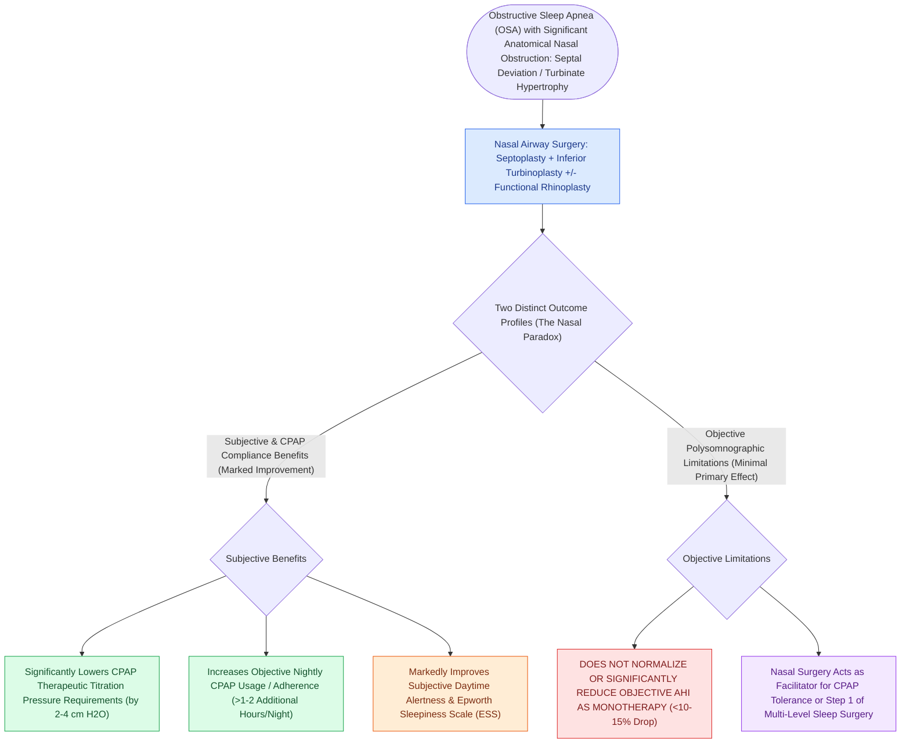

# Nasal surgery alone improves CPAP compliance and subjective daytime somnolence without normalizing AHI

## Active Recall

> [!question]- Why is isolated nasal surgery performed in patients with obstructive sleep apnea if it rarely normalizes AHI?
> *Answer / Clinical Rationale*: Because it **lowers therapeutic CPAP pressures**, eliminates mouth leaking, and **significantly improves CPAP compliance and subjective sleepiness**.

> [!question]- By how much does successful nasal airway surgery typically reduce therapeutic CPAP pressure requirements?
> *Answer / Clinical Rationale*: By **$2\text{ to }4\text{ cm H}_2\text{O}$**.

## Core Clinical & Mechanistic Principles
Isolated nasal surgery (septoplasty, inferior turbinate reduction, functional rhinoplasty, endoscopic sinus surgery) plays a critical supportive role in sleep-disordered breathing:
- **The "Nasal Paradox" in OSA**:
  - Correcting high nasal airway resistance (deviated septum, turbinate hypertrophy) **does NOT significantly reduce the objective Apnea-Hypopnea Index (AHI)** in the vast majority of patients (mean AHI reduction is only $10\text{–}15\%$).
  - However, isolated nasal surgery produces **dramatic improvements in subjective daytime sleepiness (Epworth Sleepiness Scale)**, sleep quality, and snoring.
- **The Primary Clinical Role: Optimizing CPAP Tolerability**:
  - High nasal resistance forces patients to breathe orally, which causes the tongue to drop posteriorly and destabilizes the pharyngeal airway.
  - Nasal obstruction causes mouth leaks, high therapeutic CPAP pressure requirements ($>14\text{–}16\text{ cm H}_2\text{O}$), and poor CPAP adherence.
  - **Nasal Surgery Lowers Therapeutic CPAP Pressures by $2\text{–}4\text{ cm H}_2\text{O}$** and **increases objective CPAP compliance by $>1\text{ to }2\text{ hours per night}$** in previously non-compliant patients.

### Surgical Technique & Critical Safety Checks
- **Pre-Surgery Counseling**: Patients must be clearly informed that nasal surgery is intended to facilitate nasal breathing and CPAP use, not to cure sleep apnea as a stand-alone procedure (see [[Positional obstructive sleep apnea is treated with sleep position trainers and positional avoidance devices|Positional OSA]]).

## Connected Concepts & Graph Traversal
- **Positional OSA**: [[Positional obstructive sleep apnea is treated with sleep position trainers and positional avoidance devices|Positional OSA]]
- **Mandibular Advancement Devices**: [[Mandibular advancement devices MAD advance the mandible to enlarge the retroglossal airway space|Mandibular Advancement Devices]]
- **Modified UPPP**: [[Modified uvulopalatopharyngoplasty UPPP resects redundant palatal tissue while preserving muscular function|Modified UPPP]]
- **Embryological & Sleep Foundation**: [[Each branchial arch packages one nerve, one artery, one cartilage bar, and one muscle group]]
- **Sleep Endoscopy & Airway Dynamics**: [[Drug-induced sleep endoscopy DISE evaluates dynamic multi-level upper airway collapse under sedation|Drug-Induced Sleep Endoscopy (DISE)]] [[Post-tonsillectomy hemorrhage is classified into primary within twenty-four hours and secondary beyond twenty-four hours]]
- **Congenital Airway Pathology**: [[Congenital subglottic stenosis results from incomplete recanalization of the laryngeal lumen during embryogenesis]]
- **Open Airway Reconstruction**: [[Slide tracheoplasty achieves immediate vascularized mucosal lumen doubling with lowest restenosis rates]]
