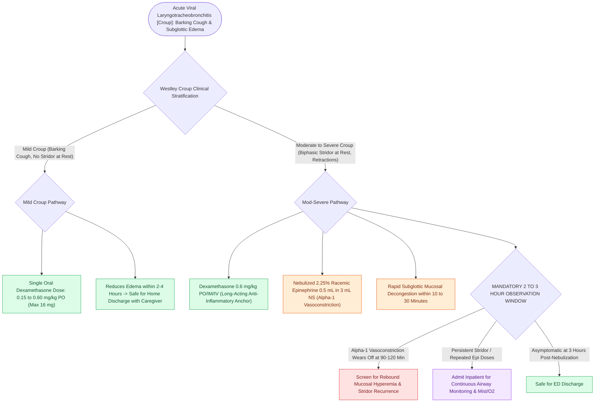

# Nebulized racemic epinephrine and oral dexamethasone provide rapid treatment for acute croup

## Active Recall

> [!question]- What is the recommended dose of dexamethasone for acute viral croup?
> *Answer / Clinical Rationale*: **$0.15\text{ to }0.6\text{ mg/kg}$** as a single oral or intramuscular dose.

> [!question]- Why must a child receiving nebulized racemic epinephrine be observed for at least 2 hours in the emergency department?
> *Answer / Clinical Rationale*: To monitor for the **rebound phenomenon (rebound mucosal hyperemia and worsening stridor)** as the drug's vasoconstrictive effect dissipates.

## Core Clinical & Mechanistic Principles
Evidence-based medical management of acute croup relies on two core synergistic pharmacological therapies:
- **Oral / IM Dexamethasone (The Anti-Inflammatory Anchor)**:
  - **Dose**: **$0.15\text{ to }0.6\text{ mg/kg}$** as a single dose (maximum $16\text{ mg}$).
  - *Mechanism*: Long-acting corticosteroid (half-life 36–72 hours); reduces subglottic mucosal edema, capillary permeability, and cytokine release within **$2\text{ to }4\text{ hours}$**.
  - *Evidence*: Significantly reduces ED revisit rates, hospital admissions, and need for intubation across all croup severities (mild, moderate, severe).
- **Nebulized Racemic Epinephrine (The Rapid Vasoconstrictor)**:
  - **Dose**: $0.5\text{ mL}$ of $2.25\%$ racemic epinephrine solution diluted in $3\text{ mL}$ normal saline (or $5\text{ mL}$ of standard $1:1000\text{ L-epinephrine}$).
  - *Mechanism*: Stimulates **alpha-1 adrenergic receptors** on subglottic mucosal arterioles, inducing rapid precapillary vasoconstriction and reducing edema within **$10\text{ to }30\text{ minutes}$**.
  - **The "Rebound Phenomenon" & 2-Hour Observation Rule**:
    - As alpha-1 vasoconstriction wears off ($90\text{–}120\text{ minutes}$), rebound mucosal hyperemia [[High-stakes pediatric and adult sleep airway complications require rapid structured algorithmic emergency rescue|can]] occur.
    - **All children receiving racemic epinephrine must be observed for at least 2 to 3 hours** in the ED prior to discharge.

### Surgical Technique & Critical Safety Checks
- **Mist Therapy**: Humidified air/mist has no proven objective benefit in clinical trials, but provides comfort.

## Connected Concepts & Graph Traversal
- **Croup Presentation**: [[Viral laryngotracheobronchitis croup presents with a barking cough and subglottic steeple sign on radiography|Croup Presentation]]
- **Acute Epiglottitis**: [[Acute epiglottitis causes rapid supraglottic swelling with thumbprint sign and mandates controlled operating room intubation|Acute Epiglottitis]]
- **Stridor Localization**: [[Inspiratory, biphasic, and expiratory stridor localize pediatric airway obstruction to supraglottic, subglottic, and tracheobronchial subsites|Stridor Localization]]
- **Embryological & Sleep Foundation**: [[Low arousal threshold causes premature awakening before airway stabilization in obstructive sleep apnea]]
- **Sleep Endoscopy & Airway Dynamics**: [[Drug-induced sleep endoscopy DISE evaluates dynamic multi-level upper airway collapse under sedation|Drug-Induced Sleep Endoscopy (DISE)]] [[Extracapsular total tonsillectomy and intracapsular subtotal tonsillotomy differ in postoperative hemorrhage and recovery]]
- **Congenital Airway Pathology**: [[Recurrent respiratory papillomatosis RRP is driven by HPV six and eleven causing recurrent laryngeal lesions]]
- **Open Airway Reconstruction**: [[Postoperative chin-to-chest flexion stitch prevents catastrophic neck extension and tracheal anastomotic dehiscence]]
