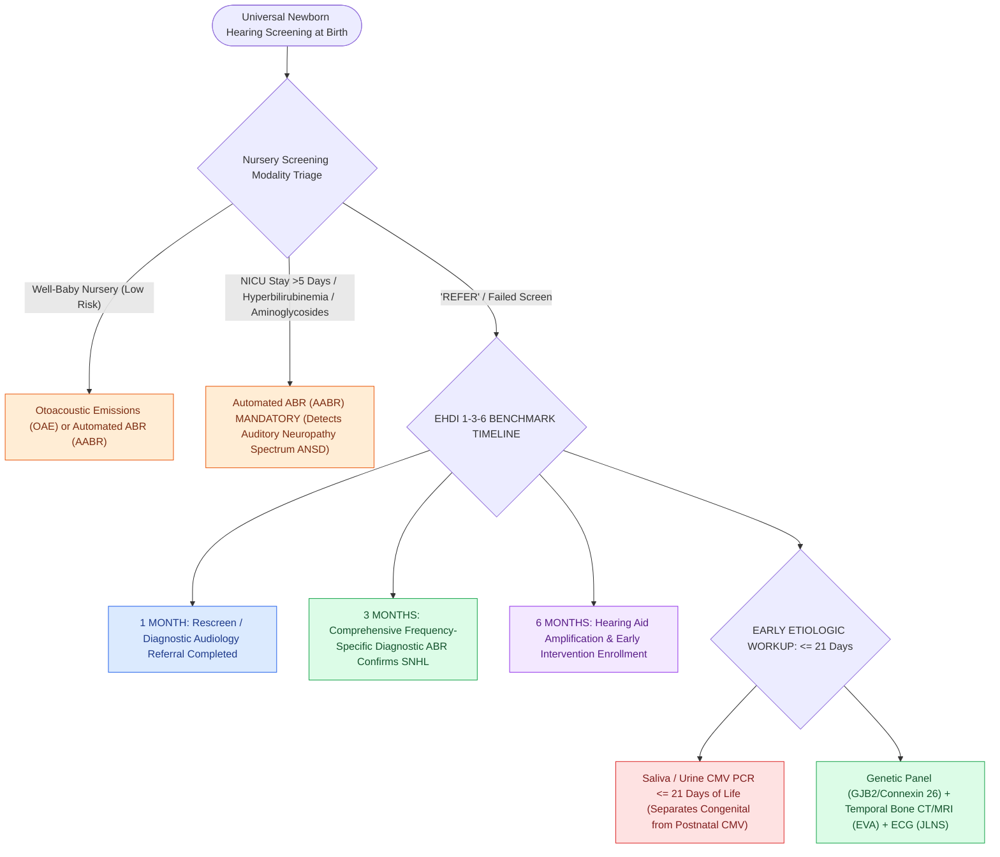

# Newborn hearing screening follows the one-three-six EHDI timeline with early CMV testing

## Active Recall

> [!question]- Why does the CMV test expire at three weeks of age?
> *Answer / Clinical Rationale*: Postnatally acquired CMV (breast milk, contact) becomes detectable after that point — only early PCR proves congenital infection as the cause of the loss.

> [!question]- Why must NICU graduates be screened with ABR rather than OAE?
> *Answer / Clinical Rationale*: Their risk profile includes auditory neuropathy — present emissions with absent neural conduction — which OAE alone would falsely pass.

## Core Clinical & Mechanistic Principles
- **1-3-6 rule**: screen by one month, diagnostic audiology (ABR) by three months, intervention (amplification, early intervention services) by six months — the timeline exists because language outcomes track intervention age, not identification age.
- Screening technology maps to nursery: OAE misses neural (auditory neuropathy) disease; **well-baby screens often use OAE, NICU graduates require ABR** — prolonged NICU stay, hyperbilirubinemia, and aminoglycosides enrich for neuropathy-spectrum disease.
- **Congenital CMV** is the leading nongenetic cause: a failed screen triggers saliva/urine CMV PCR **within the first three weeks of life** — after that window, congenital cannot be separated from postnatal acquisition; dried blood spot retrieval is the late-window salvage.
- 'Passed the newborn screen' is not immunity: delayed-onset and progressive losses (CMV, EVA/Pendred, GJB2 variants) mandate re-testing any child with language delay or parental concern.

### Management & Critical Safety Checks
- A refer result is a referral, not a diagnosis — but the machinery (diagnostic ABR, medical evaluation, genetics/ophthalmology, early intervention) must move on the 1-3-6 clock.
- Confirmed SNHL evaluation bundles: genetics (GJB2 first-line or panel), CMV status, imaging by phenotype, ophthalmology (Usher), and cardiology when syndrome-indicated (Jervell-Lange-Nielsen ECG) (see [[Connexin 26 mutations in GJB2 and congenital CMV infection are leading causes of non-syndromic pediatric sensorineural hearing loss|Connexin 26 & CMV]]).

## Connected Concepts & Graph Traversal
- **GJB2 & CMV Genetics**: [[Connexin 26 mutations in GJB2 and congenital CMV infection are leading causes of non-syndromic pediatric sensorineural hearing loss|Connexin 26 & CMV]]
- **Syndromic SNHL Syndromes**: [[Syndromic pediatric sensorineural hearing loss encompasses Pendred, Usher, Waardenburg, and Jervell and Lange-Nielsen syndromes|Syndromic Hearing Loss]]
- **Stickler SNHL Syndrome**: [[Stickler syndrome combines progressive sensorineural hearing loss, spondyloepiphyseal dysplasia, and retinal detachment|Stickler Syndrome]]
- **Treacher Collins Dysostosis**: [[Treacher Collins syndrome results from TCOF1 mutations causing mandibulofacial dysostosis and conductive hearing loss|Treacher Collins Syndrome]]
- **Pediatric Mastoiditis**: [[Pediatric acute mastoiditis with subperiosteal abscess requires intravenous ceftriaxone, myringotomy tube placement, and cortical mastoidectomy|Pediatric Mastoiditis]]
