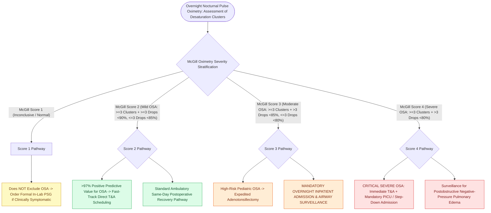

# Nocturnal pulse oximetry McGill score stratifies pediatric obstructive sleep apnea severity

## Active Recall

> [!question]- What is the positive predictive value of a positive McGill Oximetry Score (Score 2, 3, or 4) for pediatric OSA?
> *Answer / Clinical Rationale*: Greater than **$97\%$ positive predictive value**.

> [!question]- What surgical management decision is mandated by a McGill Score of 3 or 4?
> *Answer / Clinical Rationale*: **Mandatory overnight inpatient admission and continuous monitoring** following adenotonsillectomy due to high risk of postoperative respiratory compromise.

## Core Clinical & Mechanistic Principles
**Nocturnal Pulse Oximetry (McGill Oximetry Score)** is a validated, cost-effective screening and prioritization tool for pediatric obstructive sleep apnea when full in-laboratory polysomnography is unavailable:
- **The McGill Oximetry Scoring System (Nixon et al., 2004)**:
  - **McGill Score 1 (Inconclusive / Normal)**: $<3$ desaturation clusters and $<3$ desaturations below $90\%$. (Does NOT rule out OSA; requires formal PSG if clinically symptomatic).
  - **McGill Score 2 (Mild OSA)**: $\ge 3$ clusters of desaturations AND $\ge 3$ drops below $90\%$, but $\le 3$ drops below $85\%$. (Positive predictive value for OSA is $>97\%$).
  - **McGill Score 3 (Moderate OSA)**: $\ge 3$ clusters of desaturations AND $>3$ drops below $85\%$, but $\le 3$ drops below $80\%$.
  - **McGill Score 4 (Severe OSA)**: $\ge 3$ clusters of desaturations AND **$>3$ drops below $80\%$**.
- **Clinical Decision Utility**:
  - A **positive McGill score (Score 2, 3, or 4) has a $>97\%$ positive predictive value for OSA**, allowing direct scheduling of [[Adenotonsillectomy is the first-line surgical treatment for pediatric obstructive sleep apnea|adenotonsillectomy]] without waiting for a delay-inducing PSG.
  - Scores 3 and 4 identify **high-risk children requiring mandatory postoperative overnight inpatient admission** and PICU monitoring.

### Surgical Technique & Critical Safety Checks
- **Desaturation Cluster Definition**: A period of $>20\text{ minutes}$ containing $\ge 5$ desaturations $\ge 4\%$, reflecting cyclical apnea-hypopnea cycles.

## Connected Concepts & Graph Traversal
- **Pediatric PSG**: [[Pediatric polysomnography criteria define obstructive sleep apnea with an obstructive apnea-hypopnea index exceeding one|Pediatric PSG]]
- **High-Risk Tonsillectomy**: [[High-risk pediatric criteria mandate overnight inpatient admission following adenotonsillectomy|High-Risk Criteria]]
- **Adenotonsillectomy**: [[Adenotonsillectomy is the first-line surgical treatment for pediatric obstructive sleep apnea|Adenotonsillectomy]]
- **Embryological & Sleep Foundation**: [[High loop gain causes ventilatory instability and periodic breathing in sleep-disordered breathing]]
- **Sleep Endoscopy & Airway Dynamics**: [[Drug-induced sleep endoscopy DISE evaluates dynamic multi-level upper airway collapse under sedation|Drug-Induced Sleep Endoscopy (DISE)]] [[Post-tonsillectomy hemorrhage is classified into primary within twenty-four hours and secondary beyond twenty-four hours]]
- **Congenital Airway Pathology**: [[Subglottic hemangiomas present as biphasic stridor in infants and respond to systemic oral propranolol]]
- **Open Airway Reconstruction**: [[Slide tracheoplasty expands complete tracheal rings by oblique division and sliding longitudinal reconstruction]]
