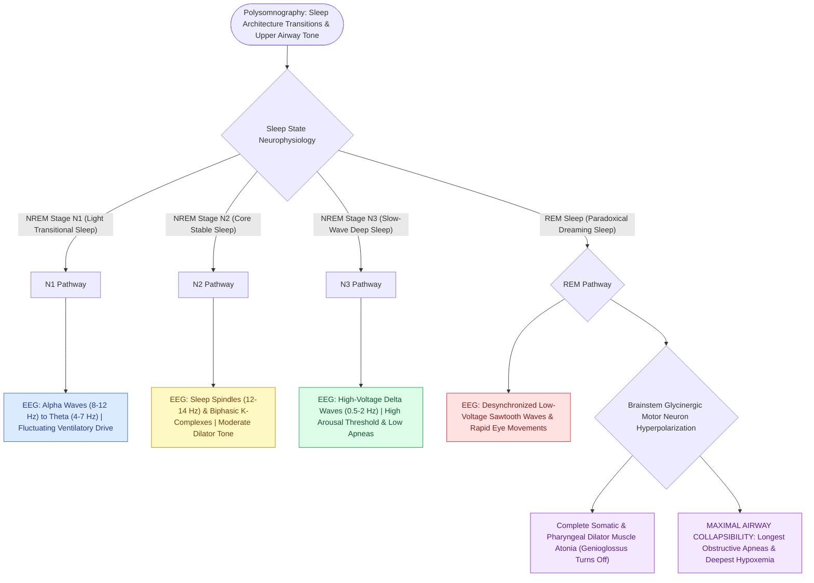

# Non-rapid eye movement and rapid eye movement sleep architecture dictate pharyngeal muscle tone

## Active Recall

> [!question]- Why is [[The Starling resistor model explains upper airway collapsibility and critical closing pressure Pcrit|upper airway collapsibility]] and oxygen desaturation most severe during REM sleep?
> *Answer / Clinical Rationale*: Because of **postsynaptic glycinergic/GABAergic motor neuron inhibition**, causing complete atonia of the pharyngeal dilator muscles (genioglossus).

> [!question]- What EEG waveforms are the diagnostic hallmarks of Stage N2 sleep?
> *Answer / Clinical Rationale*: **Sleep spindles** and **K-complexes**.

## Core Clinical & Mechanistic Principles
Sleep architecture exerts profound control over respiratory motor output and upper airway patency:
- **Non-Rapid Eye Movement (NREM) Sleep Stages**:
  - **Wakefulness & Sleep Onset (The Alpha Rhythm)**: Relaxed wakefulness with eyes closed is defined by the **alpha rhythm ($8–13\text{ Hz}$)**, maximal over the occipital EEG derivations. Sleep onset begins when $>50\%$ of an epoch shows attenuation of alpha activity.
  - **Stage N1 (Light Sleep)**: Transition phase accounting for $2–5\%$ of total sleep time; low-amplitude mixed-frequency theta activity ($4–7\text{ Hz}$) replaces alpha rhythm. Characterized electrophysiologically by prominent **vertex sharp waves** (maximal over the central derivations, duration $<200\text{ ms}$) occurring in late Stage N1, accompanied by slow rolling eye movements and unstable periodic respiratory drive.
  - **Stage N2 (Core Sleep)**: Characterized by **sleep spindles ($12\text{–}14\text{ Hz}$)** and **K-complexes**; mild progressive decrease in upper airway dilator tone.
  - **Stage N3 (Slow-Wave / Deep Sleep)**: High-amplitude delta waves ($0.5\text{–}2\text{ Hz}$); **most stable autonomic and respiratory drive**; highest [[Low arousal threshold causes premature awakening before airway stabilization in obstructive sleep apnea|arousal threshold]]; lowest frequency of obstructive apneas.
- **Rapid Eye Movement (REM) Sleep & Generalized Muscle Atonia**:
  - Characterized by desynchronized EEG (sawtooth waves), rapid eye movements, and dreaming.
  - **Cholinergic / Glycinergic Postsynaptic Inhibition**: Brainstem pathways hyperpolarize alpha and gamma somatic motor neurons, causing **complete skeletal muscle atonia**.
  - **Loss of Upper Airway Dilator Tone**: The **genioglossus, tensor veli palatini, and hyoid suspensory muscles lose active neural drive**, causing maximal airway collapsibility, longest apnea durations, and deepest oxygen desaturations.

### Surgical Technique & Critical Safety Checks
- **REM-Related OSA**: Defined as an overall $\text{AHI} \ge 5$ with a $\text{REM-AHI} / \text{NREM-AHI} \ge 2$, commonly seen in women and mild/moderate OSA.

## Connected Concepts & Graph Traversal
- **Upper Airway Dilators**: [[Geniohyoid and genioglossus muscles are primary upper airway dilators maintaining pharyngeal patency|Airway Dilators]]
- **Non-Anatomical Endotypes**: [[Loop gain, arousal threshold, and muscle responsiveness represent the non-anatomical endotypes of obstructive sleep apnea|Non-Anatomical Endotypes]]
- **HGNS Stimulation**: [[Hypoglossal nerve stimulation HGNS activates the medial branch of CN XII to advance the tongue during inspiration|HGNS Stimulation]]
- **Physiological Basis**: [[Restless legs syndrome presents with nocturnal dysesthesias driven by central iron deficiency and dopamine dysregulation treated with dopamine agonists|Sleep-Onset Dependence of RLS Symptoms]]
