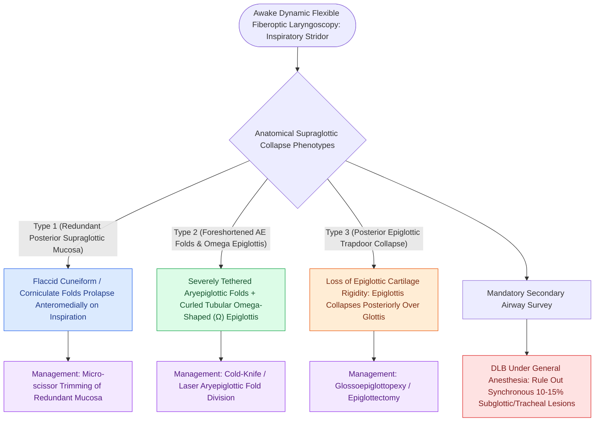

# Omega-shaped epiglottis, foreshortened aryepiglottic folds, and redundant arytenoid mucosa define laryngomalacia

## Active Recall

> [!question]- What are the three distinct anatomical collapse types observed in laryngomalacia?
> *Answer / Clinical Rationale*: **Type 1 (redundant arytenoid/cuneiform mucosa)**, **Type 2 (foreshortened AE folds with omega epiglottis)**, and **Type 3 (posterior epiglottic trapdoor collapse)**.

> [!question]- What percentage of children with severe laryngomalacia harbor a synchronous secondary airway anomaly?
> *Answer / Clinical Rationale*: Approximately **$10\text{ to }15\%$** (e.g., subglottic stenosis or tracheomalacia).

## Core Clinical & Mechanistic Principles
Awake flexible laryngoscopy in infants with [[Laryngomalacia is the most common cause of congenital pediatric stridor characterized by dynamic supraglottic collapse|laryngomalacia]] reveals three distinct, classic anatomical collapse patterns (often occurring in combination):
- **The Three Classic Anatomical Collapse Types**:
  1. **Type 1 (Redundant Arytenoid / Cuneiform Mucosa)**:
     - Characterized by excessive, flaccid, redundant mucosa over the **cuneiform and corniculate cartilages**.
     - Prolapses anteriorly and medially into the glottic aperture during inspiration like a ball-valve.
  2. **Type 2 (Foreshortened Aryepiglottic Folds)**:
     - The aryepiglottic (AE) folds are **severely foreshortened and tethered**, pulling the epiglottis tightly backward over the glottis.
     - Curled, elongated, tubular **"omega-shaped" ($\Omega$) epiglottis**.
  3. **Type 3 (Posterior Epiglottic Collapse / Epiglottopexy Failure)**:
     - The entire epiglottis lacks cartilaginous stiffness and collapses directly posteriorly like a trapdoor over the laryngeal inlet during inspiration.

### Surgical Technique & Critical Safety Checks
- **Secondary Airway Lesions (Synchronous Lesions)**: A formal direct laryngoscopy and bronchoscopy (DLB) under general anesthesia is indicated in severe cases to rule out **synchronous lower airway lesions (subglottic stenosis, [[Tracheomalacia causes dynamic expiratory tracheal collapse and is managed with posterior tracheobronchopexy|tracheomalacia]] in $10\text{–}15\%$ of cases)**.

## Connected Concepts & Graph Traversal
- **Laryngomalacia Overview**: [[Laryngomalacia is the most common cause of congenital pediatric stridor characterized by dynamic supraglottic collapse|Laryngomalacia Overview]]
- **Supraglottoplasty**: [[Endoscopic supraglottoplasty cold-steel and laser division of aryepiglottic folds relieves severe laryngomalacia|Supraglottoplasty]]
- **Subglottic Stenosis**: [[Congenital subglottic stenosis results from incomplete recanalization of the laryngeal lumen during embryogenesis|Subglottic Stenosis]]
- **Embryological & Sleep Foundation**: [[Adult polysomnography criteria define obstructive sleep apnea severity by apnea-hypopnea index thresholds of five, fifteen, and thirty]]
- **Sleep Endoscopy & Airway Dynamics**: [[Drug-induced sleep endoscopy DISE evaluates dynamic multi-level upper airway collapse under sedation|Drug-Induced Sleep Endoscopy (DISE)]] [[Post-tonsillectomy hemorrhage is classified into primary within twenty-four hours and secondary beyond twenty-four hours]]
- **Congenital Airway Pathology**: [[Acute epiglottitis causes rapid supraglottic swelling with thumbprint sign and mandates controlled operating room intubation]]
- **Open Airway Reconstruction**: [[Double-stage LTR maintains a tracheostomy and utilizes an endolaryngeal LT-Mold or Montgomery T-tube stent]]
