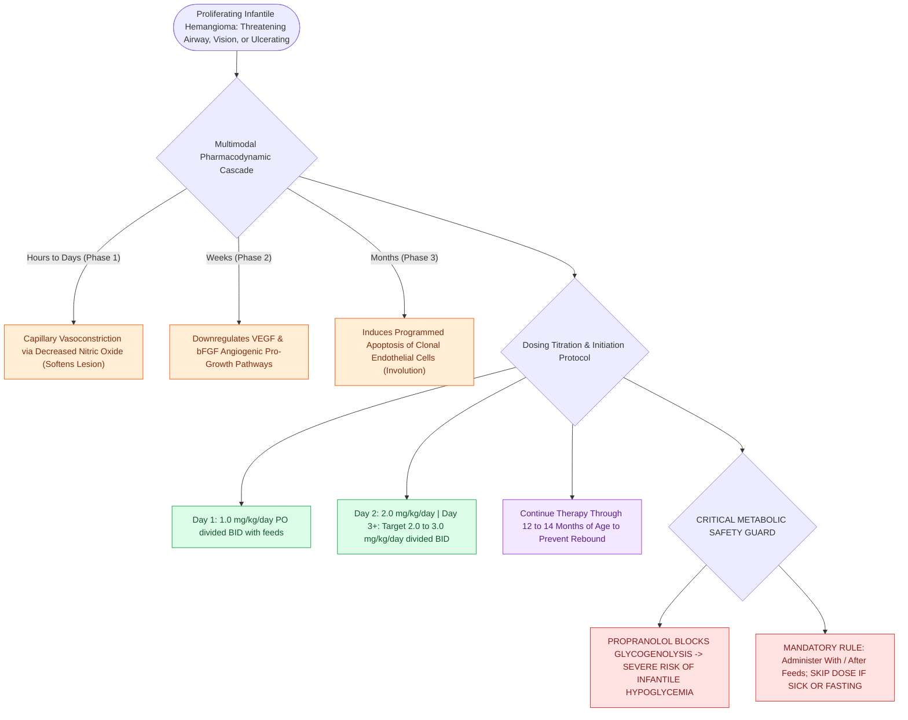

# Oral propranolol is the first-line pharmacotherapy for proliferating infantile hemangiomas

## Active Recall

> [!question]- What is the target therapeutic dose of oral propranolol for infantile hemangiomas?
> *Answer / Clinical Rationale*: **$2.0\text{ to }3.0\text{ mg/kg/day}$** divided into two daily doses (with feeds).

> [!question]- What is the most dangerous potential metabolic side effect of propranolol in infants, and how is it prevented?
> *Answer / Clinical Rationale*: **Hypoglycemia** (prevented by always administering doses with or immediately after feeding, and skipping doses during fasting/gastroenteritis).

## Core Clinical & Mechanistic Principles
**Oral Propranolol** (discovered serendipitously by Christine Léauté-Labrèze in 2008) is the international first-line therapy for problematic, proliferating infantile hemangiomas:
- **Multimodal Pharmacological Mechanisms**:
  1. **Early Vasoconstriction (Hours–Days)**: Decreases release of nitric oxide, inducing capillary vasoconstriction and immediate softening/lightening.
  2. **Angiogenic Downregulation (Weeks)**: Downregulates **VEGF (Vascular Endothelial Growth Factor)** and **bFGF (basic Fibroblast Growth Factor)** signaling pathways.
  3. **Apoptosis Induction (Months)**: Triggers programmed apoptosis of proliferating capillary endothelial cells.
- **Evidence-Based Dosing Protocol (FDA-Approved Hemangeol)**:
  - **Target Dose**: **$2.0\text{ to }3.0\text{ mg/kg/day}$**, divided into two daily doses (BID) taken with or immediately after feeds.
  - *Dose Escalation*: Initiate at $1.0\text{ mg/kg/day}$ on Day 1; advance to $2.0\text{ mg/kg/day}$ on Day 2; reach $3.0\text{ mg/kg/day}$ on Day 3.
  - **Treatment Duration**: Maintained through **$12\text{ to }14\text{ months}$ of age** to prevent rebound growth.
- **Monitoring & Safety Precautions**:
  - **Hypoglycemia Risk**: Propranolol blocks glycogenolysis; parents must **skip a dose if the infant is not feeding, vomiting, or fasting**.

### Surgical Technique & Critical Safety Checks
- **Contraindications**: Sinus bradycardia, 2nd/3rd degree heart block, decompensated heart failure, cardiogenic shock, and asthma/bronchospasm (see [[Infantile hemangiomas exhibit rapid neonatal proliferation followed by slow involution driven by GLUT-1 positivity|Infantile Hemangiomas]]).

## Connected Concepts & Graph Traversal
- **Infantile Hemangiomas**: [[Infantile hemangiomas exhibit rapid neonatal proliferation followed by slow involution driven by GLUT-1 positivity|Infantile Hemangiomas]]
- **Subglottic Hemangioma**: [[Subglottic hemangiomas present as biphasic stridor in infants and respond to systemic oral propranolol|Subglottic Hemangioma]]
- **Lymphatic Malformations**: [[Lymphatic malformations are slow-flow vascular anomalies classified into macrocystic and microcystic lesions|Lymphatic Malformations]]
- **Embryological & Sleep Foundation**: [[Geniohyoid and genioglossus muscles are primary upper airway dilators maintaining pharyngeal patency]]
- **Sleep Endoscopy & Airway Dynamics**: [[Drug-induced sleep endoscopy DISE evaluates dynamic multi-level upper airway collapse under sedation|Drug-Induced Sleep Endoscopy (DISE)]] [[Post-tonsillectomy hemorrhage is classified into primary within twenty-four hours and secondary beyond twenty-four hours]]
- **Congenital Airway Pathology**: [[Inspiratory, biphasic, and expiratory stridor localize pediatric airway obstruction to supraglottic, subglottic, and tracheobronchial subsites]]
- **Open Airway Reconstruction**: [[Aortopexy suspends the aorta to the sternum to relieve anterior vascular tracheal compression]]
