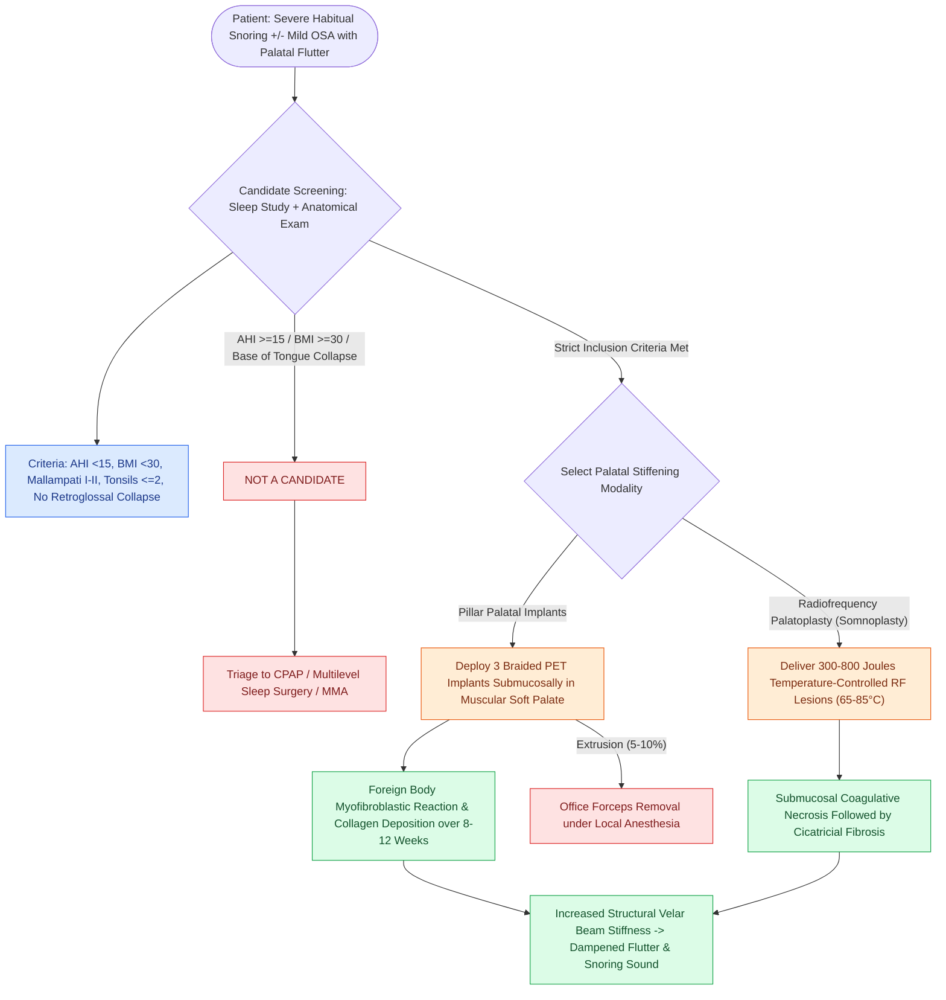

# Palatal implants and radiofrequency stiffening induce submucosal fibrosis to dampen soft palate vibration in primary snoring and mild obstructive sleep apnea

## Active Recall

> [!question]- What is the biomaterial composition, insertion geometry, and cellular tissue response of the Pillar palatal implant system?
> *Answer / Clinical Rationale*: The **Pillar implant system** consists of cylindrical implants made of braided **polyethylene terephthalate (PET / Dacron)** biomaterial (approximately $18\text{ mm}$ long and $1.5\text{ mm}$ in diameter). Under local anesthesia, **three implants** are deployed submucosally into the muscular substance of the soft palate in a parallel sagittal orientation: one in the midline anterior to the uvula and two laterally spaced $\sim 2\text{ mm}$ apart *(Fig 9.2)*. The porous braided microstructure incites a controlled, chronic **foreign-body myofibroblastic inflammatory response** with collagen deposition and neovascularization over **$8\text{ to }12\text{ weeks}$**, producing a structural composite matrix that increases palatal beam stiffness and dampens inspiratory flutter without altering palatal length.

> [!question]- What anatomical and polysomnographic criteria define the ideal candidate for in-office palatal stiffening procedures?
> *Answer / Clinical Rationale*: The ideal candidate presents with **primary snoring** or **mild obstructive sleep apnea (AHI $<15\text{ events/hr}$)**, a **$\text{BMI} < 30\text{ kg/m}^2$**, **Friedman/Mallampati palate position I or II**, small or absent palatine tonsils (**tonsil grade 0–2**), an elongated, fluttering soft palate, and the documented **absence of significant retroglossal or hypopharyngeal collapse** on drug-induced sleep endoscopy (DISE).

> [!question]- What is the most frequent surgical complication of palatal implant insertion, and how is it managed?
> *Answer / Clinical Rationale*: **Partial extrusion of the implant** through the oral or nasopharyngeal mucosa is the most frequent complication, occurring in approximately **$5\%\text{ to }10\%$ of cases**. Extrusions typically present with foreign-body sensation, tickling in the throat, or mucosal ulceration. If an implant becomes exposed, it **cannot be salvaged**; it must be grasped with forceps and gently **removed under local anesthesia**. Removal does not compromise previously formed scar tissue, and a replacement implant can be placed 6 to 8 weeks later if needed.

## Core Clinical & Mechanistic Principles

Snoring sound generation originates predominantly from dynamic fluttering of the soft palate and uvula during inspiration (the "palatal flutter" phenomenon). Minimally invasive palatal stiffening procedures—including **palatal implants (Pillar procedure)** and **temperature-controlled radiofrequency palatoplasty (somnoplasty)**—aim to alter the biomechanical resonant frequency of the velum through submucosal fibrosis without excising mucosal tissue or predisposing to velopharyngeal insufficiency.

### Operative Technique: Pillar Implant Insertion

1. **Topical and Infiltration Anesthesia**:
   - Cetacaine spray followed by infiltration of $1\%\text{ lidocaine with } 1:100,000\text{ epinephrine}$ along the midline and paramedian soft palate.
2. **Implant Placement Geometry** *(Fig 9.2)*:
   - Three sterile delivery tools containing preloaded braided PET cylindrical implants are used.
   - The delivery needle enters the soft palate at the junction of the hard and soft palate, directed posteriorly within the substance of the **levator veli palatini** and **tensor veli palatini** muscles, terminating $\ge 5\text{ mm}$ rostral to the base of the uvula.
   - **Central implant**: Placed precisely in the midline.
   - **Lateral implants**: Placed parallel to the midline implant, spaced $2\text{ mm}$ laterally on either side.
   - Implants must remain entirely submucosal; superficial placement risks early mucosal ulceration and extrusion.
3. **Radiofrequency Palatoplasty (Somnoplasty)**:
   - Employs a specialized bipolar needle electrode delivering low-temperature ($65\text{--}85^\circ\text{C}$) radiofrequency energy.
   - Three lesions (midline and bilateral paramedian) receive $300\text{ to }800\text{ Joules}$ per site.
   - Coagulative necrosis contracts over 6 to 8 weeks, creating submucosal stiffening scar tissue.

### Clinical Indications & Outcomes Comparison

| Parameter | Palatal Implants (Pillar System) | Radiofrequency Palatoplasty (Somnoplasty) | Uvulopalatopharyngoplasty (UPPP) |
| :--- | :--- | :--- | :--- |
| **Primary Indication** | Primary snoring; mild OSA ($\text{AHI} < 15$) | Primary snoring; mild OSA ($\text{AHI} < 15$) | Moderate-to-severe OSA; hypertrophic tonsils |
| **Setting** | In-office under local anesthesia ($<15\text{ minutes}$) | In-office under local anesthesia ($<15\text{ minutes}$) | Operating room under general anesthesia |
| **Postoperative Pain** | Minimal to mild ($1\text{--}2\text{ days}$); liquid/soft diet | Mild to moderate ($2\text{--}5\text{ days}$) | Severe ($10\text{--}14\text{ days}$); narcotic requirement |
| **Tissue Resection** | **Zero** mucosal or muscular resection | **Zero** resection (submucosal lesion) | Mucosal resection, uvular amputation, pillar suturing |
| **Risk of VPI / Stenosis** | Negligible | Negligible | Documented risk ($2\%\text{--}5\%$ transient VPI) |
| **Major Complication** | Implant extrusion ($5\%\text{ to }10\%$) | Mucosal ulceration / sloughing ($<3\%$) | Postoperative hemorrhage ($2\%\text{--}4\%$), airway collapse |

Comprehensive anatomical and therapeutic integration links these principles directly to [[Relocating the palatopharyngeus anterolaterally splints the lateral pharyngeal walls in expansion pharyngoplasty|Expansion Pharyngoplasty]].

## Connected Concepts & Graph Traversal
- **Radiofrequency Physics**: [[Radiofrequency ablation of the inferior turbinates and soft palate stiffens tissue through submucosal fibrosis|Radiofrequency Submucosal Stiffening]]
- **Resection Sleep Surgery**: [[Modified uvulopalatopharyngoplasty UPPP resects redundant palatal tissue while preserving muscular function|Modified UPPP Craft]]
- **Staging Triage**: [[The Friedman staging system correlates tonsil size and palate position with uvulopalatopharyngoplasty success|Friedman Staging Matrix]]
- **Dynamic Collapse Endoscopy**: [[VOTE classification standardizes drug-induced sleep endoscopy findings across velum, oropharynx, tongue base, and epiglottis|VOTE Velar Collapse]]
- **Palatal Complications**: [[Velopharyngeal incompetence following sleep surgery causes transient or permanent hypernasality and nasal regurgitation|Velopharyngeal Incompetence]]
