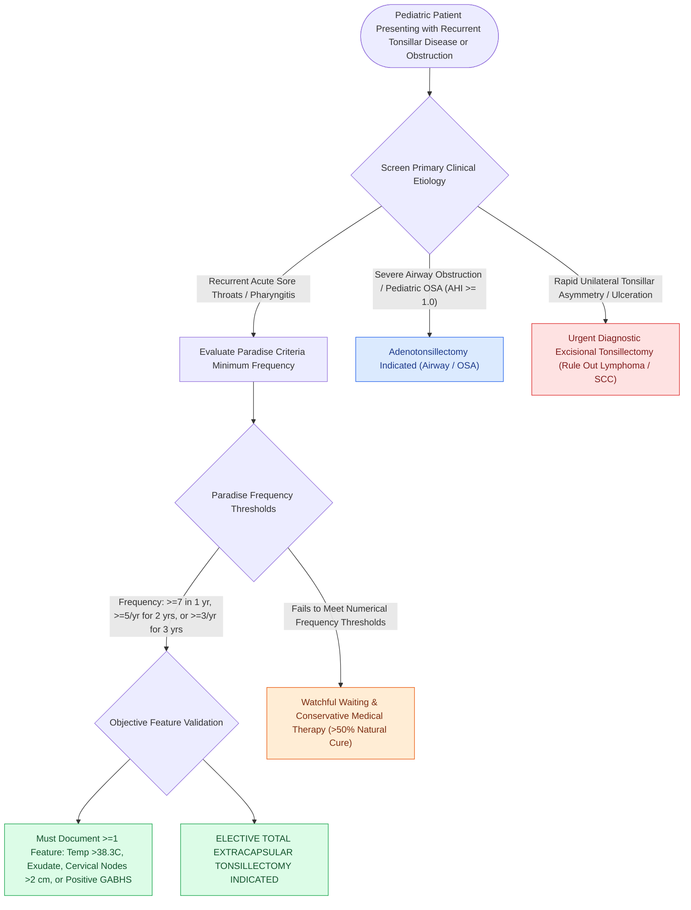

# Paradise criteria define evidence-based indications for pediatric tonsillectomy in recurrent throat infections

## Active Recall

> [!question]- What are the minimum frequency thresholds for pediatric tonsillectomy under the Paradise criteria?
> *Answer / Clinical Rationale*: **$\ge 7$ episodes in the past year**, **$\ge 5$ episodes/year for 2 years**, or **$\ge 3$ episodes/year for 3 years**.

> [!question]- What four objective clinical features can validate an episode of sore throat under the Paradise criteria?
> *Answer / Clinical Rationale*: **Temperature $>38.3^\circ\text{C}$**, **tonsillar exudate**, **cervical lymphadenopathy ($>2\text{ cm}$ or tender)**, and **positive GABHS strep rapid test or throat culture**.

> [!question]- When is adjunctive adenoidectomy indicated for middle ear disease in pediatric patients?
> *Answer / Clinical Rationale*: In children **$\ge 4\text{ years of age}$** undergoing initial tympanostomy tube placement, or in children of any age undergoing **repeat (second set) tube placement** for chronic recurrent otitis media.

## Core Clinical & Mechanistic Principles
The **Paradise Criteria (Jack Paradise et al., 1984)** establish the stringent, evidence-based frequency and clinical documentation standards for performing elective tonsillectomy for recurrent acute throat infections:
- **The Minimum Frequency Thresholds**:
  - **$\ge 7\text{ documented episodes}$ in the preceding 1 year**, OR
  - **$\ge 5\text{ documented episodes per year}$ in each of the preceding 2 years**, OR
  - **$\ge 3\text{ documented episodes per year}$ in each of the preceding 3 years**.
- **Clinical Documentation Requirements for Each Episode**:
  - Each episode must be documented in the medical record with a sore throat PLUS **at least ONE of the following objective clinical features**:
    1. **Fever $>38.3^\circ\text{C}$ ($>101^\circ\text{F}$)**.
    2. **Cervical lymphadenopathy** (tender lymph nodes or nodes $>2\text{ cm}$).
    3. **Tonsillar exudate**.
    4. **Positive laboratory test for Group A Beta-Hemolytic Streptococcus (GABHS)** (positive rapid strep antigen or throat culture).
- **Antibiotic Requirement**: Episodes must have been treated with standard antibiotic regimens for culture-positive strep.

### Non-Paradise Infectious & Autoinflammatory Indications (PFAPA Syndrome)
While the Paradise criteria strictly regulate surgery for recurrent GABHS tonsillitis, autoinflammatory periodic fever syndromes represent an evidence-based non-Paradise surgical indication:
- **PFAPA Syndrome (Periodic Fever, Aphthous Stomatitis, Pharyngitis, Adenitis)**:
  - An autoinflammatory disorder of early childhood characterized by stereotypic, predictable febrile episodes lasting **$3–7\text{ days}$** that recur cyclically every **$21–42\text{ days}$** in an otherwise healthy child with normal growth and development.
  - Manifests with abrupt high fevers ($>39^\circ\text{C}$) accompanied by at least one cardinal feature: shallow aphthous oral ulcers, exudative or non-exudative pharyngitis, and tender anterior cervical lymphadenitis. Throat cultures and viral panels remain consistently negative.
  - *Response to Corticosteroids*: A single dose of oral prednisone ($1–2\text{ mg/kg}$) or betamethasone produces dramatic abortive cessation of fever within hours (pathognomonic clinical feature), though it can paradoxically shorten the interval between flares.
  - *Surgical Cure*: Bilateral [[Extracapsular total tonsillectomy and intracapsular subtotal tonsillotomy differ in postoperative hemorrhage and recovery|tonsillectomy]] (with or without adenoidectomy) provides a **definitive cure / long-term complete clinical resolution in $>90–95\%$ of affected children**, effectively halting periodic inflammatory cytokine surges.

### Surgical Technique & Critical Safety Checks
- **Watchful Waiting**: Children not meeting these stringent criteria should undergo watchful waiting, as spontaneous resolution of recurrent infections occurs in $>50\%$ of children over time.
- **AAO-HNS Clinical Guidelines for Pediatric Adenoidectomy**:
  - *Primary Indications for Standalone or Adjunctive Adenoidectomy*:
    1. **Nasal Obstruction & Sleep-Disordered Breathing**: Chronic mouth breathing, hyponasal speech, and adenoidal hypertrophy causing upper airway resistance or pediatric OSA.
    2. **Recurrent / Chronic Adenoiditis**: $\ge 4\text{ episodes/year}$ of persistent purulent rhinorrhea and postnasal drip without significant tonsillitis.
    3. **Chronic Otitis Media with Effusion (OME)**: Indicated as an adjunct to tympanostomy tube placement in children **$\ge 4\text{ years of age}$**, or in children of any age undergoing **repeat (second set) tympanostomy tubes** for persistent middle ear effusion or recurrent AOM.
    4. **Pediatric Chronic Rhinosinusitis**: Serves as a bacterial biofilm reservoir; adenoidectomy is the first-line surgical intervention before considering functional endoscopic sinus surgery (FESS) in children (see [[Adenotonsillectomy is the first-line surgical treatment for pediatric obstructive sleep apnea|Adenotonsillectomy for Pediatric OSA]]).

## Connected Concepts & Graph Traversal
- **Pediatric OSA First-Line**: [[Adenotonsillectomy is the first-line surgical treatment for pediatric obstructive sleep apnea|Adenotonsillectomy for Pediatric OSA]]
- **Tonsillectomy Techniques**: [[Extracapsular total tonsillectomy and intracapsular subtotal tonsillotomy differ in postoperative hemorrhage and recovery|Extracapsular vs Intracapsular Techniques]]
- **Post-Tonsillectomy Bleed**: [[Post-tonsillectomy hemorrhage is classified into primary within twenty-four hours and secondary beyond twenty-four hours|Post-Tonsillectomy Hemorrhage Protocol]]
- **Peritonsillar Abscess**: [[Peritonsillar abscess presents with unilateral palatal fullness, uvular deviation, and trismus requiring drainage|Peritonsillar Abscess (Quinsy)]]
- **Tympanostomy Tube Guidelines**: [[Tympanostomy tube placement follows guideline criteria for chronic effusion and recurrent acute otitis media|Tympanostomy Tube Placement & OME]]
- **Pediatric PSG**: [[Pediatric polysomnography criteria define obstructive sleep apnea with an obstructive apnea-hypopnea index exceeding one|Pediatric Polysomnography & Overnight Admission]]
