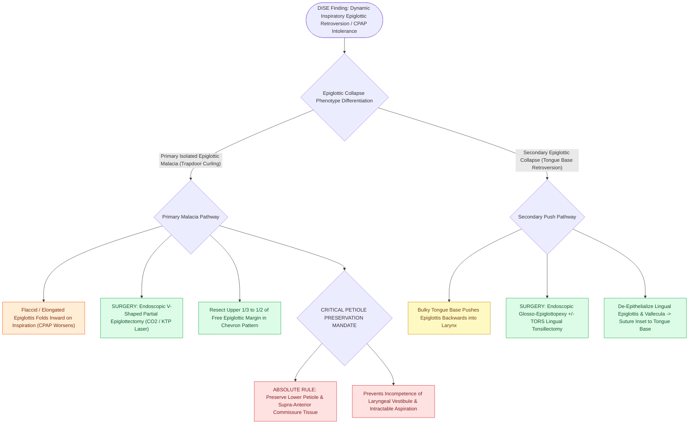

# Partial epiglottectomy and epiglottopexy correct dynamic epiglottic retroversion during inspiration

## Active Recall

> [!question]- Why is CPAP often ineffective and poorly tolerated in patients with primary trapdoor epiglottic collapse?
> *Answer / Clinical Rationale*: Because positive airway pressure **pneumatically pushes the flaccid epiglottis downward directly onto the vocal cords**, worsening airway obstruction.

> [!question]- What anatomical portion of the epiglottis must be strictly preserved during partial epiglottectomy to prevent aspiration?
> *Answer / Clinical Rationale*: The **lower petiole and lower half of the epiglottis**.

## Core Clinical & Mechanistic Principles
Dynamic **epiglottic collapse (epiglottic retroversion / trapdoor epiglottis)** is identified on [[Drug-induced sleep endoscopy DISE evaluates dynamic multi-level upper airway collapse under sedation|DISE]] in **$15\text{–}25\%$ of adult OSA patients** and is a frequent cause of CPAP intolerance:
- **Two Distinct Epiglottic Collapse Mechanisms on DISE**:
  1. **Primary (Isolated) Epiglottic Malacia**: The epiglottis is flaccid, curling, or excessively long, folding backward like a trapdoor over the glottic aperture during inspiration. (CPAP exacerbates this by pushing the epiglottis further down onto the larynx).
  2. **Secondary Epiglottic Collapse**: The tongue base retroverts and mechanically pushes a normal epiglottis backward into the glottis.
- **Surgical Correction Modalities**:
  - **Partial (V-Shaped) Epiglottectomy**:
    - Performed transorally using CO2 laser, KTP laser, or microdebrider.
    - Resects the **upper one-third to one-half of the free epiglottic edge in a wedge/chevron shape**, widening the glottic inlet while preserving the lower petiole and laryngeal protection.
  - **Endoscopic Epiglottopexy / Glosso-Epiglottopexy**:
    - Indicated when epiglottic cartilage is healthy but lacks anterior support.
    - De-epithelialize the **lingual surface of the epiglottis and the opposing vallecular / base of tongue mucosa** with CO2 laser or Coblation.
    - Place 2–3 transoral mucosal/cartilage sutures to pexy the epiglottis anteriorly against the tongue base, preventing backward collapse.

### Surgical Technique & Critical Safety Checks
- **Aspiration Safety**: Resecting the upper free margin does not impair deglutition; however, **resecting the lower petiole destroys laryngeal closure and causes intractable aspiration**.

## Connected Concepts & Graph Traversal
- **VOTE Classification**: [[VOTE classification standardizes drug-induced sleep endoscopy findings across velum, oropharynx, tongue base, and epiglottis|VOTE Classification]]
- **Hyoid Suspension**: [[Hyoid suspension thyrohyoidopexy anchors the hyoid bone to the thyroid cartilage to stabilize the hypopharynx|Hyoid Suspension]]
- **TORS Tongue Base**: [[Transoral robotic surgery TORS tongue base reduction debulks lingual tonsil and midline tongue musculature in OSA|TORS Tongue Base]]
- **Embryological & Sleep Foundation**: [[The Starling resistor model explains upper airway collapsibility and critical closing pressure Pcrit]]
- **Adenotonsillar & Endoscopic DISE**: [[Paradise criteria define evidence-based indications for pediatric tonsillectomy in recurrent throat infections]]
- **Congenital Airway Pathology**: [[Microdebrider debulking and intralesional cidofovir provide surgical and adjuvant control of RRP]]
- **Open Airway Reconstruction**: [[Slide tracheoplasty expands complete tracheal rings by oblique division and sliding longitudinal reconstruction]]
