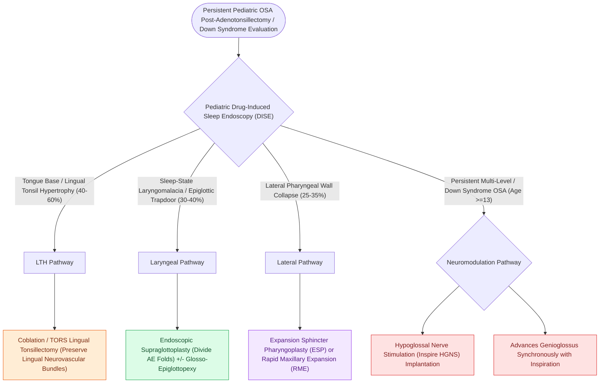

# Pediatric DISE identifies persistent multi-level airway collapse following adenotonsillectomy

## Active Recall

> [!question]- What are the two most common anatomical sites of persistent upper airway obstruction identified by DISE in children post-adenotonsillectomy?
> *Answer / Clinical Rationale*: **Lingual tonsil hypertrophy** (40–60%) and **sleep-state laryngomalacia / epiglottic collapse** (30–40%).

> [!question]- Why is DISE particularly valuable in children with Down syndrome and OSA?
> *Answer / Clinical Rationale*: Because Down syndrome patients frequently have **multi-level collapse (macroglossia, hypotonia, laryngomalacia)** that fails standard T&A.

## Core Clinical & Mechanistic Principles
In children with **persistent obstructive sleep apnea following [[Adenotonsillectomy is the first-line surgical treatment for pediatric obstructive sleep apnea|adenotonsillectomy]]** ($15\text{–}25\%$ of general pediatric OSA, $>50\%$ in syndromic/obese children), Pediatric DISE identifies occult non-tonsillar sites of obstruction:
- **Most Common Sites of Persistent Pediatric Collapse on DISE**:
  1. **Lingual Tonsil Hypertrophy ($40\text{–}60\%$)**: Compensatory lymphoid hyperplasia at the tongue base causing severe [[Transoral robotic surgery TORS tongue base reduction debulks lingual tonsil and midline tongue musculature in OSA|retroglossal obstruction]].
  2. **Occult Laryngomalacia / Epiglottic Retroversion ($30\text{–}40\%$)**: Sleep-state dependent prolapse of redundant arytenoid mucosa or a flaccid epiglottis into the laryngeal inlet.
  3. **[[Expansion sphincter pharyngoplasty ESP rotates the palatopharyngeus muscle to stabilize lateral pharyngeal wall collapse|Lateral Pharyngeal Wall Collapse]] ($25\text{–}35\%$)**: Inward collapse of the tonsillar pillars and pharyngeal constrictors.
  4. **Residual / Regrown Adenoid Pad**: Obstructing the posterior choanae.
  5. **Macroglossia & Retrognathia**: Common in Down syndrome and Pierre Robin sequence.
- **Targeted Secondary Interventions Dictated by Pediatric DISE**:
  - Lingual tonsil hypertrophy $\r\r\rightarrow$ **Coblation / TORS Lingual Tonsillectomy**.
  - Sleep-state [[Laryngomalacia is the most common cause of congenital pediatric stridor characterized by dynamic supraglottic collapse|laryngomalacia]] $\r\r\rightarrow$ **[[Endoscopic supraglottoplasty cold-steel and laser division of aryepiglottic folds relieves severe laryngomalacia|Supraglottoplasty]] / [[Partial epiglottectomy and epiglottopexy correct dynamic epiglottic retroversion during inspiration|Epiglottopexy]]**.
  - Lateral wall collapse $\r\r\rightarrow$ **Expansion Pharyngoplasty** or Orthodontic **[[Rapid maxillary expansion widens the hard palate and nasal floor to improve pediatric nasal breathing and OSA|Rapid Maxillary Expansion]] (RME)**.

### Surgical Technique & Critical Safety Checks
- **Down Syndrome Cohort**: Children with Trisomy 21 have a $>60\text{–}70\%$ persistence of OSA after T&A; DISE is standard of care before any secondary surgery.

## Connected Concepts & Graph Traversal
- **Lingual Tonsils**: [[Lingual tonsil hypertrophy causes persistent pediatric obstructive sleep apnea and base of tongue collapse|Lingual Tonsils]]
- **Supraglottoplasty**: [[Endoscopic supraglottoplasty cold-steel and laser division of aryepiglottic folds relieves severe laryngomalacia|Supraglottoplasty]]
- **DISE Endoscopy**: [[Drug-induced sleep endoscopy DISE evaluates dynamic multi-level upper airway collapse under sedation|DISE Endoscopy]]
- **Embryological & Sleep Foundation**: [[Loop gain, arousal threshold, and muscle responsiveness represent the non-anatomical endotypes of obstructive sleep apnea]]
- **Adenotonsillar & Endoscopic DISE**: [[Paradise criteria define evidence-based indications for pediatric tonsillectomy in recurrent throat infections]]
- **Congenital Airway Pathology**: [[Recurrent respiratory papillomatosis RRP is driven by HPV six and eleven causing recurrent laryngeal lesions]]
- **Open Airway Reconstruction**: [[Cricotracheal resection CTR achieves primary end-to-end anastomosis for severe Grade III and IV subglottic stenosis]]
