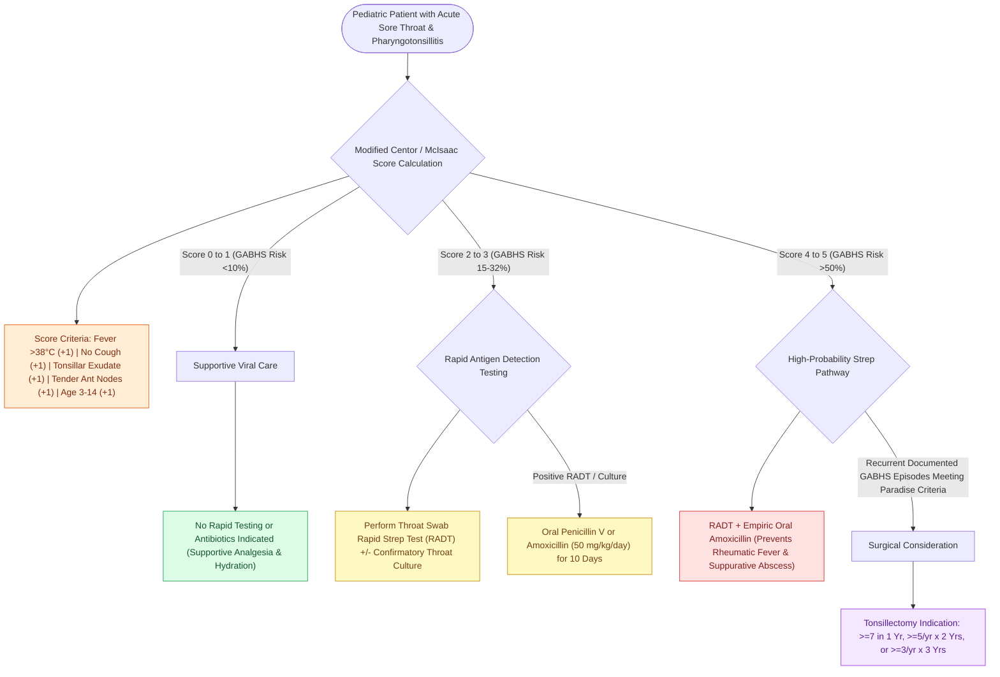

# Pediatric acute bacterial tonsillitis is differentiated from viral pharyngitis using modified Centor criteria

## Active Recall

> [!question]- What are the four clinical components of the original Centor score for streptococcal pharyngitis?
> *Answer / Clinical Rationale*: (1) **Fever** (history of >38.0°C), (2) **Absence of cough**, (3) **Tender anterior cervical lymphadenopathy**, and (4) **Tonsillar exudate or marked swelling**.

> [!question]- What are the Paradise criteria frequency thresholds for recurrent tonsillectomy?
> *Answer / Clinical Rationale*: At least **7 documented episodes in the preceding year**, OR at least **5 episodes per year for the past 2 consecutive years**, OR at least **3 episodes per year for the past 3 consecutive years**.

## Core Clinical & Mechanistic Principles

**Acute tonsillitis** in children is an acute inflammatory infection of the palatine tonsils. While the majority of pharyngotonsillitis cases in children are viral (Adenovirus, Epstein-Barr virus / Mononucleosis, Enterovirus, Rhinovirus), **Group A beta-hemolytic Streptococcus (GABHS / Streptococcus pyogenes)** accounts for **15% to 30%** of cases in children aged 3 to 14 years.

Accurate clinical discrimination of GABHS from viral etiologies is critical to prevent suppurative complications ([[Peritonsillar abscess presents with unilateral palatal fullness, uvular deviation, and trismus requiring drainage|peritonsillar abscess]], [[Deep neck space infections spread along cervical fascial planes between the pharynx, mediastinum, and skull base|retropharyngeal/parapharyngeal space abscess]], [[Lemierre syndrome involves Fusobacterium necrophorum internal jugular thrombophlebitis and septic emboli|Lemierre syndrome]]) and non-suppurative autoimmune sequelae (**Acute Rheumatic Fever**, **Post-Streptococcal Glomerulonephritis**).

The **Modified Centor (McIsaac) Scoring System** stratifies probability:
- **Tonsillar exudates or swelling** (+1)
- **Tender anterior cervical adenopathy** (+1)
- **History of fever >38.0°C (100.4°F)** (+1)
- **Absence of cough** (+1)
- **Age 3–14 years** (+1; age 15–44 years = 0; age $\ge$ 45 years = -1)

A score $\ge$ 3 mandates rapid antigen detection testing (RADT) and confirmatory throat culture. Viral etiologies are characterized by concurrent cough, rhinorrhea, conjunctivitis, anterior stomatitis, or hoarseness.

### Surgical Technique & Craft Nuance: Pharmacotherapy & Surgical Indications

1. **Antimicrobial Therapy**: First-line treatment for confirmed GABHS tonsillitis is **oral Penicillin V (250 mg PO BID/TID in children <27 kg; 500 mg BID/TID in older children/adults for 10 days)** or **Amoxicillin (50 mg/kg/day once daily or divided BID, max 1,000 mg/day for 10 days)** due to superior palatability. In penicillin-allergic individuals without anaphylaxis, first-generation cephalosporins (cephalexin) or macrolides/clindamycin are employed.
2. **Paradise Criteria for Tonsillectomy**: Surgical indication criteria for recurrent acute throat infections include:
   - $\ge$ **7 documented episodes in the past 1 year**, OR
   - $\ge$ **5 documented episodes per year for the past 2 consecutive years**, OR
   - $\ge$ **3 documented episodes per year for the past 3 consecutive years**.
## References
1. Mitchell, R.B., Archer, S.M., Ishman, S.L., et al. (2019). Clinical Practice Guideline: Tonsillectomy in Children (Update). *Otolaryngol Head Neck Surg*, 160(1_suppl):S1-S42.
2. Jeyakumar, A., Miller, S., Mitchell, R.B. (2013). Adenotonsillar Disease in Children. In Johnson, J.J., Rosen, C.A. (Eds.), *Bailey’s Head and Neck Surgery-Otolaryngology* 5e (pp. 1430-1444). Baltimore, MD: Lippincott Williams & Wilkins.
3. Christian, J.M., Felts, C.B., Beckman, N.A., et al. (2020). Deep Neck and Odontogenic Infections. In Flint, P.W., et al. (Eds.), *Cummings Otolaryngology Head and Neck Surgery* 7e (pp. 141-154). Philadelphia, PA: Elsevier.

## Connected Concepts & Graph Traversal

- **Critical Suppurative Complication**: [[Peritonsillar abscess presents with unilateral palatal fullness, uvular deviation, and trismus requiring drainage|Peritonsillar Abscess (Quinsy)]]
- **Surgical Craft & Hemorrhage Risk**: [[Post-tonsillectomy secondary hemorrhage occurs seven to ten days postoperatively from eschar sloughing requiring urgent airway control|Post-Tonsillectomy Hemorrhage]]
- **Deep Neck Spread**: [[Deep neck space infections spread along cervical fascial planes between the pharynx, mediastinum, and skull base|Deep Cervical Space Infection]]
- **Vascular Thrombophlebitis**: [[Lemierre syndrome involves Fusobacterium necrophorum internal jugular thrombophlebitis and septic emboli|Lemierre Syndrome]]
- **Airway Obstruction in Sleep**: [[Adenotonsillectomy is the first-line surgical treatment for pediatric obstructive sleep apnea|T&A for Pediatric OSA]]
