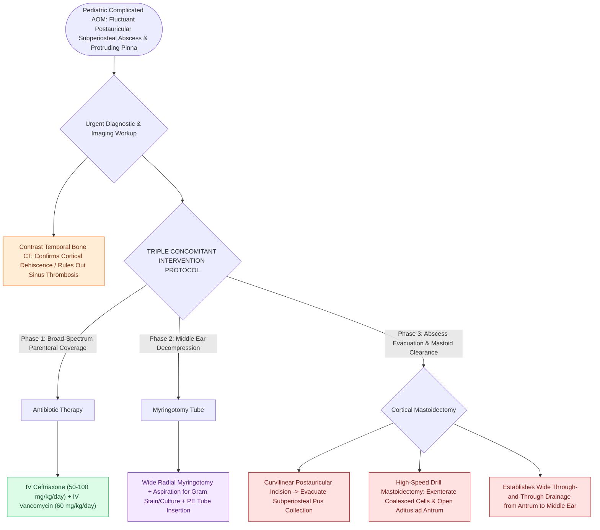

# Pediatric acute mastoiditis with subperiosteal abscess requires intravenous ceftriaxone, myringotomy tube placement, and cortical mastoidectomy

## Active Recall

> [!question]- What clinical sign distinguishes a subperiosteal mastoid abscess from acute otitis externa with reactive postauricular edema?
> *Answer / Clinical Rationale*: In a subperiosteal mastoid abscess, the **postauricular sulcus (crease) is effaced/obliterated** by fluctuant purulence beneath the periosteum, and the pinna is displaced forward. In otitis externa, postauricular soft tissue swelling does not efface the deep sulcus, and gentle manipulation of the tragus or pinna elicits exquisite canal pain that is absent in pure mastoiditis.

> [!question]- Why is tympanostomy tube placement performed simultaneously with mastoidectomy for coalescent mastoiditis?
> *Answer / Clinical Rationale*: Myringotomy with tube placement immediately decompresses the tensely infected middle ear space, provides culture material, establishes direct through-and-through drainage from the mastoid antrum across the aditus into the external canal, and facilitates delivery of topical ototopical drops.

## Core Clinical & Mechanistic Principles
In pediatric patients with [[Uncomplicated acute otitis media in pediatric and adult patients is treated with first-line high-dose amoxicillin|acute otitis media (AOM)]], progressive bacterial osteolysis of the thin mastoid cortex can breach the lateral subperiosteal plane, forming a **subperiosteal abscess (SPA)** over the mastoid surface. The developing abscess elevates the periosteum away from the bone, displacing the pinna anteriorly and inferiorly, obliterating the postauricular crease, and presenting with classic fluctuance, erythema, and tenderness.

The primary pathogens are *Streptococcus pneumoniae*, *Streptococcus pyogenes* (Group A Strep), and *Staphylococcus aureus* (including MRSA). Contrast-enhanced temporal bone CT defines cortical bone breakdown (coalescence) and rules out intracranial extension (such as [[Lateral sinus thrombophlebitis presents with picket fence fevers and Griesinger sign requiring intravenous antibiotics and mastoidectomy|sigmoid sinus thrombophlebitis]] or epidural abscess). Definitive management requires a staged or combined approach comprising targeted parenteral antibiotics, middle ear pressure equalization via [[Standard open tracheotomy utilizes horizontal intersinusoidal or Bjork flap entry|myringotomy]] and tympanostomy tube placement, and surgical abscess evacuation with cortical mastoidectomy.

### Surgical Technique & Craft Nuances
1. **Parenteral Antimicrobial Regimen**:
   - **Ceftriaxone ($50\text{ to }100\text{ mg/kg/day}$ IV)** plus **Vancomycin ($60\text{ mg/kg/day}$ divided q6h)** to ensure high CNS penetration and coverage against resistant *Streptococcus pneumoniae* and MRSA.
2. **Myringotomy & Pressure Equalization Tube Placement**:
   - Perform a wide radial myringotomy in the anteroinferior or posteroinferior quadrant of the tympanic membrane under microscopy.
   - Aspirate middle ear purulence for Gram stain and cultures, and insert a fluoroplastic tympanostomy tube to provide continuous ventilation and middle ear drainage.
3. **Postauricular Incision & Cortical Mastoidectomy**:
   - Make a curvilinear postauricular incision $3\text{ to }5\text{ mm}$ posterior to the retroauricular sulcus.
   - Incise the periosteum, sharply evacuate the subperiosteal abscess cavity, and irrigate copiously.
   - Identify surgical landmarks: Macewen's triangle, temporal line, and external auditory canal spine of Henle.
   - Using a high-speed otologic drill and continuous irrigation, perform a complete **cortical mastoidectomy**, saucerizing the mastoid cortex, opening the mastoid antrum, exenterating diseased retrofacial and perisinus air cells, and establishing wide patency of the aditus ad antrum into the middle ear.
## References
1. Arts, H.A., Adams, M.E. (2013). Intratemporal and Intracranial Complications of Otitis Media. In Johnson, J.J., Rosen, C.A. (Eds.), *Bailey’s Head and Neck Surgery-Otolaryngology* 5e (pp. 2399-2409). Baltimore, MD: Lippincott Williams & Wilkins.
2. Schilder, A.G., Rosenfeld, R.M., Venekamp, R.P. (2020). Acute Otitis Media and Otitis Media with Effusion. In Flint, P.W., et al. (Eds.), *Cummings Otolaryngology Head and Neck Surgery* 7e (pp. 2956-2969). Philadelphia, PA: Elsevier.
3. Glikson, E., et al. (2017). Pediatric acute mastoiditis: 10-year experience and management protocol. *Int J Pediatr Otorhinolaryngol*, 96:139-143.

## Connected Concepts & Graph Traversal
- **Physiological Basis**: [[Acute coalescent mastoiditis causes trabecular osteoclasis and subperiosteal abscess formation|Acute Coalescent Mastoiditis]]
- **Underlying Precursor**: [[Uncomplicated acute otitis media in pediatric and adult patients is treated with first-line high-dose amoxicillin|Pediatric Acute Otitis Media]]
- **Intracranial Complication**: [[Lateral sinus thrombophlebitis presents with picket fence fevers and Griesinger sign requiring intravenous antibiotics and mastoidectomy|Lateral Sinus Thrombophlebitis]]
- **Petrous Extension**: [[Gradenigo triad of otorrhea, retroorbital pain, and abducens nerve palsy indicates suppurative petrous apicitis|Gradenigo Triad & Petrous Apicitis]]
- **Facial Nerve Safety**: [[The facial nerve traverses six distinct anatomical segments from the pons to the parotid gland|Facial Nerve Course]]
