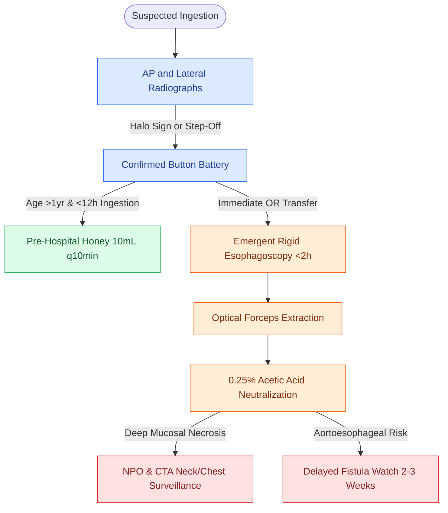

# Pediatric esophageal button battery impaction causes liquefaction necrosis within two hours and mandates emergent endoscopic extraction

## Active Recall

> [!question]- What is the electrochemical mechanism causing rapid liquefaction necrosis in esophageal button battery impaction?
> *Answer / Clinical Rationale*: Electrical current flow hydrolyzes tissue fluid at the **negative pole (anode)**, generating concentrated **hydroxide ($\text{OH}^-$) ions** that elevate local tissue pH to **$12\text{–}14$**, producing aggressive **alkaline liquefactive necrosis** that can perforate the esophagus within **$<2\text{ hours}$**.

> [!question]- How does a button battery appear on AP and lateral radiographs compared to an ingested coin?
> *Answer / Clinical Rationale*: On AP view, a button battery exhibits a concentric **"double-ring" or "halo sign"**, and on lateral view, it demonstrates a characteristic **"step-off" beveled edge** (orienting the dangerous anode), whereas a coin is a smooth, uniform single radiopacity.

> [!question]- What pre-hospital and intraoperative interventions mitigate tissue damage from an ingested button battery?
> *Answer / Clinical Rationale*: Pre-hospital **oral honey or sucralfate suspension ($10\text{ mL}$ every 10 min, up to 6 doses)** acts as a weak acid buffer to reduce burn depth in children $>1\text{ year}$; intraoperative post-extraction irrigation with **$0.25\%\text{ to }0.5\%$ dilute acetic acid ($50\text{–}100\text{ mL}$)** neutralizes residual mucosal alkalinity.

## Core Clinical & Mechanistic Principles
**Ingested disc button batteries lodged in the pediatric esophagus** represent true surgical emergencies requiring rapid radiographic localization and immediate operating room extraction:

- **The Three Physiologic Esophageal Narrowings**:
  1. **Cricopharyngeus Muscle / Upper Esophageal Sphincter (C6)**: The narrowest point of the entire gastrointestinal tract and the **site of $>70\%$ of all pediatric esophageal foreign body impactions**.
  2. **Aortic Arch & Left Mainstem Bronchus Crossing (T4)**: A fixed anatomical constriction where expanding necrosis risks catastrophic **aortoesophageal fistula** (fatal exsanguination) or **tracheoesophageal fistula**.
  3. **Lower Esophageal Sphincter / Diaphragmatic Hiatus (T10–T11)**: Gastroesophageal junction.

- **Biochemical Mechanism of Button Battery Injury (The 2-Hour Window)**:
  - Once lodged against moist esophageal mucosa, the battery closes an electrical circuit, conducting current from the anode to the cathode.
  - Water hydrolysis at the **negative pole (anode)** generates concentrated **hydroxide ($\text{OH}^-$) ions**, rapidly elevating the local tissue pH to **$12\text{–}14$**.
  - This alkaline chemical environment drives rapid, transmural **liquefaction necrosis within $2\text{ hours}$ of impaction**, dissolving proteins and penetrating deep collagenous fascial planes.
  - *Catastrophic Sequelae*: Esophageal perforation, **Aortoesophageal Fistula (AEF)**, **Tracheoesophageal Fistula (TEF)**, mediastinitis, and refractory post-inflammatory esophageal strictures. Delayed vascular blowout can occur up to **$2\text{–}3\text{ weeks}$ post-extraction**.

- **Radiographic Differentiation: Button Battery vs. Ingested Coin**:
  - **Anteroposterior (AP) View**:
    - *Button Battery*: Exhibits a distinct **"Double-Ring" or "Halo Sign"** (caused by the stepped outer rim of the battery housing).
    - *Coin*: Uniform, homogeneous radiopaque disc without a concentric double ring.
  - **Lateral View**:
    - *Button Battery*: Demonstrates a **"Step-Off" contour** between the smaller cathode and larger anode, indicating the orientation of the dangerous negative pole (facing posteriorly = aortic risk; facing anteriorly = tracheal risk).
    - *Coin*: Smooth, flat, rectangular cross-section without a step-off.
  - *Esophageal vs Tracheal Orientation*: Esophageal foreign bodies align in the **coronal plane** on AP radiographs (flat face visible on AP view), whereas tracheal foreign bodies align in the **sagittal plane** (flat face visible on lateral view) due to the incomplete posterior tracheal cartilage.

- **Pre-Hospital & Pre-Operative Mitigation Protocol**:
  - **Oral Honey or Sucralfate**: If the battery ingestion occurred within $12\text{ hours}$ and perforation is not suspected, administer **$10\text{ mL}$ of honey or sucralfate suspension every $10\text{ minutes}$ (up to 6 doses)** in children $>1\text{ year of age}$.
  - *Mechanism*: Viscous honey/sucralfate coats the mucosa and acts as a weak acid buffer, neutralizing hydroxide ions and significantly reducing the depth of liquefaction injury prior to surgical removal.

### Surgical Technique & Critical Safety Checks
- **Extraction Protocol**: Perform **rigid esophagoscopy under general endotracheal anesthesia** with an uncuffed or securely taped tube. Grasp the battery with optical forceps; immediately irrigate the injured esophageal mucosa with **$0.25\%$ acetic acid or sterile saline** to neutralize residual alkaline residues.
- **Post-Extraction Surveillance**: If deep mucosal ulceration, muscularis exposure, or transmural necrosis is visualized, place a nasogastric feeding tube under direct endoscopic vision, obtain an immediate contrast CT of the neck and chest to assess for vascular proximity and occult perforation, and keep the patient NPO on broad-spectrum intravenous antibiotics (see [[Nasal foreign bodies presenting with unilateral foul-smelling rhinorrhea mandate urgent removal with particular vigilance for button batteries|Nasal Button Battery Removal]]).

## Connected Concepts & Graph Traversal
- **Nasal Battery Emergencies**: [[Nasal foreign bodies presenting with unilateral foul-smelling rhinorrhea mandate urgent removal with particular vigilance for button batteries|Nasal Button Battery Removal]]
- **Deep Space Infection Spread**: [[The danger space permits unrestricted infection spread from skull base to posterior mediastinum|Esophageal Perforation & Danger Space Mediastinitis]]
- **Stridor Diagnostics**: [[Pediatric stertor and stridor differentiate upper supraglottic airway obstruction from intrathoracic tracheobronchial disease|Pediatric Airway Foreign Bodies]]
- **Vascular Compression Pathology**: [[Innominate artery compression syndrome causes dynamic anterior tracheal pulsatile collapse|Aortoesophageal Fistula & Great Vessel Anatomy]]
- **Pediatric Airway Stenting**: [[Slide tracheoplasty achieves immediate vascularized mucosal lumen doubling with lowest restenosis rates|Pediatric Airway Reconstruction]]
