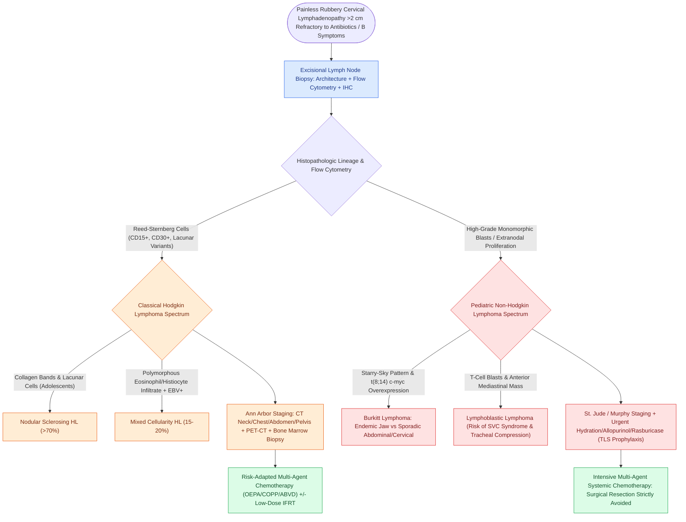

# Pediatric head and neck lymphomas present as painless cervical lymphadenopathy staged by Ann Arbor and St Jude systems

## Active Recall

> [!question]- What clinical features differentiate pediatric Hodgkin lymphoma from Non-Hodgkin lymphoma at presentation?
> *Answer / Clinical Rationale*: **Hodgkin Lymphoma (HL)** exhibits a bimodal age distribution with a prominent peak in **adolescents and young adults (15–30 years)**, presenting as **painless, firm, non-tender, "rubbery" cervical lymphadenopathy** (most commonly Levels II–IV and supraclavicular) that spreads in an **orderly, contiguous lymphatic fashion**. Systemic **"B" symptoms** (unexplained fever $>38^\circ\text{C}$, drenching night sweats, and unintentional weight loss $>10\%$ over 6 months) occur in $\sim 25\%\text{ to }30\%$. In contrast, pediatric **Non-Hodgkin Lymphoma (NHL)** peaks in **younger children (5–10 years)**, is uniformly **high-grade**, exhibits **explosive rapid tumor doubling**, involves **extranodal sites** (Waldeyer ring, tonsils, base of tongue, gastrointestinal tract) with high frequency, disseminates in a **non-contiguous pattern**, and presents with life-threatening emergencies (acute airway compromise, superior vena cava syndrome, or acute tumor lysis syndrome).

> [!question]- What is the pathognomonic histological hallmark of Hodgkin lymphoma, and how do its WHO classical subtypes differ?
> *Answer / Clinical Rationale*: The pathognomonic hallmark is the **Reed-Sternberg (RS) cell**: a giant binucleated or multinucleated B-cell with prominent, eosinophilic inclusion-like nucleoli resembling **"owl's eyes"**, expressing **CD15 (+)** and **CD30 (+)** while usually negative for CD45 and CD20. Classical HL is divided into four WHO subtypes:
> 1. **Nodular Sclerosis**: Most common subtype ($>70\%$ of pediatric/adolescent cases), characterized by collagenous fibrotic bands circumscribing lymphoid nodules containing RS cell variants (**lacunar cells**); predilection for the anterior mediastinum and lower cervical nodes.
> 2. **Mixed Cellularity**: Second most common ($15\%\text{--}20\%$); features a polymorphous inflammatory background (eosinophils, plasma cells, histiocytes) with classic RS cells; strongly linked to **Epstein-Barr virus (EBV, $>70\%$)**.
> 3. **Lymphocyte-Rich**: Uncommon; excellent prognosis; abundant reactive mantle-zone lymphocytes surrounding few RS cells.
> 4. **Lymphocyte-Depleted**: Rare in children ($<2\%$); abundant atypical pleomorphic RS cells with sparse lymphocytes; poor prognosis; associated with advanced HIV/immunodeficiency.
> *(Note: Nodular Lymphocyte-Predominant HL [NLPHL] is a distinct non-classical entity with "popcorn" LP cells that are CD20+, CD45+, CD15-, CD30-).*

> [!question]- Which staging systems govern pediatric Hodgkin vs Non-Hodgkin lymphoma, and what are their staging criteria?
> *Answer / Clinical Rationale*:
> - **Hodgkin Lymphoma**: Staged using the **Ann Arbor Staging System** (with Cotswolds modifications):
>   - *Stage I*: Single lymph node region or localized single extralymphatic organ/site ($I_E$).
>   - *Stage II*: Two or more lymph node regions on the **same side of the diaphragm**, or localized involvement of an extralymphatic organ plus contiguous nodal disease ($II_E$).
>   - *Stage III*: Lymph node regions on **both sides of the diaphragm**, which may include the spleen ($III_S$) or localized extralymphatic organ ($III_E$).
>   - *Stage IV*: Diffuse or disseminated involvement of one or more distant extralymphatic organs (bone marrow, liver, lung pleura).
>   - Suffixes: **A** = absence of B symptoms; **B** = presence of unexplained fever $>38^\circ\text{C}$, drenching night sweats, or $>10\%$ weight loss in 6 months.
> - **Non-Hodgkin Lymphoma**: Staged using the **St. Jude (Murphy) Staging System**, which emphasizes extranodal disease, gastrointestinal localization, mediastinal masses, and central nervous system / bone marrow blast counts.

## Core Clinical & Mechanistic Principles

Lymphomas represent the second most common malignancy of the head and neck in pediatric patients (behind rhabdomyosarcoma in toddlers, and the most common in children $>6\text{ years}$). Evaluation mandates tissue diagnosis via excisional lymph node biopsy—fine needle aspiration (FNA) is inadequate for architectural classification.

### Comprehensive Comparison Ledger: Pediatric Hodgkin vs Non-Hodgkin Lymphoma

| Feature | Hodgkin Lymphoma (HL) | Non-Hodgkin Lymphoma (NHL) |
| :--- | :--- | :--- |
| **Peak Demographics** | Bimodal: adolescents (15–19 years) and adults; rare under 5 | Younger children: peak age 5–10 years; male predominance (3:1) |
| **Clinical Presentation** | Asymptomatic, painless, rubbery, mobile cervical/supraclavicular node; slow enlargement | Explosive rapid growth; painless massive cervical lymphadenopathy or Waldeyer ring mass |
| **Lymphatic Spread** | **Contiguous, predictable** along anatomic nodal chains; extranodal rare acutely | **Non-contiguous, widespread, hematogenous** dissemination; early BM/CNS spread |
| **Extranodal Disease** | Rare at onset ($<5\%$); mediastinal mass common in nodular sclerosis | Extremely common ($>50\%$): tonsils, adenoids, base of tongue, ileocecal junction, bone |
| **Systemic Symptoms** | **B symptoms in 25–30%**: fever $>38^\circ\text{C}$, night sweats, $>10\%$ weight loss | Tumor lysis syndrome (hyperuricemia, hyperkalemia, hyperphosphatemia, hypocalcemia) |
| **Histopathology** | Few neoplastic cells (**Reed-Sternberg cells**) surrounded by polyclonal immune cells | Dense, sheet-like sheets of malignant monomorphic lymphocytes with high mitotic index |
| **Immunophenotype** | Classical: **CD15 (+), CD30 (+)**; CD20 (-), CD45 (-) | B-cell: **CD19, CD20 (+)**; T-cell: **CD3, CD4, CD8 (+)**; TdT (+) in lymphoblastic |
| **Staging System** | **Ann Arbor Staging** (Stages I–IV, with A/B and E/S suffixes) | **St. Jude (Murphy) Staging** (Stages I–IV based on localized vs disseminated/CNS/BM) |
| **Primary Therapy** | Multi-agent chemotherapy (OEPA/ABVD) + low-dose involved-field radiotherapy (IFRT) | Multi-agent chemotherapy alone; **surgery limited to biopsy**; RT rarely used |

### Pediatric Non-Hodgkin Lymphoma Subtypes

1. **Burkitt Lymphoma**:
   - Mature B-cell neoplasm exhibiting the highest proliferation index of any human malignancy (Ki-67 nearly $100\%$, doubling time $<24\text{ hours}$).
   - **Histology**: Classic **"starry-sky" pattern** created by pale, tingible-body macrophages actively engulfing apoptotic nuclear debris against a uniform dark background of intermediate-sized basophilic lymphoblasts.
   - **Cytogenetics**: Pathognomonic reciprocal translocation of the ***c-myc* proto-oncogene** on chromosome 8 to immunoglobulin loci:
     - **$t(8;14)(q24;q32)$**: Translocation to the immunoglobulin heavy chain locus ($85\%$).
     - Variant translocations: $t(2;8)$ (kappa light chain) or $t(8;22)$ (lambda light chain).
   - **Clinical Forms**:
     - *Endemic (African)*: Strongly associated with EBV ($>95\%$); presents as a rapidly expanding, destructive jaw or facial bone mass.
     - *Sporadic (Western)*: Lower EBV association ($20\%\text{--}30\%$); presents predominantly as an abdominal/ileocecal mass with intussusception, or cervical lymphadenopathy and tonsillar hypertrophy.

2. **Lymphoblastic Lymphoma**:
   - Accounts for $\sim 30\%$ of pediatric NHL; predominantly of **immature T-cell lineage** ($75\%$).
   - Presents characteristically in adolescent males with a rapidly expanding **anterior mediastinal mass**, causing life-threatening extrinsic compression of the trachea, stridor, wheezing, orthopnea, and superior vena cava (SVC) syndrome.
   - Flow cytometry demonstrates **terminal deoxynucleotidyl transferase (TdT +)**, CD1a, and cytoplasmic CD3.

3. **Diffuse Large B-Cell Lymphoma (DLBCL)**:
   - Heterogeneous large transformed B-cells expressing CD20; presents as rapidly enlarging cervical masses or destructive Waldeyer ring tumors.

Comprehensive physiological and surgical principles connect these findings directly to [[Elective neck dissection is indicated for oral cavity squamous cell carcinoma with depth of invasion exceeding four millimeters|cervical lymphadenectomy]].

## Connected Concepts & Graph Traversal
- **Cervical Mass Triage**: [[Pediatric head and neck rhabdomyosarcoma stratifies into favorable orbital and unfavorable parameningeal sites managed with multimodality chemoradiation|Pediatric Rhabdomyosarcoma Evaluation]]
- **Tonsillar Asymmetry**: [[Paradise criteria define evidence-based indications for pediatric tonsillectomy in recurrent throat infections|Tonsillectomy Indications & Unilateral Tonsillar Hypertrophy]]
- **Deep Neck Space Infections**: [[Peritonsillar abscess presents with unilateral palatal fullness, uvular deviation, and trismus requiring drainage|Peritonsillar Abscess vs Cervical Malignancy]]
- **Immunodeficiency Lymphoma**: [[Head and neck manifestations of HIV encompass Kaposi sarcoma, benign lymphoepithelial cysts of the parotid, and opportunistic infections|HIV-Associated Lymphoma and Salivary Cysts]]
- **Small Round Blue Cell Differential**: [[Sinonasal small round blue cell tumors are differentiated by immunohistochemistry into SNUC, olfactory neuroblastoma, melanoma, lymphoma, and rhabdomyosarcoma|Small Round Blue Cell Histological Panel]]
