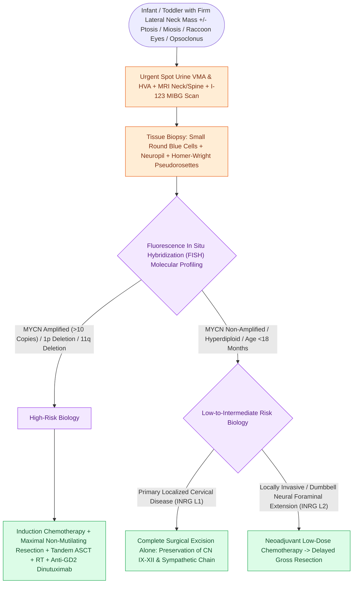

# Pediatric head and neck neuroblastoma originates from neural crest sympathoadrenal precursors and carries prognosis dictated by MYCN amplification

## Active Recall

> [!question]- What is the cellular origin of neuroblastoma, what percentage arise primary in the head and neck, and what is its classic physical examination hallmark?
> *Answer / Clinical Rationale*: Neuroblastoma originates from primitive **pluripotent neural crest cells** destined to form the sympathetic nervous system ganglia and adrenal medulla. Approximately **$2\%\text{ to }5\%$** of all neuroblastomas arise primarily in the head and neck from the **cervical sympathetic chain** (cervical ganglia). The classic physical examination hallmark is a firm, non-tender, fixed lateral neck mass associated with ipsilateral **Horner syndrome** (ptosis, miosis, anhidrosis, and **heterochromia iridis** if the disruption of sympathetic innervation to ocular melanocytes occurs in early infancy).

> [!question]- What pathognomonic clinical syndromes and metastatic presentations characterize pediatric neuroblastoma?
> *Answer / Clinical Rationale*:
> 1. **Orbital Metastasis ("Raccoon Eyes")**: Hematogenous metastasis to the periorbital bones and sphenoid wing produces unilateral or bilateral **proptosis, periorbital ecchymoses, and subconjunctival hemorrhage**, frequently mimicking child abuse or basilar skull fracture.
> 2. **Opsoclonus-Myoclonus-Ataxia Syndrome ("Dancing Eyes, Dancing Feet")**: A paraneoplastic autoimmune syndrome characterized by chaotic multidirectional saccadic eye movements, myoclonic jerking of the extremities, and ataxia; typically associated with localized, low-stage, $MYCN$-non-amplified neuroblastomas with favorable oncologic outcomes but severe long-term neurocognitive sequelae.
> 3. **Kerner-Morrison Syndrome**: Severe, refractory, watery secretory diarrhea caused by tumor hypersecretion of **vasoactive intestinal peptide (VIP)**.
> 4. **"Blueberry Muffin" Baby**: Multiple subcutaneous blue-gray metastatic skin nodules seen in neonates with disseminated disease.

> [!question]- Which biochemical tests, imaging modalities, and cytogenetic markers establish diagnosis, staging, and risk stratification?
> *Answer / Clinical Rationale*:
> - **Biochemical Markers**: Spot or 24-hour urine collection for catecholamine metabolites: **homovanillic acid (HVA)** and **vanillylmandelic acid (VMA)** are elevated in over **$90\%$** of neuroblastomas.
> - **Nuclear Scintigraphy**: **$^{123}\text{I-MIBG}$ (metaiodobenzylguanidine)** scintigraphy provides high sensitivity ($>90\%$) and specificity for detecting primary and metastatic disease by binding norepinephrine transporters on neuroendocrine cells.
> - **Cross-Sectional Imaging**: MRI and CT of the neck and skull base identify tumor calcifications ($>80\%$), encasement of the carotid sheath, and **"dumbbell" extension through the neural foramina** into the spinal canal with cord compression.
> - **Histopathology**: Small round blue cells embedded in an eosinophilic fibrillary background (**neuropil**), forming **Homer-Wright pseudorosettes** (neuroblasts arranged circumferentially around a central core of primitive neuritic processes).
> - **Molecular Genetics**: **$MYCN$ (N-myc) proto-oncogene amplification** ($>10$ copies) is the single strongest adverse genetic predictor, conferring rapid progression and therapy resistance regardless of age or stage. Additional poor-prognosis markers include **$1p$ deletion, $11q$ deletion**, and diploid DNA index; in contrast, hyperdiploidy and $TrkA$ expression predict favorable spontaneous regression or maturation.

## Core Clinical & Mechanistic Principles

Neuroblastoma is the most common extracranial solid tumor of infancy ($<1\text{ year}$) and the third most common pediatric cancer overall. Cervical sympathetic neuroblastoma typically has a more favorable biology and prognosis than abdominal/adrenal primaries, provided $MYCN$ is non-amplified.

### INRG Risk Stratification & Clinical Prognostic Features

| Risk Group | Age & Stage (INRG) | Molecular Profile ($MYCN$) | Clinical Behavior | Standard Management Paradigm | Overall Survival |
| :--- | :--- | :--- | :--- | :--- | :--- |
| **Very Low Risk** | Any age, Stage L1 (localized without image-defined risk factors [IDRFs]) | Non-amplified | Indolent; primary cervical masses often amenable to upfront resection | Complete surgical excision alone; observation for small perinatal adrenal lesions | **$>95\%$** |
| **Low Risk** | Infants $<18\text{ months}$, Stage L2 (localized with IDRFs) or Stage MS | Non-amplified | Spontaneous maturation into ganglioneuroma or regression | Conservative surgical resection $\pm$ minimal carboplatin/etoposide chemotherapy | **$>90\%$** |
| **Intermediate Risk** | Children $>18\text{ months}$ with L2 disease, or infants with metastatic disease | Non-amplified | Moderate invasiveness; dumbbell neuroforaminal involvement common | Neoadjuvant chemotherapy (4–8 cycles) followed by surgical resection; RT reserved for progression | **$\sim 80\%\text{--}90\%$** |
| **High Risk** | Any age with $MYCN$ amplification, or $>18\text{ months}$ with Stage M (distant mets) | **$MYCN$ amplified** ($>10$ copies) | Highly aggressive, explosive dissemination to cortical bone, marrow, liver | Intensive induction chemotherapy, gross tumor resection, tandem autologous SCT, radiation, anti-GD2 dinutuximab + GM-CSF | **$<50\%$** |

### Surgical Pearls for Primary Cervical Neuroblastoma

1. **Anatomical Relationships**:
   - Arises from the cervical sympathetic ganglia located deep to the carotid sheath along the prevertebral fascia (longus colli muscle).
   - Mobilization requires identification and preservation of the internal jugular vein, common/internal carotid arteries, vagus nerve, and lower cranial nerves (glossopharyngeal, accessory, hypoglossal).
   - **Postoperative Horner Syndrome**: Inevitable if the sympathetic trunk is sacrificed during en bloc tumor extirpation; parents must be counseled preoperatively regarding permanent mild ptosis, miosis, and lack of facial flushing on the ipsilateral side.

2. **Dumbbell Tumor Extension**:
   - Up to $10\%\text{ to }15\%$ of cervical neuroblastomas extend medially through the neural foramina into the epidural space.
   - Preoperative MRI of the entire spinal cord is mandatory to exclude subclinical spinal cord compression.
   - Requires combined single-stage transcervical and neurosurgical posterior laminectomy / laminoplasty if cord impingement is present.

Comprehensive physiological and surgical principles connect these findings directly to [[The RET proto-oncogene dictates medullary thyroid carcinoma aggression and timing of prophylactic thyroidectomy in MEN 2|neural crest oncogenesis]].

## Connected Concepts & Graph Traversal
- **Small Round Blue Cell Tumors**: [[Sinonasal small round blue cell tumors are differentiated by immunohistochemistry into SNUC, olfactory neuroblastoma, melanoma, lymphoma, and rhabdomyosarcoma|Small Round Blue Cell Diagnostic Panel]]
- **Pediatric Neck Masses**: [[Fibromatosis coli presents as a benign neonatal sternocleidomastoid mass causing congenital muscular torticollis|Neonatal Lateral Neck Masses]]
- **Cervical Lymphadenopathy**: [[Pediatric head and neck lymphomas present as painless cervical lymphadenopathy staged by Ann Arbor and St Jude systems|Pediatric Lymphoma Staging & Features]]
- **Congenital Neck Differential**: [[Lymphatic malformations are slow-flow vascular anomalies classified into macrocystic and microcystic lesions|Lateral Neck Mass Differential]]
- **Rhabdomyosarcoma Differential**: [[Pediatric head and neck rhabdomyosarcoma stratifies into favorable orbital and unfavorable parameningeal sites managed with multimodality chemoradiation|Pediatric Rhabdomyosarcoma Protocol]]
