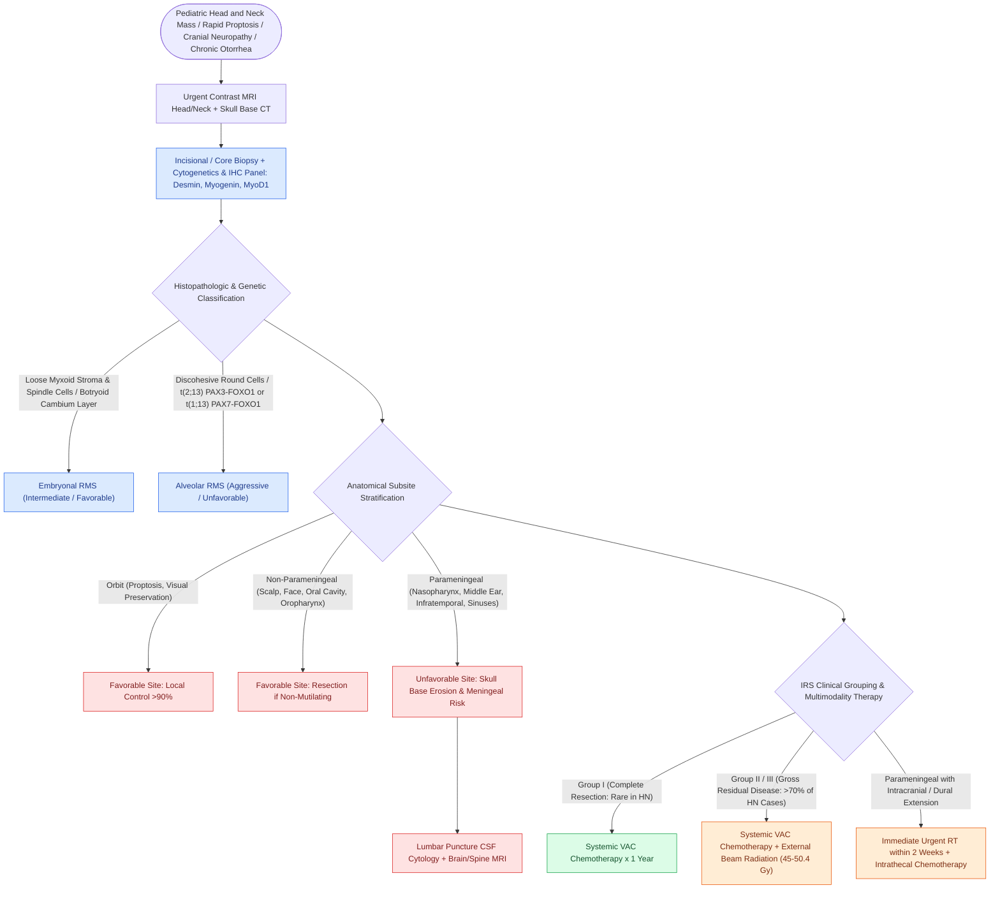

# Pediatric head and neck rhabdomyosarcoma stratifies into favorable orbital and unfavorable parameningeal sites managed with multimodality chemoradiation

## Active Recall

> [!question]- How are pediatric head and neck rhabdomyosarcoma anatomic sites categorized, and why is parameningeal location considered unfavorable?
> *Answer / Clinical Rationale*: Head and neck RMS sites are divided into **Orbit** (favorable, excellent local control and survival $>85\%$), **Non-Parameningeal** (favorable / intermediate: scalp, face, oral cavity, oropharynx), and **Parameningeal** (unfavorable: nasopharynx, middle ear / mastoid, infratemporal fossa, pterygopalatine fossa, and paranasal sinuses). Parameningeal sites carry a poor prognosis due to their proximity to the skull base, frequent cranial nerve palsies (CN III, IV, V, VI, VII), early osseous skull base erosion, and high propensity for **direct intracranial / leptomeningeal extension**, which mandates lumbar puncture CSF cytology, whole-neuroaxis MRI staging, and urgent external beam radiation therapy.

> [!question]- What are the defining histological and cytogenetic differences between embryonal and alveolar rhabdomyosarcoma?
> *Answer / Clinical Rationale*: **Embryonal RMS** ($\sim 60\%\text{ to }70\%$ of pediatric cases, peak age $<5\text{ years}$) features alternating dense cellular and loose myxoid stroma with spindle-shaped rhabdomyoblasts and cross-striated "strap cells"; it includes the **botryoid variant** (polypoid "grape-like" mass beneath mucous membranes with a dense subepithelial *cambium layer*) and carries a favorable-to-intermediate prognosis without consistent translocations (often $11p15$ loss of heterozygosity). **Alveolar RMS** ($\sim 20\%\text{ to }25\%$, peak in adolescents) features small, uniform round cells detached from central fibrovascular septa creating an appearance mimicking pulmonary alveoli; it is highly aggressive with poor survival and is driven by pathognomonic reciprocal translocations: **$t(2;13)(q35;q14)$** encoding the **$PAX3\text{--}FOXO1$** fusion transcript ($75\%$) or **$t(1;13)(p36;q14)$** encoding **$PAX7\text{--}FOXO1$** ($10\%$). Both subtypes stain positive for **Desmin**, **Myogenin** (diffuse nuclear positivity in alveolar), and **MyoD1**.

> [!question]- How does the Intergroup Rhabdomyosarcoma Study (IRS) clinical grouping system direct surgical and adjuvant therapy?
> *Answer / Clinical Rationale*: The IRS grouping is based on the extent of disease following initial surgical exploration:
> - **Group I**: Localized disease completely resected with negative margins (rare in head and neck, $<10\%$).
> - **Group II**: Gross total resection with microscopic positive margins or completely resected regional lymph nodes.
> - **Group III**: Incomplete resection or diagnostic biopsy with gross residual disease (most common head/neck presentation, $>70\%$).
> - **Group IV**: Distant metastatic disease at presentation (lungs, bone, bone marrow).
> Surgical resection is indicated **only if complete gross excision can be accomplished without functional sacrifice or mutilation**. Mutilating radical resections (e.g., orbital exenteration) are contraindicated because RMS is exquisitely chemosensitive and radiosensitive; management relies on diagnostic biopsy followed by multi-agent chemotherapy (**VAC**: Vincristine, Actinomycin D, Cyclophosphamide) and external beam radiation therapy ($\sim 45\text{--}50.4\text{ Gy}$) for all Group II–IV and parameningeal tumors.

## Core Clinical & Mechanistic Principles

Rhabdomyosarcoma (RMS) is the most common soft-tissue sarcoma of childhood, accounting for over $50\%$ of soft-tissue sarcomas and $35\%\text{ to }40\%$ of all pediatric head and neck non-epithelial malignancies. Management requires multidisciplinary COG-directed chemoradiotherapy, reserving surgery for initial tissue biopsy or non-morbid gross excision.

### Anatomic Subsite Prognostic Breakdown

| Anatomic Category | Specific Anatomical Subsites | Clinical Presentation & Danger Signs | Prognosis (5-Year OS) | Radiation Requirement |
| :--- | :--- | :--- | :--- | :--- |
| **Orbital** *(Favorable)* | Intraconal / extraconal orbit | Rapid onset painless proptosis, chemosis, diplopia; bone erosion rare | **$>85\%\text{--}90\%$** | Local RT tailored to response; orbital exenteration **strictly avoided** |
| **Non-Parameningeal** *(Favorable)* | Scalp, forehead, facial soft tissues, oral cavity, oropharynx, larynx | Painless, firm, rapidly enlarging soft tissue or mucosal mass | **$\sim 70\%\text{--}80\%$** | Local RT for Group II/III disease following non-mutilating wide excision |
| **Parameningeal** *(Unfavorable)* | Nasopharynx, middle ear/mastoid, sphenoid/ethmoid sinuses, pterygopalatine & infratemporal fossae | Bloody otorrhea, cranial neuropathies (CN III, IV, V, VI, VII), nasal obstruction, headache | **$<50\%\text{--}65\%$** | **Mandatory high-dose RT** (45–50.4 Gy); urgent RT within 2 weeks if skull base/meningeal breach |

### Histopathology & Molecular Cytogenetics

1. **Embryonal Rhabdomyosarcoma (ERMS)**:
   - Accounts for $\sim 65\%$ of cases; peak incidence under 5 years old.
   - Alternating hypercellular and hypocellular loose myxoid fields containing primitive mesenchymal cells and elongated tadpole- or strap-shaped rhabdomyoblasts with cross-striations.
   - **Botryoid Variant**: Arises beneath mucosal surfaces (nasopharynx, middle ear), forming soft, polypoid, glistening clusters resembling a "bunch of grapes". Histology shows a dense condensation of rhabdomyoblasts beneath the intact mucosal surface (**Nicholson's cambium layer**).
   - Molecular: Loss of heterozygosity at $11p15.5$ (loss of maternal IGF2 imprinting).

2. **Alveolar Rhabdomyosarcoma (ARMS)**:
   - Accounts for $\sim 20\%$ to $25\%$; peak incidence in adolescents and young adults.
   - Nests of uniform, small, round blue cells loosely adherent to central fibrovascular trabeculae, with detached central cells floating within empty alveolar spaces.
   - Pathognomonic reciprocal chromosomal translocations:
     - **$t(2;13)(q35;q14)$**: Fuses the DNA-binding domain of $PAX3$ with the transactivation domain of $FOXO1$ ($75\%$).
     - **$t(1;13)(p36;q14)$**: Fuses $PAX7$ with $FOXO1$ ($10\%$).
   - Diffuse, intense nuclear **Myogenin** expression and high metastatic propensity.

Comprehensive physiological and surgical principles connect these findings directly to [[Transcribriform EEA provides access to olfactory groove meningiomas and esthesioneuroblastomas|skull base surgical corridors]].

## Connected Concepts & Graph Traversal
- **Small Round Blue Cell Differential**: [[Sinonasal small round blue cell tumors are differentiated by immunohistochemistry into SNUC, olfactory neuroblastoma, melanoma, lymphoma, and rhabdomyosarcoma|Sinonasal SRBCT Immunohistochemical Profile]]
- **Radiobiology Principles**: [[Altered radiation fractionation schemes exploit differential repair and repopulation kinetics to optimize the therapeutic ratio in head and neck cancer|Radiobiology and Fractionation in Pediatric Head and Neck Cancer]]
- **Pediatric Airway Stridor**: [[Inspiratory, biphasic, and expiratory stridor localize pediatric airway obstruction to supraglottic, subglottic, and tracheobronchial subsites|Pediatric Airway Stridor Evaluation]]
- **Cervical Lymphadenopathy**: [[Pediatric head and neck lymphomas present as painless cervical lymphadenopathy staged by Ann Arbor and St Jude systems|Pediatric Lymphoma Staging & Workup]]
- **Sympathetic Neoplasms**: [[Pediatric head and neck neuroblastoma originates from neural crest sympathoadrenal precursors and carries prognosis dictated by MYCN amplification|Pediatric Neuroblastoma of the Cervical Chain]]
