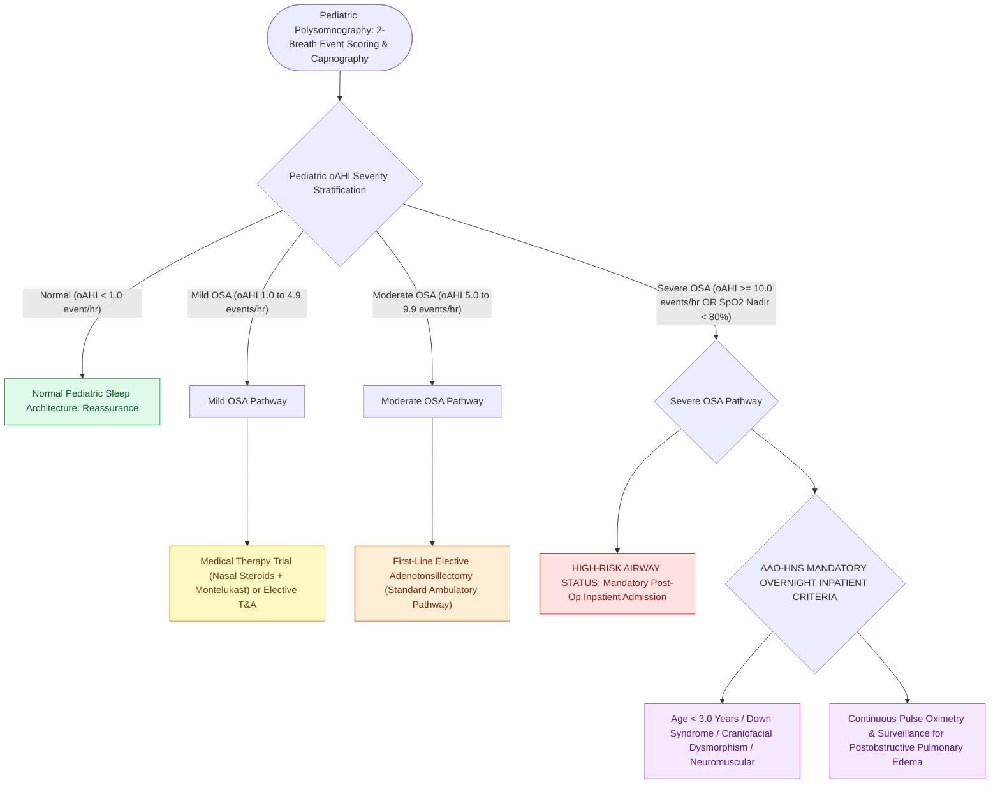

# Pediatric polysomnography criteria define obstructive sleep apnea with an obstructive apnea-hypopnea index exceeding one

## Active Recall

> [!question]- What is the minimum obstructive Apnea-Hypopnea Index (oAHI) threshold defining pediatric OSA?
> *Answer / Clinical Rationale*: An **$\text{oAHI} \ge 1.0\text{ event per hour}$** (unlike adults where $\text{AHI} < 5$ is normal, $>1$ event/hr is considered abnormal in children).

> [!question]- What oAHI threshold defines severe pediatric obstructive sleep apnea?
> *Answer / Clinical Rationale*: An **$\text{oAHI} \ge 10.0\text{ events per hour}$** (or a nadir oxygen saturation $<80\%$).

> [!question]- Which clinical criteria mandate overnight hospital admission following pediatric adenotonsillectomy?
> *Answer / Clinical Rationale*: **Age $<3\text{ years}$**, **severe OSA ($\text{oAHI} \ge 10$ or nadir $<80\%$)**, **Down syndrome or craniofacial malformations**, neuromuscular disorders, and pulmonary hypertension.

## Core Clinical & Mechanistic Principles
**Pediatric Polysomnography (PSG)** utilizes distinct scoring criteria and severity thresholds compared to adult sleep studies, reflecting the greater vulnerability of developing children to intermittent hypoxia:
- **Pediatric Scoring Rules (AASM Guidelines)**:
  - **Obstructive Apnea**: A drop in respiratory airflow by $\ge 90\%$ for at least the **duration of 2 baseline breaths**, accompanied by continued respiratory effort.
  - **Obstructive Hypopnea**: A drop in airflow by $\ge 30\%$ for $\ge 2$ breaths with $\ge 3\%$ oxygen desaturation OR an electroencephalographic arousal.
- **Pediatric OSA Severity Stratification by Obstructive AHI (oAHI)**:
  - **Normal**: $\text{oAHI} < 1.0\text{ event/hour}$.
  - **Mild OSA**: $\text{oAHI} = 1.0\text{ to }4.9\text{ events/hour}$.
  - **Moderate OSA**: $\text{oAHI} = 5.0\text{ to }9.9\text{ events/hour}$.
  - **Severe OSA**: $\mathbf{\text{oAHI} \ge 10.0\text{ events/hour}}$ (or $\text{nadir } \text{SpO}_2 < 80\%$).
- **End-Tidal CO2 ($\text{EtCO}_2$) Monitoring**:
  - Mandatory in pediatric PSG to detect **obstructive hypoventilation** ($\text{EtCO}_2 > 50\text{ mmHg}$ for $>25\%$ of total sleep time).

### Surgical Technique & Critical Safety Checks
- **Indications for Polysomnography (AAO-HNS Guidelines)**: Mandatory prior to [[Adenotonsillectomy is the first-line surgical treatment for pediatric obstructive sleep apnea|adenotonsillectomy]] in children with obesity, Down syndrome, craniofacial abnormalities, neuromuscular disorders, sickle cell disease, or discordance between tonsil size and symptoms.
- **Mandatory Overnight Inpatient Admission Criteria Following Adenotonsillectomy**:
  - AAO-HNS clinical guidelines mandate **inpatient admission with continuous pulse oximetry** for children with any of the following high-risk features:
    1. **Age $<3.0\text{ years}$**.
    2. **Severe OSA**: $\text{oAHI} \ge 10.0\text{ events/hour}$ or oxygen saturation nadir $<80\%$.
    3. **Systemic Complications of OSA**: Cor pulmonale, pulmonary hypertension, failure to thrive (FTT).
    4. **Craniofacial / Syndromic Anatomy**: Down syndrome (Trisomy 21), achondroplasia, Pierre Robin sequence, craniofacial dysostosis.
    5. **Neuromuscular Disorders**: Cerebral palsy, muscular dystrophies, hypotonia.
    6. **Living $>60\text{ minutes}$ from a surgical hospital** or unreliable home care.

## Connected Concepts & Graph Traversal
- **Adult OSA Criteria**: [[Adult polysomnography criteria define obstructive sleep apnea severity by apnea-hypopnea index thresholds of five, fifteen, and thirty|Adult OSA PSG Criteria]]
- **T&A for Pediatric OSA**: [[Adenotonsillectomy is the first-line surgical treatment for pediatric obstructive sleep apnea|Adenotonsillectomy & Overnight Admission]]
- **McGill Oximetry Scoring**: [[Nocturnal pulse oximetry McGill score stratifies pediatric obstructive sleep apnea severity|McGill Oximetry Protocol]]
- **Critical Closing Pressure**: [[The Starling resistor model explains upper airway collapsibility and critical closing pressure Pcrit|Starling Resistor Model & Pcrit]]
- **Pediatric DISE**: [[Pediatric DISE identifies persistent multi-level airway collapse following adenotonsillectomy|Pediatric Drug-Induced Sleep Endoscopy]]
- **Tonsillectomy Guidelines**: [[Paradise criteria define evidence-based indications for pediatric tonsillectomy in recurrent throat infections|Paradise Tonsillectomy Criteria]]
- **Diagnostic Evaluation**: [[Polysomnographic event criteria differentiate obstructive, central, and mixed apneas through airflow sensors and thoracoabdominal effort monitoring|Sensor-Level Event Scoring Underlying Pediatric OAHI]]
