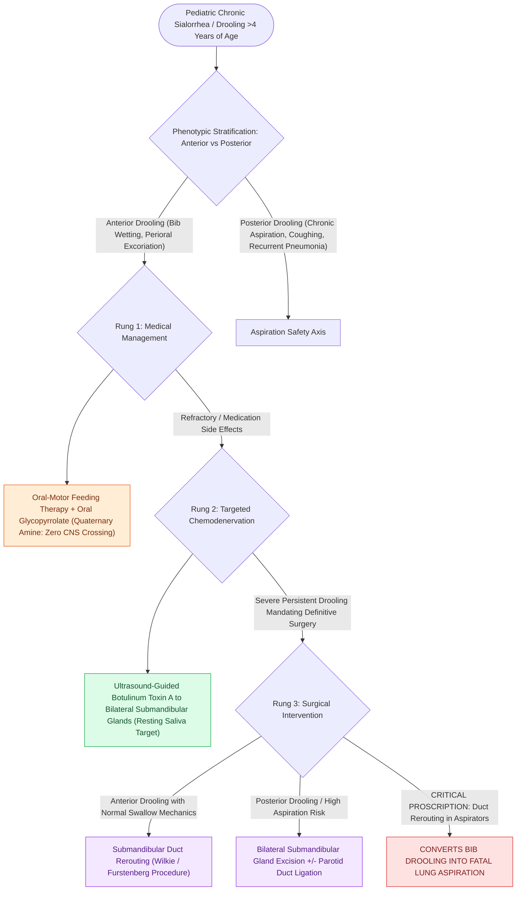

# Pediatric sialorrhea is managed along a ladder from anticholinergics and botulinum toxin to duct surgery

## Active Recall

> [!question]- Why are the submandibular glands the primary toxin target rather than the parotids?
> *Answer / Clinical Rationale*: They generate the majority of resting (unstimulated) saliva — the drooling substrate; parotids dominate only stimulated flow.

> [!question]- Why is duct rerouting contraindicated in the child with posterior drooling?
> *Answer / Clinical Rationale*: Rerouting redirects saliva toward the pharynx — in an aspirator it converts a bib problem into a lung problem.

## Core Clinical & Mechanistic Principles
- Framing: drooling past age four (or any age with skin breakdown, social burden, or **posterior drooling with aspiration**) in neurologically affected children (cerebral palsy dominant) is a treatable condition, not an inevitability — and anterior (bib) versus posterior (lung) drooling are different diseases.
- Ladder rung one: oral-motor/behavioral therapy and posture, plus medication — **glycopyrrolate** (quaternary, less CNS penetration) or scopolamine patches, side-effect-limited (constipation, urinary retention, thickened secretions).
- Rung two: **ultrasound-guided botulinum toxin to submandibular (± parotid) glands** — the submandibular glands produce most resting saliva, making them the primary target; effect lasts months and doubles as a surgical trial.
- Rung three: surgery — submandibular duct rerouting (contraindicated with aspiration — it sends saliva backward), submandibular gland excision, or ductal ligations, selected by the anterior/posterior distinction.

### Management & Critical Safety Checks
- Anchor decisions to the aspiration axis: posterior drooling with pneumonias pushes toward secretion reduction (toxin, gland excision), never rerouting.
- Quantify outcomes (drooling scales, bib counts, pneumonia frequency) — this is quality-of-life surgery and the metric is the family's day (see [[Ankyloglossia release is indicated for functional breastfeeding impairment rather than appearance|Ankyloglossia Release]]).

## Connected Concepts & Graph Traversal
- **Ankyloglossia & Tongue Function**: [[Ankyloglossia release is indicated for functional breastfeeding impairment rather than appearance|Ankyloglossia Release]]
- **Robin Airway Glossoptosis**: [[Pierre Robin sequence manifests with micrognathia, glossoptosis, and secondary U-shaped cleft palate|Pierre Robin Sequence]]
- **Palatoplasty Repairs**: [[Two-flap palatoplasty and Furlow double-reversing Z-plasty reconstruct the hard and soft palate musculature|Palatoplasty Repairs]]
- **Velopharyngeal Insufficiency**: [[Velopharyngeal insufficiency VPI causes hypernasal resonance and nasal air emission during speech|Velopharyngeal Insufficiency]]
- **Pediatric Airway Noise**: [[Pediatric stertor and stridor differentiate upper supraglottic airway obstruction from intrathoracic tracheobronchial disease|Pediatric Stridor]]
