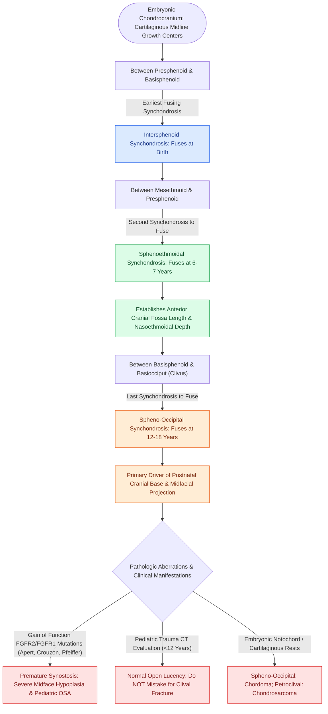

# Pediatric skull base synchondroses guide craniofacial growth and ossify in a predictable sequence from anterior to posterior

## Active Recall

> [!question]- What are the three midline skull base synchondroses, what is their anatomical location, and in what chronological sequence do they ossify?
> *Answer / Clinical Rationale*: The three primary midline cranial base synchondroses are cartilaginous growth plates (primary cartilaginous joints) that drive endochondral ossification of the chondrocranium, ossifying in a strict **anterior-to-posterior sequence**:
> 1. **Intersphenoid Synchondrosis**: Located between the presphenoid and basisphenoid ossification centers; fuses **at birth** (perinatal period).
> 2. **Sphenoethmoidal Synchondrosis**: Located between the posterior ethmoid (mesethmoid) and presphenoid; fuses at **6 to 7 years of age**, completing the growth of the anterior cranial fossa and anterior midface.
> 3. **Spheno-Occipital Synchondrosis (SOS / Clival Synchondrosis)**: Located between the basisphenoid and basiocciput; fuses latest, between **12 and 18 years of age** (pubertal growth through late adolescence). It serves as the principal growth engine driving anteroposterior elongation of the cranial base, pharyngeal depth, and forward projection of the midfacial complex.

> [!question]- How does premature fusion of skull base synchondroses contribute to the craniofacial phenotype in syndromic craniosynostoses?
> *Answer / Clinical Rationale*: In syndromic craniosynostoses (such as **Crouzon, Apert, and Pfeiffer syndromes** driven by gain-of-function **FGFR2 and FGFR1 mutations**), the mutation causes premature osseous fusion not only of the calvarial sutures, but also of the **cranial base synchondroses** (especially the sphenoethmoidal and spheno-occipital synchondroses). Premature synostosis of these cartilaginous growth centers arrests the forward and downward translation of the midface, resulting in severe **cranial base shortening, maxillary and midface hypoplasia (Class III malocclusion)**, shallow orbits with prominent **exorbitism/proptosis**, and significant circumferential narrowing of the nasopharynx and hypopharynx that causes **severe, multilevel pediatric obstructive sleep apnea**.

> [!question]- What is the radiological, surgical, and oncologic significance of the spheno-occipital synchondrosis in otolaryngology?
> *Answer / Clinical Rationale*:
> - **Radiologic Mimicry**: On high-resolution CT scans of pediatric head trauma, the unossified, radiolucent, open spheno-occipital synchondrosis in children under 12 years old must **not be mistaken for a traumatic clival fracture** or skull base diastasis.
> - **Pediatric Endoscopic Skull Base Surgery**: During expanded endoscopic endonasal approaches (EEA) to the pediatric ventral skull base, aggressive electrocautery, drilling, or wide stripping of the clival perichondrium/cartilage across an open SOS risks **iatrogenic premature growth arrest**, resulting in severe secondary midface retrusion.
> - **Neoplastic Origin Site**: Skull base synchondroses are predilection sites for specific malignancies: embryonic notochordal rests at the **spheno-occipital synchondrosis** give rise to **clival chordomas**, whereas cartilaginous remnants at the **petroclival and sphenopetrosal synchondroses** give rise to **skull base chondrosarcomas**.

## Core Clinical & Mechanistic Principles

The cranial base develops through endochondral ossification within the embryonic cartilaginous chondrocranium. Unlike the calvarial vault (which expands via intramembranous ossification under brain pressure), the skull base is governed by intrinsic cartilaginous growth plates called **synchondroses**, which feature bipolar growth zones that expand bidirectionally.

### Anatomical & Chronological Ledger: Skull Base Synchondroses

| Synchondrosis | Anatomical Boundaries | Histological Growth Zone | Age of Radiographic & Histologic Closure | Functional & Developmental Impact | Associated Pathologies & Surgical Pearls |
| :--- | :--- | :--- | :--- | :--- | :--- |
| **Intersphenoid Synchondrosis** | Between presphenoid and postsphenoid (basisphenoid) | Bipolar endochondral cartilaginous plate | **At birth** (perinatal period / 0 months) | Fuses prior to major postnatal facial development | Rarely implicated in postnatal disease; sets early pituitary fossa geometry |
| **Sphenoethmoidal Synchondrosis** | Between mesethmoid (perpendicular plate) and presphenoid | Bipolar growth plate | **6 to 7 years** of age | Dictates anterior cranial base length and early upper midface projection | Early closure restricts anterior fossa development; landmark during pediatric sinus/anterior EEA |
| **Spheno-Occipital Synchondrosis (SOS)** | Between basisphenoid and basiocciput (mid-clivus) | Robust bidirectional bipolar proliferating cartilage | **12 to 18 years** (pubertal growth spurt to adulthood) | **Principal growth center** driving cranial base elongation, pharyngeal airway, and maxillary advancement | Premature closure causes severe midface retrusion; normal radiolucent lucency on pediatric CT; site of **clival chordoma** |
| **Petroclival Synchondrosis** | Laterally between petrous apex and basiocciput | Multipolar synchondrosis | Fuses in late adolescence / early adulthood ($>16\text{ years}$) | Mediates lateral expansion of posterior and middle cranial fossae | Arising site of **skull base chondrosarcomas**; boundary for transclival endoscopic approaches |

### Pathophysiological & Surgical Implications

1. **Syndromic Craniosynostosis (FGFR Mutations)**:
   - In FGFR-driven disorders (Apert, Crouzon, Pfeiffer), abnormal fibroblastic growth factor signaling accelerates chondrocyte differentiation into osteoblasts.
   - Premature synchondrosis fusion halts the anteroposterior vector of the basicranium. The maxilla, which is tethered to the anterior skull base, cannot translate forward, resulting in characteristic dish-face midface hypoplasia, severe Class III malocclusion, and dramatic pharyngeal airway constriction that frequently requires **neonatal tracheostomy or early midface distraction osteogenesis (Le Fort III / monobloc distraction)**.

2. **Pediatric Endoscopic Endonasal Skull Base Surgery (EEA)**:
   - In children under 10 years old undergoing EEA for craniopharyngioma, chordoma, or skull base encephaloceles, the sphenoid sinus is often poorly pneumatized (conchal or presellar type) and synchondroses remain open.
   - Surgeons must avoid uncurbed coagulation or excessive drilling across the open SOS to prevent iatrogenic growth arrest.

3. **Trauma Differentiation on CT**:
   - Thin-cut bone-window CT scans in pediatric trauma routinely demonstrate a clean, smooth, corticated linear lucency transversing the mid-clivus.
   - **Diagnostic Rule**: Symmetrical, smoothly corticated margin with predictable midline orientation represents the normal unossified **spheno-occipital synchondrosis**; jagged, displaced, asymmetrical, or non-corticated lucencies denote true clival fractures.

Comprehensive physiological and surgical principles connect these findings directly to [[Multi-layer skull base reconstruction combines underlay, inlay, and overlay barriers|skull base reconstruction]].

## Connected Concepts & Graph Traversal
- **Syndromic Craniosynostosis**: [[Apert syndrome combines acrocephalosyndactyly from FGFR2 mutations with complex hand-foot syndactyly and cleft palate|Apert Syndrome Cranial Base & Midface Pathophysiology]]
- **Crouzon Phenotype**: [[Crouzon syndrome exhibits FGFR2-mediated craniosynostosis with ocular proptosis, midface hypoplasia, and normal extremities|Crouzon Syndrome & Midface Hypoplasia]]
- **Bicoronal Craniosynostosis**: [[Pfeiffer syndrome features FGFR1 and FGFR2 mutations causing bicoronal craniosynostosis, broad thumbs and great toes, and severe midface hypoplasia|Pfeiffer Syndrome]]
- **🔗 Clival Surgical Corridors (Sinus)**: [[Transclival EEA provides midline access to clival chordomas and chondrosarcomas|Transclival EEA and Petroclival Synchondroses]]
- **Pediatric OSA & Maxillary Deficiencies**: [[Pediatric polysomnography criteria define obstructive sleep apnea with an obstructive apnea-hypopnea index exceeding one|Pediatric Obstructive Sleep Apnea Evaluation]]
