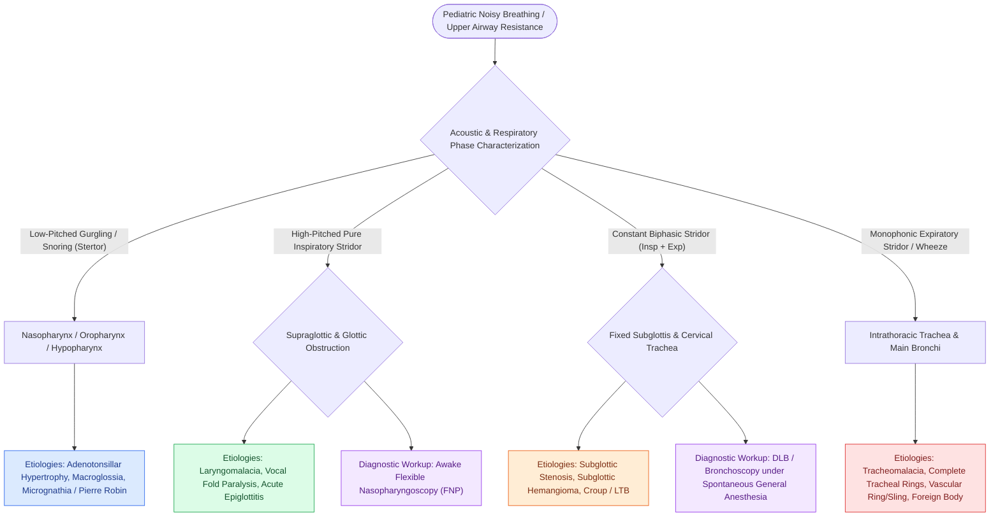

# Pediatric stertor and stridor differentiate upper supraglottic airway obstruction from intrathoracic tracheobronchial disease

## Active Recall

> [!question]- How does the respiratory phase of stridor (inspiratory vs. biphasic vs. expiratory) dictate the anatomical site of airway narrowing?
> *Answer / Clinical Rationale*: **Inspiratory stridor** denotes **supraglottic or glottic obstruction** (where negative inspiratory pressure draws flaccid extrathoracic tissues inward); **biphasic stridor** indicates a **fixed subglottic or upper cervical tracheal lesion** (constant narrowing across both phases); **expiratory stridor** localizes to the **intrathoracic trachea or bronchial tree** (where positive intrathoracic expiratory pressures dynamic collapse the intrathoracic lumen).

> [!question]- What is the most common cause of congenital inspiratory stridor in neonates and infants?
> *Answer / Clinical Rationale*: **Laryngomalacia**, characterized by dynamic inward prolapse of supraglottic tissues (elongated curled epiglottis, redundant arytenoid mucosa, shortened aryepiglottic folds) during inspiration.

## Core Clinical & Mechanistic Principles

**Noisy breathing in pediatric patients** is a cardinal sign of compromised upper or lower airway laminar airflow. Acoustically and anatomically, turbulent sounds are categorized into **stertor**, **stridor**, and **wheezing**:

1. **Stertor**: A low-pitched, non-musical, snoring or gurgling sound generated by turbulent airflow through the **nasopharynx, oropharynx, or hypopharynx** (e.g., adenotonsillar hypertrophy, macroglossia, micrognathia/Pierre Robin sequence, nasal obstruction, retropharyngeal phlegmon).
2. **Stridor**: A harsh, high-pitched musical sound resulting from rapid, turbulent airflow through a narrowed airway segment extending from the **supraglottis to the extrathoracic trachea**. Stridor is phase-dependent:
   - **Inspiratory Stridor**: Localizes to the **supraglottis and glottis** (e.g., [[Laryngomalacia is the most common cause of congenital pediatric stridor characterized by dynamic supraglottic collapse|laryngomalacia]], vocal fold paralysis, [[Acute epiglottitis causes rapid supraglottic swelling with thumbprint sign and mandates controlled operating room intubation|acute epiglottitis]]). Dynamic negative intraluminal pressure during inspiration collapses pliable extrathoracic supraglottic tissues inward.
   - **Biphasic Stridor**: Localizes to the **fixed subglottis or cervical trachea** (e.g., subglottic stenosis, croup / [[Viral laryngotracheobronchitis croup presents with a barking cough and subglottic steeple sign on radiography|laryngotracheobronchitis]], [[Subglottic hemangiomas present as biphasic stridor in infants and respond to systemic oral propranolol|subglottic hemangioma]], foreign body).
   - **Expiratory Stridor / Wheeze**: Localizes to the **intrathoracic trachea and mainstem bronchi** (e.g., tracheomalacia, vascular rings/slings, lower [[Airway foreign body aspiration mandates rigid bronchoscopy despite normal radiographs|airway foreign body]]). Intrathoracic pressure increases during exhalation, compressing intrathoracic airways.

### Surgical Technique & Craft Nuance: Flexible Nasopharyngoscopy & Triple Endoscopy

1. **Awake Flexible Nasopharyngoscopy (FNP)**: The gold standard initial diagnostic procedure in the awake, spontaneously breathing infant. A 1.9 mm to 2.4 mm pediatric flexible fiberoptic scope is passed through the nares without topical anesthetic to visualize dynamic supraglottic collapse (laryngomalacia with omega-shaped epiglottis, shortened aryepiglottic folds, and retroverted arytenoids) and bilateral vocal fold mobility.
2. **Direct Laryngoscopy and Bronchoscopy (DLB / Triple Endoscopy)**: Indicated for biphasic or expiratory stridor, cyanosis, failure to thrive, atypical progression, or when a secondary synchronous airway lesion is suspected (occurs in 10–20% of laryngomalacia cases).
## References
1. Carter, J., Rahbar, R., Brigger, M., et al. (2016). International Pediatric ORL Group (IPOG) laryngomalacia consensus recommendations. *Int J Pediatr Otorhinolaryngol*, 86:256-261.
2. Dohar, J.E., Anne, S. (2013). Stridor, Aspiration, and Cough. In Johnson, J.J., Rosen, C.A. (Eds.), *Bailey’s Head and Neck Surgery-Otolaryngology* 5e (pp. 1338-1355). Baltimore, MD: Lippincott Williams & Wilkins.
3. Sidell, D.R., Messner, A.H. (2020). Evaluation and Management of the Pediatric Airway. In Flint, P.W., et al. (Eds.), *Cummings Otolaryngology Head and Neck Surgery* 7e (pp. 3053-3067). Philadelphia, PA: Elsevier.

## Connected Concepts & Graph Traversal
- **Primary Congenital Stridor**: [[Laryngomalacia is the most common cause of congenital pediatric stridor characterized by dynamic supraglottic collapse|Laryngomalacia Dynamic Collapse]]
- **Subglottic Stridor Grading**: [[Myer-Cotton grading system stratifies subglottic stenosis from Grade I less than fifty percent to Grade IV no lumen|Cotton-Myer Grading System]]
- **Emergency Medical Rescue**: [[Nebulized racemic epinephrine and oral dexamethasone provide rapid treatment for acute croup|Croup & Racemic Epinephrine]]
- **Foreign Body Differential**: [[Pediatric esophageal button battery impaction causes liquefaction necrosis within two hours and mandates emergent endoscopic extraction|Esophageal Button Battery]]
- **Airway Foreign Body**: [[Airway foreign body aspiration mandates rigid bronchoscopy despite normal radiographs|Airway Foreign Body Rigid Bronchoscopy]]
- **Acute Supraglottitis**: [[Acute epiglottitis causes rapid supraglottic swelling with thumbprint sign and mandates controlled operating room intubation|Acute Epiglottitis]]
