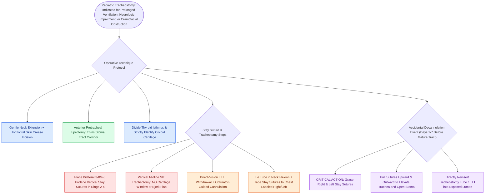

# Pediatric tracheostomy mandates horizontal skin incision, vertical tracheal split sparing the cricoid, and bilateral stay sutures to mitigate accidental decannulation

## Active Recall

> [!question]- Why are anterior tracheal window excision and Bjork flaps strictly contraindicated in pediatric and neonatal tracheostomy?
> *Answer / Clinical Rationale*: Infant tracheal cartilages are extremely small and compliant; excising an anterior cartilaginous window or fashioning an inferior Bjork flap leads to **loss of anterior structural support, stomal collapse, tracheomalacia, and severe acquired subglottic or upper tracheal stenosis**.

> [!question]- How are pediatric tracheal stay sutures placed and utilized during an emergency accidental decannulation?
> *Answer / Clinical Rationale*: Non-absorbable monofilament sutures (3-0 or 4-0 Prolene) are placed vertically through the tracheal rings on either side of the vertical midline incision, labeled **"Right" and "Left"**, and taped to the chest; pulling them upward and outward **elevates the trachea and opens the stoma**, guiding tube reinsertion before the tract matures.

## Core Clinical & Mechanistic Principles

Pediatric tracheostomy differs fundamentally from adult procedures due to distinctive neonatal and infant anatomy: a cephalad larynx, compliant pliable tracheal cartilages, high pleural cupolae, and a high-riding innominate artery across the lower trachea. The primary indications in modern practice include prolonged mechanical ventilation for bronchopulmonary dysplasia (BPD), craniofacial airway obstruction, and severe neurologic impairment requiring pulmonary toilet or as a salvage for [[Tracheostomy provides immediate definitive relief for severe life-threatening refractory obstructive sleep apnea]]:

### Unique Anatomical Hazards in Children
1. **High Pleural Domes**: Pleural apices rise higher into the root of the neck in infants; aggressive lateral dissection risks immediate pneumothorax or pneumomediastinum.
2. **Cricoid Proximity**: The subglottis is the narrowest point of the pediatric airway; incising or injuring the cricoid cartilage or first tracheal ring precipitates severe subglottic chondritis and circumferential stenosis.
3. **Pliable, Compressible Trachea**: Overzealous pressure can collapse the soft neonatal tracheal rings, predisposing to posterior tracheal wall puncture and tracheoesophageal fistula formation.

### Step-by-Step Operative Technique
- **Patient Positioning**: Place a small shoulder roll to achieve gentle neck extension. Overextension must be avoided as it draws the mediastinum into the cervical field, risking innominate artery injury.
- **Skin Incision**: A horizontal skin crease incision is planned approximately one-third of the distance from the lower border of the cricoid cartilage to the sternal notch. Dissection transitions to a strictly vertical midline plane through the subplatysmal fat.
- **Anterior Cervical Lipectomy**: Excision of the pretracheal subcutaneous fat pad (McMurray-Prescott technique) thins the soft-tissue corridor, mitigating false tract formation during postoperative cannula exchange.
- **Midline Strap Separation & Isthmus**: The midline linea alba is divided; strap muscles are retracted laterally. The thyroid isthmus is identified, cross-clamped, divided, and suture-ligated (or mobilized and swept inferiorly) to expose tracheal rings 2 through 4.
- **Placement of Tracheal Stay Sutures**: Before making the tracheotomy, bilateral vertical stay sutures of **3-0 or 4-0 monofilament polypropylene (Prolene)** are placed through the full thickness of the 2nd and 3rd (or 3rd and 4th) tracheal cartilages, positioned 2 to 3 mm lateral to the intended midline cut.
- **Vertical Midline Tracheotomy**:
  - A vertical slit incision is made strictly through the 2nd, 3rd, and 4th tracheal rings using a #15 blade.
  - **Cartilage Excision is Prohibited**: No cartilage is excised, and no Bjork flap is created.
- **Cannula Insertion & Verification**:
  - Lateral traction on the stay sutures splays open the vertical tracheotomy.
  - The oral endotracheal tube (ETT) is withdrawn under direct visualization until its tip lies just superior to the stoma.
  - An appropriately sized, uncuffed or tight-to-shaft pediatric tracheostomy tube (pre-fitted with its rounded obturator) is inserted into the lumen.
  - Connect ventilator and immediately confirm bilateral chest expansion and continuous end-tidal CO2 (ETCO2).
- **Securing the Tube & Stay Sutures**:
  - Tracheostomy ties are secured with the infant's neck in **neutral to flexed** position, allowing a single finger between tie and neck.
  - The right and left stay sutures are clearly labeled **"Right"** and **"Left"** with waterproof tape and secured flat to the anterior chest wall.

### Management of Accidental Decannulation
- The pediatric tracheocutaneous tract takes **5 to 7 days to mature**. Accidental decannulation prior to tract maturation is a life-threatening emergency because the compliant tracheal wall falls away into the pretracheal space.
- Pulling the right stay suture to the patient's right and the left stay suture to the left simultaneously lifts the trachea anteriorly to the skin surface and widely opens the stomal slit, allowing instantaneous, direct reinsertion of the cannula or an endotracheal tube without creating a false passage.
- The first routine tracheostomy tube change is performed by the surgical team at **Day 5 to 7**; stay sutures are removed only after the first change is successfully completed.

## Connected Concepts & Graph Traversal

- **Stridor Localization**: [[Inspiratory, biphasic, and expiratory stridor localize pediatric airway obstruction to supraglottic, subglottic, and tracheobronchial subsites]]
- **Laryngotracheal Reconstruction**: [[Single-stage and double-stage laryngotracheal reconstruction LTR repair mature high-grade subglottic stenosis]]
- **Slide Tracheoplasty**: [[Slide tracheoplasty expands complete tracheal rings by oblique division and sliding longitudinal reconstruction]]
- **Tracheomalacia Management**: [[Tracheomalacia causes dynamic expiratory tracheal collapse and is managed with posterior tracheobronchopexy]]
- **Neck Flexion Suture**: [[Postoperative chin-to-chest flexion stitch prevents catastrophic neck extension and tracheal anastomotic dehiscence]]
