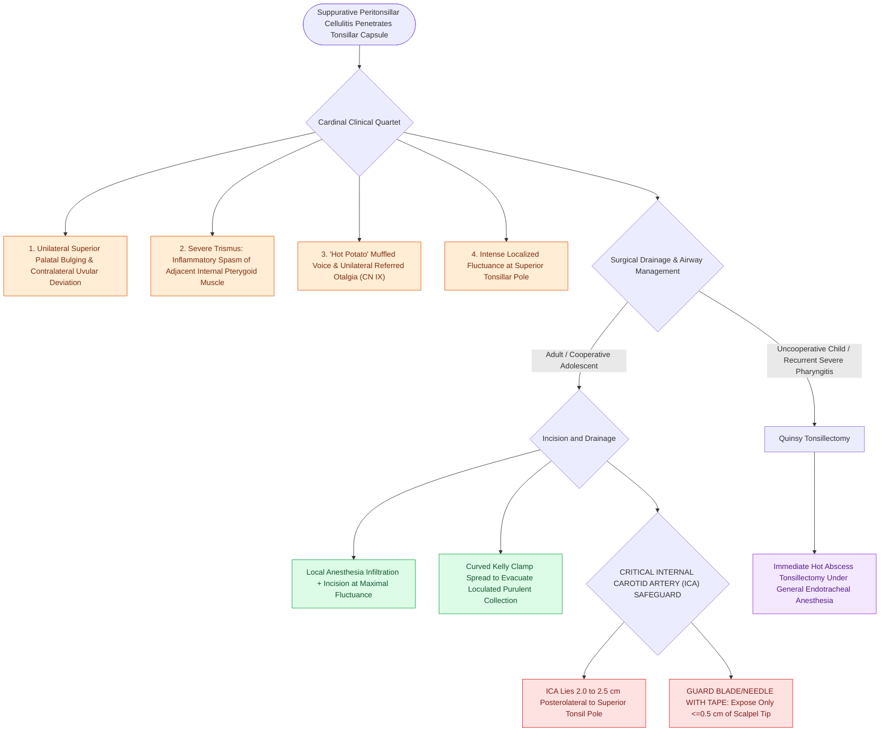

# Peritonsillar abscess presents with unilateral palatal fullness, uvular deviation, and trismus requiring drainage

## Active Recall

> [!question]- What muscle is irritated and spasms to cause trismus in a peritonsillar abscess?
> *Answer / Clinical Rationale*: The **internal (medial) pterygoid muscle**.

> [!question]- What major vascular structure lies approximately $2.0\text{ to }2.5\text{ cm}$ posterolateral to the tonsillar fossa that must be avoided during incision and drainage?
> *Answer / Clinical Rationale*: The **internal carotid artery**.

## Core Clinical & Mechanistic Principles
**Peritonsillar Abscess (PTA / Quinsy)** is the most common deep head and neck infection in children and young adults, occurring when suppurative infection penetrates the tonsillar capsule into the potential space between the **capsule of the palatine tonsil and the superior pharyngeal constrictor muscle**:
- **Pathophysiology & Microbiology**:
  - Arises from acute exudative tonsillitis or suppuration of the **Weber salivary glands** (minor salivary glands in the supratonsillar fossa).
  - *Microbiology*: Polymicrobial infection with **Group A Streptococcus (*Streptococcus pyogenes*)**, *Fusobacterium necrophorum*, *Streptococcus anginosus* group, and oral anaerobes.
- **The Cardinal Clinical Quartet**:
  1. **Severe Unilateral Sore Throat & Otalgia** (referred via CN IX).
  2. **Trismus**: Inability to open the mouth due to inflammatory irritation and spasm of the adjacent **internal pterygoid muscle**.
  3. **"Hot Potato" (Muffled) Voice**: Due to palatal edema and splinting.
  4. **Unilateral Superior Palatal Bulging with Contralateral Uvular Deviation**: Downward and medial displacement of the tonsil with uvula pushed to the opposite side.
- **Surgical Craft & Drainage Techniques**:
  - **Needle Aspiration vs. Incision and Drainage (I&D)**:
    - Topical/local anesthetic infiltration (1% lidocaine with 1:100,000 epinephrine).
    - Incise at the point of maximal fluctuance (typically superior-lateral to the tonsil pole) using a #11 blade wrapped with tape leaving only $0.5\text{ cm}$ of exposed tip (to **prevent laceration of the internal carotid artery** situated $2.0\text{–}2.5\text{ cm}$ posterolateral).
    - Spread with a curved Kelly clamp to evacuate all pus.
  - **Quinsy Tonsillectomy (Abscess Tonsillectomy)**: Indicated in uncooperative young children, recurrent tonsillitis, or failure of drainage.

### Surgical Technique & Critical Safety Checks
- **Pharmacotherapy**: IV Ampicillin-Sulbactam or Clindamycin + a single dose of IV Dexamethasone ($0.6\text{ mg/kg}$) to rapidly reduce pain and trismus (see [[Paradise criteria define evidence-based indications for pediatric tonsillectomy in recurrent throat infections|Paradise Tonsillectomy Criteria]]).

## Connected Concepts & Graph Traversal
- **Paradise Tonsillectomy Criteria**: [[Paradise criteria define evidence-based indications for pediatric tonsillectomy in recurrent throat infections|Paradise Tonsillectomy Criteria]]
- **Acute Tonsillitis Centor Score**: [[Pediatric acute bacterial tonsillitis is differentiated from viral pharyngitis using modified Centor criteria|Bacterial Tonsillitis Centor Score]]
- **Primary vs Secondary Hemorrhage**: [[Post-tonsillectomy hemorrhage is classified into primary within twenty-four hours and secondary beyond twenty-four hours|Post-Tonsillectomy Hemorrhage Timing]]
- **Severe Hemorrhage Resuscitation**: [[Severe secondary post-tonsillectomy hemorrhage requires urgent airway stabilization and surgical electrocautery|Severe Hemorrhage Airway Stabilization]]
- **Deep Neck Infection Spread**: [[Second branchial cleft anomalies represent the most common branchial anomaly situated anterior to the sternocleidomastoid|Lateral Cervical Infection]]
