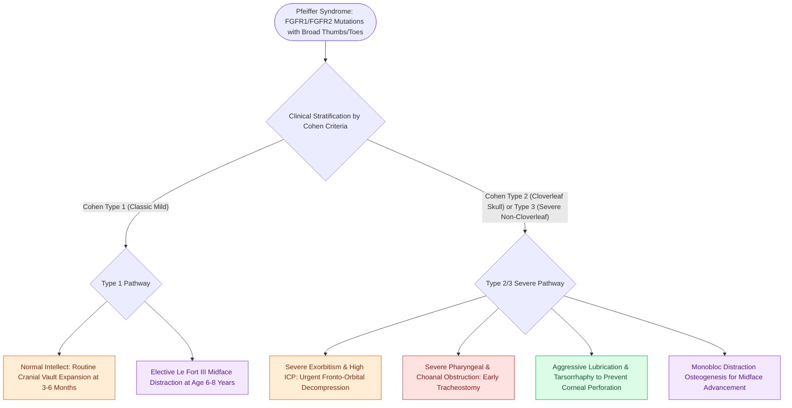

# Pfeiffer syndrome features FGFR1 and FGFR2 mutations causing bicoronal craniosynostosis, broad thumbs and great toes, and severe midface hypoplasia

## Active Recall

> [!question]- What genetic mutations and limb anomalies pathognomonically distinguish Pfeiffer syndrome from Apert and Crouzon syndromes?
> *Answer / Clinical Rationale*: Pfeiffer syndrome is caused by gain-of-function mutations in **FGFR1 (8p11)** and **FGFR2 (10q26)** and presents with pathognomonic **broad, radially deviated thumbs and great toes (brachydactyly/clinodactyly)**, distinguishing it from Crouzon syndrome (normal hands and feet) and Apert syndrome (complex bony and cutaneous syndactyly of digits 2 through 4).

> [!question]- How does the Cohen clinical classification stratify Pfeiffer syndrome severity and prognosis?
> *Answer / Clinical Rationale*: **Cohen Type 1** presents with classic mild bicoronal synostosis, midface hypoplasia, normal intellect, and autosomal dominant inheritance; **Cohen Type 2** presents with a severe cloverleaf skull (Kleeblattschädel), extreme proptosis, hydrocephalus, and high infant mortality; **Cohen Type 3** features severe ocular and neurological impairment similar to Type 2 but without a cloverleaf skull deformity.

## Core Clinical & Mechanistic Principles

Pfeiffer syndrome is an autosomal dominant craniosynostosis syndrome with an incidence of approximately 1 in 100,000 live births, first described by Rudolf Pfeiffer in 1963. The disorder is driven by gain-of-function mutations in the fibroblast growth factor receptor genes **FGFR1** (chromosome 8p11.23) and **FGFR2** (chromosome 10q26.13), resulting in constitutive receptor tyrosine kinase activation, premature cranial suture fusion, and aberrant limb morphogenesis:

### Pathognomonic Phenotypic Triad
1. **Craniosynostosis & Skull Base Architecture**:
   - Predominantly features bicoronal craniosynostosis causing turribrachycephaly (tall, shortened skull) and a hypoplastic anterior cranial fossa.
   - Severe forms demonstrate multi-suture synostosis involving sagittal, squamosal, and coronal sutures leading to a cloverleaf skull deformity (**Kleeblattschädel**).
2. **Craniofacial Dysmorphism**:
   - Severe midface retrusion and maxillary hypoplasia resulting in Class III malocclusion and relative mandibular prognathism.
   - Extremely shallow orbits producing severe ocular proptosis (exorbitism), hypertelorism, downslanting palpebral fissures, strabismus, and a risk of exposure keratopathy or globe subluxation.
   - High arched palate, secondary choanal stenosis or choanal atresia, and pharyngeal crowding predisposing to life-threatening pediatric obstructive sleep apnea.
3. **Extremity Malformations**:
   - Broad, shortened, and radially deviated thumbs and halluces (great toes).
   - Partial soft-tissue syndactyly of digits 2 and 3 of the hands and feet, differing from the complex mitten-hand osseous syndactyly characteristic of [[Apert syndrome combines acrocephalosyndactyly from FGFR2 mutations with complex hand-foot syndactyly and cleft palate]] and the completely normal extremities of [[Crouzon syndrome exhibits FGFR2-mediated craniosynostosis with ocular proptosis, midface hypoplasia, and normal extremities]].

### Cohen Clinical Classification & Prognostic Stratification
- **Type 1 (Classic Pfeiffer)**: Autosomal dominant transmission or sporadic mutation; bicoronal synostosis, midface hypoplasia, broad digits, normal intelligence, and favorable long-term functional outcome.
- **Type 2**: Sporadic new *FGFR2* mutations; cloverleaf skull deformity, severe ocular proptosis, elbow ankylosis, Arnold-Chiari malformation, hydrocephalus, cognitive impairment, and high infant mortality from respiratory or neurological failure.
- **Type 3**: Sporadic mutations; clinical findings identical to Type 2 with marked proptosis and severe neurodevelopmental delay, but lacking the cloverleaf skull contour.

### Staged Multidisciplinary Surgical Reconstruction
- **Infancy (3 to 6 Months)**: Fronto-orbital advancement and cranial vault remodeling (bifrontal craniotomy with advancement of the supraorbital bar) to relieve elevated intracranial pressure (ICP) and enlarge the bony orbital volume.
- **Airway & Corneal Protection**: Mandatory tarsorrhaphies to prevent corneal ulceration; tracheostomy is frequently required in Type 2 and Type 3 patients due to severe midface hypoplasia and skull base compression.
- **Childhood (6 to 8 Years)**: Le Fort III midface advancement or monobloc advancement, typically utilizing rigid external distraction (RED) or internal distraction osteogenesis to advance the midface and expand the nasopharyngeal airway.
- **Skeletal Maturity (16 to 18 Years)**: Definitive orthognathic surgery (Le Fort I osteotomy and bilateral sagittal split osteotomy) to achieve stable functional dental occlusion.

## Connected Concepts & Graph Traversal

- **Mandibulofacial Dysostosis**: [[Treacher Collins syndrome results from TCOF1 mutations causing mandibulofacial dysostosis and conductive hearing loss]]
- **Micrognathia & Cleft Palate**: [[Pierre Robin sequence manifests with micrognathia, glossoptosis, and secondary U-shaped cleft palate]]
- **Choanal Obstruction**: [[Congenital bilateral choanal atresia causes cyclical cyanosis relieved by crying and requires urgent oral airway placement]]
- **Oculoauriculovertebral Spectrum**: [[Goldenhar syndrome exhibits hemifacial microsomia, epibulbar dermoids, preauricular appendages, and vertebral anomalies]]
- **Collagenopathy Syndromes**: [[Stickler syndrome combines progressive sensorineural hearing loss, spondyloepiphyseal dysplasia, and retinal detachment]]
