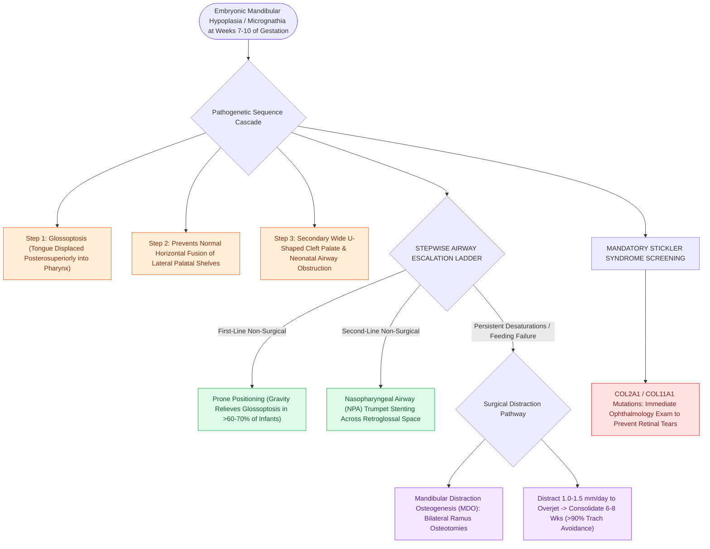

# Pierre Robin sequence manifests with micrognathia, glossoptosis, and secondary U-shaped cleft palate

## Active Recall

> [!question]- Why is Pierre Robin termed a 'sequence' rather than a syndrome, and what is the exact chronological cascade of embryological pathogenesis?
> *Answer / Clinical Rationale*: It is a sequence because a single primary mechanical defect initiates a secondary cascade of malformations: (1) Early embryonic **micrognathia/mandibular hypoplasia** at weeks 7–10 of gestation causes (2) superior and posterior displacement of the tongue into the nasopharynx (**glossoptosis**), which mechanically (3) prevents the vertical palatal shelves from elevating and fusing horizontally, culminating in a wide **U-shaped cleft palate**.

> [!question]- What is the step-by-step airway management ladder for an infant with Pierre Robin sequence presenting with respiratory distress?
> *Answer / Clinical Rationale*: (1) Non-surgical: **Prone positioning** (uses gravity to draw the tongue forward; succeeds in $>60\text{–}70\%$ of mild cases), followed by **nasopharyngeal airway (NPA)** placement. (2) Surgical: If prone positioning and NPA fail or if feeding remains uncoordinated with severe desaturations, escalate to **tongue-lip adhesion (TLA)** or **bilateral mandibular distraction osteogenesis (MDO)**; tracheostomy is reserved for multilevel airway collapse or MDO failure.

> [!question]- What is the single most common syndromic association with Pierre Robin sequence, and what screening evaluation is mandatory?
> *Answer / Clinical Rationale*: **Stickler syndrome** (*COL2A1* / *COL11A1* mutation) accounts for up to $30\text{–}40\%$ of syndromic PRS cases. An immediate **ophthalmologic evaluation** is mandatory to detect high myopia and lattice vitreoretinal degeneration to prevent catastrophic **retinal detachment**.

## Core Clinical & Mechanistic Principles
Pierre Robin sequence (PRS) is defined by the classic diagnostic triad:
1. **Micrognathia** (small, hypoplastic mandible).
2. **Glossoptosis** (posterior displacement of the base of the tongue into the hypopharynx).
3. **Upper Airway Obstruction** $\pm$ a wide **U-shaped cleft palate** (cleft is present in $80\text{–}90\%$ of cases, contrasting with the narrow V-shaped cleft of non-syndromic palatoplasty).

### Surgical Interventions
- **Mandibular Distraction Osteogenesis (MDO)**:
  - *Mechanism*: Bilateral mandibular ramus/body osteotomies with internal or external distractors.
  - *Distraction Protocol*: Latency period ($24\text{–}48\text{ hours}$), distraction phase ($1.0\text{–}1.5\text{ mm/day}$ in divided increments until edge-to-edge or Class III incisor overjet achieved), and consolidation period ($6\text{–}8\text{ weeks}$) for bone ossification.
  - *Outcome*: Directly pulls the anterior genioglossus attachment forward, permanently expanding the retroglossal airway and achieving $>90\%$ tracheostomy avoidance or decannulation rates.
- **Tongue-Lip Adhesion (TLA)**:
  - Surgical suturing of the anterior ventral tongue musculature to the lower labial orbicularis oris and alveolar ridge. Temporary bridge; typically released at $9\text{–}12\text{ months}$ during cleft palate repair.
- **Cleft Palate Repair Timing**:
  - Palatoplasty is typically delayed until $10\text{–}14\text{ months}$ to ensure airway stabilization, frequently utilizing two-flap palatoplasty techniques with intravelar veloplasty (see [[Stickler syndrome combines progressive sensorineural hearing loss, spondyloepiphyseal dysplasia, and retinal detachment|Stickler Syndrome Screening]]).

## Connected Concepts & Graph Traversal
- **Syndromic Association**: [[Stickler syndrome combines progressive sensorineural hearing loss, spondyloepiphyseal dysplasia, and retinal detachment|Stickler Syndrome Screening]]
- **Pediatric Airway Assessment**: [[Pediatric stertor and stridor differentiate upper supraglottic airway obstruction from intrathoracic tracheobronchial disease|Pediatric Stridor & Airway Anatomy]]
- **Palatoplasty Techniques**: [[Two-flap palatoplasty and Furlow double-reversing Z-plasty reconstruct the hard and soft palate musculature|Palatoplasty Craft & Execution]]
- **Craniofacial Comparison**: [[Treacher Collins syndrome results from TCOF1 mutations causing mandibulofacial dysostosis and conductive hearing loss|Treacher Collins vs Pierre Robin]]
- **Definitive Refractory Airway**: [[Tracheostomy provides immediate definitive relief for severe life-threatening refractory obstructive sleep apnea|Tracheostomy in Refractory Pediatric OSA]]
