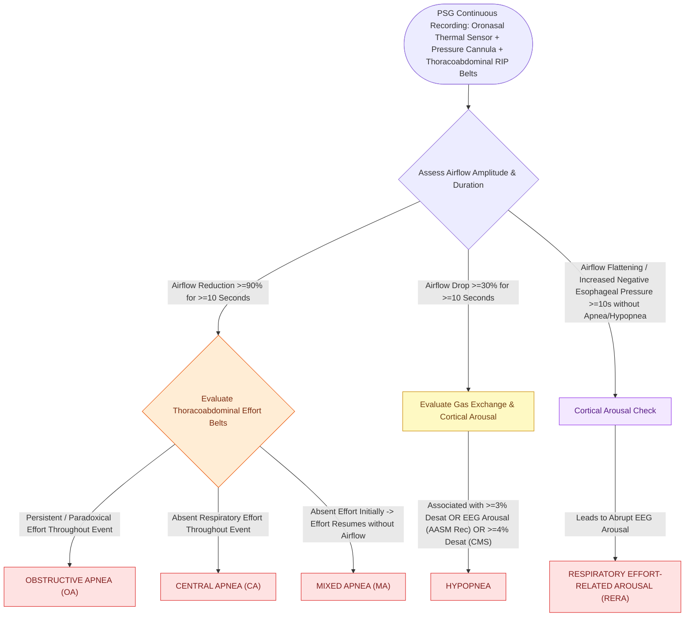

# Polysomnographic event criteria differentiate obstructive, central, and mixed apneas through airflow sensors and thoracoabdominal effort monitoring

## Active Recall

> [!question]- What sensor montage is used on polysomnography to detect airflow cessation versus respiratory effort, and how do their tracings distinguish obstructive from central apnea?
> *Answer / Clinical Rationale*: Airflow is monitored using an **oronasal thermal sensor (thermistor)** as the primary sensor for apneas and a **nasal air pressure transducer** for hypopneas and flow limitation. Respiratory effort is recorded using **respiratory inductance plethysmography (RIP) belts** around the thorax and abdomen, or **esophageal manometry**. In an **obstructive apnea**, airflow drops by $\ge 90\%$ for $\ge 10\text{ seconds}$ while thoracoabdominal belts show **persistent or paradoxical respiratory effort** (chest and abdomen moving in opposite directions against a closed airway). In a **central apnea**, airflow drops by $\ge 90\%$ for $\ge 10\text{ seconds}$ with **complete absence of thoracoabdominal effort** throughout the entire event duration.

> [!question]- How is a mixed apnea scored on polysomnography, and what pathophysiological mechanism underlies its biphasic morphology?
> *Answer / Clinical Rationale*: A **mixed apnea** is characterized by airflow cessation ($\ge 90\%$) lasting $\ge 10\text{ seconds}$ that **begins with an initial lack of thoracoabdominal respiratory effort (central component)** and **concludes with the resumption of respiratory effort against an occluded airway without airflow (obstructive component)**. This occurs because central hypopnea or apnea leads to progressive loss of pharyngeal dilator muscle tone during the central pause; when central ventilatory drive abruptly resumes due to hypercapnic chemical stimulation, the collapsed, hypotonic upper airway acts as a Starling resistor, producing physical airway obstruction until cortical arousal restores neuromuscular patency.

> [!question]- What are the AASM diagnostic criteria distinguishing the 'recommended' and 'acceptable' rules for scoring adult hypopneas?
> *Answer / Clinical Rationale*: - **AASM Recommended Rule**: A reduction in airflow by **$\ge 30\%$ from baseline** for at least **$10\text{ seconds}$**, accompanied by a **$\ge 3\%$ oxyhemoglobin desaturation** OR an **electroencephalographic (EEG) arousal**. - **AASM Acceptable / CMS Rule**: A reduction in airflow by **$\ge 30\%$ from baseline** for at least **$10\text{ seconds}$**, accompanied by a **$\ge 4\%$ oxyhemoglobin desaturation** (regardless of EEG arousal).

## Core Clinical & Mechanistic Principles

Overnight diagnostic polysomnography (PSG) is the gold standard for diagnosing sleep-disordered breathing. The electrophysiological and respiratory montage simultaneously tracks sleep architecture (EEG, EOG, chin EMG), cardiac rhythm (ECG), gas exchange (pulse oximetry), airflow velocity, and chest/abdominal respiratory mechanics.

### Respiratory Event Definitions Ledger

| Respiratory Event | Airflow Criteria | Duration | Effort / Mechanics Criteria | Arousal / Desaturation Criteria | Clinical Significance |
| :--- | :--- | :--- | :--- | :--- | :--- |
| **Obstructive Apnea** *(Fig 9.4 B)* | $\ge 90\%$ reduction from baseline (oronasal thermal sensor) | $\ge 10\text{ seconds}$ | **Continued or increased** thoracoabdominal effort throughout | Desaturation and EEG arousal common but not mandatory | Mechanical pharyngeal collapse requiring anatomic or PAP therapy |
| **Central Apnea** *(Fig 9.4 A)* | $\ge 90\%$ reduction from baseline | $\ge 10\text{ seconds}$ | **Complete absence** of thoracoabdominal effort throughout | Desaturation occurs; terminates with hyperpneic ventilatory burst | Failure of central respiratory drive; associated with CHF, opioids, or stroke |
| **Mixed Apnea** | $\ge 90\%$ reduction from baseline | $\ge 10\text{ seconds}$ | **Biphasic**: initial absent effort followed by late obstructed effort | Terminated by EEG arousal upon resumption of airflow | Transition from central pauses to secondary physical collapse |
| **Hypopnea** *(Fig 9.4 C)* | $\ge 30\%$ reduction from baseline (nasal pressure transducer) | $\ge 10\text{ seconds}$ | Thoracoabdominal effort present | $\ge 3\%$ desat OR EEG arousal (AASM); $\ge 4\%$ desat (CMS) | Partial airway narrowing causing nocturnal hypoxemia and fragmentation |
| **RERA** | Progressive negative esophageal pressure or waveform flattening | $\ge 10\text{ seconds}$ | Increasing respiratory effort | **EEG arousal mandatory**; does not meet apnea/hypopnea criteria | Hallmark of Upper Airway Resistance Syndrome (UARS) |

### Polysomnographic Indices & Clinical Metrics

1. **Apnea Index (AI)**: Number of apneas per hour of total sleep time (TST).
2. **Apnea-Hypopnea Index (AHI)**:
   $$\text{AHI} = \frac{\text{Apneas} + \text{Hypopneas}}{\text{Total Sleep Time (hours)}}$$
   - Adult severity thresholds: **Mild** ($5.0\text{–}14.9$), **Moderate** ($15.0\text{–}29.9$), **Severe** ($\ge 30.0$).
3. **Respiratory Disturbance Index (RDI)**:
   $$\text{RDI} = \frac{\text{Apneas} + \text{Hypopneas} + \text{RERAs}}{\text{Total Sleep Time (hours)}}$$
4. **Central Apnea Index (CAI)**: Central apneas per hour of TST ($>5/\text{hr}$ defines central sleep apnea).

### Portable Sleep-Monitoring Device Classification

- **Type 1 (In-Laboratory Full Attended Polysomnography)**: Minimum of 7 channels (EEG, EOG, chin EMG, ECG, airflow, effort, oximetry) with an attended technologist. Gold standard.
- **Type 2 (Comprehensive Unattended Home PSG)**: Minimum of 7 channels including EEG for sleep staging, but conducted unattended in the home environment.
- **Type 3 (Home Sleep Apnea Test - HSAT / Modified Portable Study)**: Minimum of 4 channels: respiratory airflow, respiratory effort, heart rate/ECG, and oxygen saturation. Lacks EEG sleep staging; index calculated per recording time (PRDI/REI), not true total sleep time.
- **Type 4 (Continuous Single/Dual Bioparameter Devices)**: Minimum of 3 channels (e.g., peripheral arterial tone [PAT], actigraphy, and pulse oximetry, such as WatchPAT).

Comprehensive anatomical and therapeutic integration links these principles directly to [[The Starling resistor model explains upper airway collapsibility and critical closing pressure Pcrit|Starling Resistor Model]].

## Connected Concepts & Graph Traversal
- **Adult PSG Thresholds**: [[Adult polysomnography criteria define obstructive sleep apnea severity by apnea-hypopnea index thresholds of five, fifteen, and thirty|Adult PSG Criteria]]
- **Pediatric PSG Standards**: [[Pediatric polysomnography criteria define obstructive sleep apnea with an obstructive apnea-hypopnea index exceeding one|Pediatric PSG Criteria]]
- **Ventilatory Control Instability**: [[High loop gain causes ventilatory instability and periodic breathing in sleep-disordered breathing|Loop Gain & Cheyne-Stokes]]
- **Arousal Mechanics**: [[Low arousal threshold causes premature awakening before airway stabilization in obstructive sleep apnea|Low Arousal Threshold]]
- **Sleep Staging Architecture**: [[Non-rapid eye movement and rapid eye movement sleep architecture dictate pharyngeal muscle tone|Sleep Architecture & Pharyngeal Tone]]
