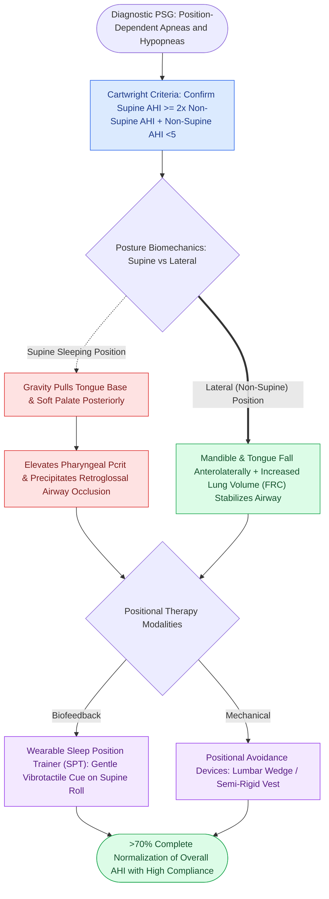

# Positional obstructive sleep apnea is treated with sleep position trainers and positional avoidance devices

## Active Recall

> [!question]- What are the Cartwright criteria for diagnosing positional obstructive sleep apnea?
> *Answer / Clinical Rationale*: A **Supine AHI at least twice ($\ge 2\times$) the non-supine AHI**, with a normal or near-normal non-supine AHI.

> [!question]- How do modern vibrotactile Sleep Position Trainers (SPTs) prevent supine sleeping?
> *Answer / Clinical Rationale*: They deliver **calibrated vibrotactile vibrations to the neck or chest** whenever the patient rolls onto their back, prompting a change to the lateral posture.

## Core Clinical & Mechanistic Principles
**Positional Obstructive Sleep Apnea (POSA)** is a distinct clinical phenotype where obstructive events occur predominantly or exclusively in the supine sleeping position:
- **Cartwright Diagnostic Criteria (1984)**:
  - Defined as a **Supine AHI / Non-Supine AHI ratio $\ge 2.0$** (with a non-supine AHI normalized or $<5\text{ events/hr}$).
  - Present in **$50\text{–}60\%$ of all patients with mild-to-moderate OSA**.
- **Biomechanical Mechanism of Supine Collapse**:
  - In the supine position, **gravity pulls the tongue base and soft palate posteriorly** against the posterior pharyngeal wall, increasing $P_{\text{crit}}$ and precipitating retroglossal airway occlusion.
  - In the lateral (non-supine) position, the mandible and tongue fall laterally and anteriorly, and lung volume (FRC) increases, stabilizing the pharynx.
- **Positional Therapy Modalities**:
  1. **Sleep Position Trainers (SPTs - Vibrotactile Biofeedback)**: A small wearable neck or chest sensor that delivers gentle, increasing vibrotactile feedback whenever the patient rolls supine, training them to sleep laterally.
  2. **Mechanical Avoidance Devices**: Tennis-ball shirts, positional wedges, lumbar backpacks.
  3. **Efficacy**: Normalizes AHI in $>70\%$ of true positional OSA patients with compliance comparable to or exceeding CPAP.

### Surgical Technique & Critical Safety Checks
- **Combination Therapy**: Positional therapy is frequently combined with oral appliances or soft tissue surgery to treat residual supine disease (see [[Mandibular advancement devices MAD advance the mandible to enlarge the retroglossal airway space|Mandibular Advancement Devices]]).

## Connected Concepts & Graph Traversal
- **Mandibular Advancement Devices**: [[Mandibular advancement devices MAD advance the mandible to enlarge the retroglossal airway space|Mandibular Advancement Devices]]
- **Nasal Surgery OSA**: [[Nasal surgery alone improves CPAP compliance and subjective daytime somnolence without normalizing AHI|Nasal Surgery OSA]]
- **Modified UPPP**: [[Modified uvulopalatopharyngoplasty UPPP resects redundant palatal tissue while preserving muscular function|Modified UPPP]]
- **Embryological & Sleep Foundation**: [[Geniohyoid and genioglossus muscles are primary upper airway dilators maintaining pharyngeal patency]]
- **Sleep Endoscopy & Airway Dynamics**: [[Drug-induced sleep endoscopy DISE evaluates dynamic multi-level upper airway collapse under sedation|Drug-Induced Sleep Endoscopy (DISE)]] [[Paradise criteria define evidence-based indications for pediatric tonsillectomy in recurrent throat infections]]
- **Congenital Airway Pathology**: [[Laryngomalacia is the most common cause of congenital pediatric stridor characterized by dynamic supraglottic collapse]]
- **Open Airway Reconstruction**: [[Anterior costal cartilage grafts expand the thyroid and cricoid cartilage framework]]
