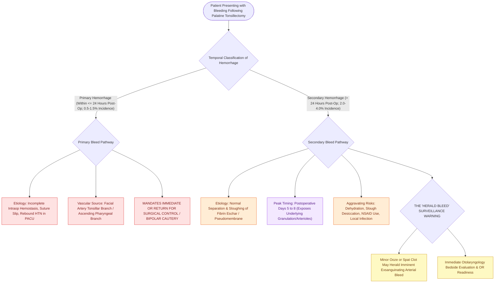

# Post-tonsillectomy hemorrhage is classified into primary within twenty-four hours and secondary beyond twenty-four hours

## Active Recall

> [!question]- What is the peak postoperative timing for secondary post-tonsillectomy hemorrhage?
> *Answer / Clinical Rationale*: Between **postoperative days 5 and 8** (coinciding with fibrin eschar separation).

> [!question]- What is the underlying physiological mechanism causing secondary post-tonsillectomy bleeding?
> *Answer / Clinical Rationale*: **Premature sloughing and separation of the fibrin pseudomembrane/eschar**, exposing underlying healing capillary beds and arterioles.

## Core Clinical & Mechanistic Principles
**Post-tonsillectomy hemorrhage (PTH)** is the most common serious complication of tonsillectomy, classified temporally by time of onset:
- **Primary Hemorrhage ($\le 24\text{ Hours}$ Postoperatively)**:
  - Occurs in **$0.5\text{–}1.5\%$** of patients (most commonly in the PACU or within 6–8 hours).
  - *Mechanism*: Surgical failure of primary hemostasis, loose ligature, acute rebound hypertension as anesthesia wears off, or unmasked coagulopathy.
  - *Characteristics*: Often brisk arterial bleeding from the tonsillar branch of the **facial artery**, descending palatine artery, or ascending pharyngeal artery; requires urgent surgical re-exploration.
- **Secondary Hemorrhage ($>24\text{ Hours}$ Postoperatively)**:
  - Occurs in **$2.0\text{–}4.0\%$** of patients.
  - **Peak Incidence**: Occurs on **postoperative days 5 to 8** (range 4–14 days).
  - *Mechanism*: Normal physiological **sloughing of the white-grey fibrin eschar / pseudomembrane** covering the tonsillar fossa, exposing underlying granulation tissue or eroded submucosal arterioles.
  - *Risk Factors*: Dehydration (causes crust desiccation and premature cracking), older age ($>12$ years), male sex, hot/abrasive diet, NSAID overuse, and active local infection.

### Surgical Technique & Critical Safety Checks
- **The "Herald Bleed" Warning**: Any minor spitting of blood or small clot in a child must be treated as a serious "herald bleed" that [[High-stakes pediatric and adult sleep airway complications require rapid structured algorithmic emergency rescue|can]] rapidly progress to catastrophic exsanguinating hemorrhage.

## Connected Concepts & Graph Traversal
- **Severe Tonsil Bleed**: [[Severe secondary post-tonsillectomy hemorrhage requires urgent airway stabilization and surgical electrocautery|Severe Tonsil Bleed Rescue]]
- **Tonsillectomy Techniques**: [[Extracapsular total tonsillectomy and intracapsular subtotal tonsillotomy differ in postoperative hemorrhage and recovery|Tonsillectomy Techniques]]
- **High-Risk Criteria**: [[High-risk pediatric criteria mandate overnight inpatient admission following adenotonsillectomy|High-Risk Criteria]]
- **Embryological & Sleep Foundation**: [[The Starling resistor model explains upper airway collapsibility and critical closing pressure Pcrit]]
- **Sleep Endoscopy & Airway Dynamics**: [[Drug-induced sleep endoscopy DISE evaluates dynamic multi-level upper airway collapse under sedation|Drug-Induced Sleep Endoscopy (DISE)]] [[Nasal steroid sprays and montelukast provide medical therapy for mild pediatric sleep-disordered breathing]]
- **Congenital Airway Pathology**: [[Nebulized racemic epinephrine and oral dexamethasone provide rapid treatment for acute croup]]
- **Open Airway Reconstruction**: [[Posterior costal cartilage grafts with a carved flange split the posterior cricoid lamina to expand the glottic lumen]]
