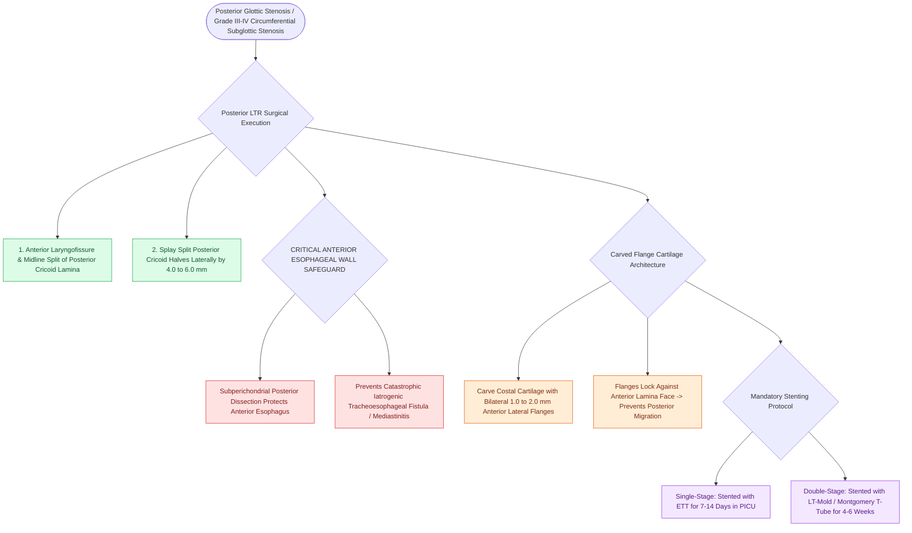

# Posterior costal cartilage grafts with a carved flange split the posterior cricoid lamina to expand the glottic lumen

## Active Recall

> [!question]- What structure lies immediately posterior to the posterior cricoid lamina that must be protected during a posterior split?
> *Answer / Clinical Rationale*: The **anterior esophageal wall** (injury risks a tracheoesophageal fistula or deep neck abscess).

> [!question]- How do the carved flanges of a posterior costal cartilage graft function mechanically?
> *Answer / Clinical Rationale*: They overlap the anterior surface of the split posterior cricoid lamina, **preventing the graft from displacing posteriorly into the esophagus**.

## Core Clinical & Mechanistic Principles
**Posterior costal cartilage grafting** is indicated for posterior glottic stenosis (interarytenoid fixation), severe [[Endoscopic balloon dilation with steroid injection manages early, soft, non-circumferential subglottic stenosis|circumferential subglottic stenosis]] (Myer-Cotton Grade III/IV), or combined glotto-subglottic stenosis:
- **Surgical Execution of the Posterior Cricoid Split**:
  1. Complete anterior laryngofissure; retract the lateral thyroid laminae.
  2. Perform a **full-thickness vertical midline split through the posterior cricoid lamina** from the interarytenoid notch down to the first tracheal ring.
  3. Splay the cut halves of the posterior cricoid laterally by **$4.0\text{–}6.0\text{ mm}$**, expanding both the posterior glottic airway and the interarytenoid distance.
  4. **The Esophageal Protection Rule**: Maintain precise subperichondrial dissection along the posterior cricoid to **avoid perforating the underlying anterior esophageal wall** (which causes a catastrophic tracheoesophageal fistula or mediastinitis).
- **Graft Design & Inset (Flanged Graft)**:
  - A block of costal cartilage is carved with a **$1.0\text{–}2.0\text{-mm}$ lateral flange (lip)** on each side.
  - The central wedge slots between the separated posterior cricoid halves, while the flanges lock against the anterior face of the lamina, **preventing posterior displacement into the esophagus**.
  - Secured with 4-0/5-0 PDS sutures; perichondrium faces the airway lumen.

### Surgical Technique & Critical Safety Checks
- **Mandatory Stenting**: Posterior grafts always require internal stenting (nasotracheal ETT for 7–14 days in [[Single-stage LTR utilizes an endotracheal tube as a temporary stent avoiding tracheostomy placement|SSLTR]], or LT-Mold for 4–6 weeks in DSLTR) to maintain lateral distraction until vascularized union occurs.

## Connected Concepts & Graph Traversal
- **LTR Reconstruction**: [[Single-stage and double-stage laryngotracheal reconstruction LTR repair mature high-grade subglottic stenosis|LTR Reconstruction]]
- **Anterior Costal Graft**: [[Anterior costal cartilage grafts expand the thyroid and cricoid cartilage framework|Anterior Costal Cartilage Graft]]
- **Double-Stage LTR**: [[Double-stage LTR maintains a tracheostomy and utilizes an endolaryngeal LT-Mold or Montgomery T-tube stent|Double-Stage LTR]]
- **Embryological & Sleep Foundation**: [[Pediatric polysomnography criteria define obstructive sleep apnea with an obstructive apnea-hypopnea index exceeding one]]
- **Sleep Endoscopy & Airway Dynamics**: [[Drug-induced sleep endoscopy DISE evaluates dynamic multi-level upper airway collapse under sedation|Drug-Induced Sleep Endoscopy (DISE)]] [[Pediatric DISE identifies persistent multi-level airway collapse following adenotonsillectomy]]
- **Congenital Airway Pathology**: [[Congenital bilateral vocal fold paralysis presents with severe inspiratory stridor requiring airway protection]]
- **Open Airway Reconstruction**: [[Preserving the recurrent laryngeal nerves at the cricothyroid articulation is essential during cricotracheal resection]]
