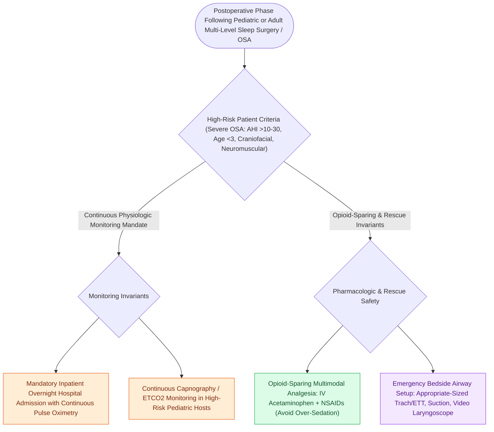

# Postoperative airway management in sleep surgery requires continuous pulse oximetry and avoidance of oversedation

## Active Recall

> [!question]- Why are patients with obstructive sleep apnea exceptionally vulnerable to respiratory arrest from postoperative opioids?
> *Answer / Clinical Rationale*: Because chronic intermittent hypoxia upregulates central opioid sensitivity, and opioids **suppress central respiratory drive while abolishing pharyngeal dilator muscle tone**.

> [!question]- What position should the bed be maintained in following pharyngeal sleep surgery to optimize airway patency?
> *Answer / Clinical Rationale*: Elevated at **$30\text{ to }45^\circ$ (head-up)**.

## Core Clinical & Mechanistic Principles
Patients with obstructive sleep apnea undergoing pharyngeal or skeletal sleep surgery are at extreme risk for **life-threatening postoperative airway obstruction and respiratory arrest**:
- **The "Double-Hit" Pathophysiological Hazard**:
  1. **Surgical Airway Compromise**: Acute pharyngeal mucosal edema, hematoma, and muscular inflammation narrow an already compromised baseline airway.
  2. **Residual Anesthesia & Opioid Sensitivity**: Patients with chronic OSA have hypersensitive central opioid receptors; postoperative narcotics suppress respiratory drive and abolish [[Non-rapid eye movement and rapid eye movement sleep architecture dictate pharyngeal muscle tone|pharyngeal dilator tone]], triggering fatal post-extubation asphyxia.
- **Mandatory Safety Protocols**:
  1. **Continuous Pulse Oximetry & Telemetry**: Continuous monitoring in the PACU and step-down unit until the patient is fully awake and maintaining room air saturation.
  2. **Multimodal Opioid-Sparing Analgesia**: Scheduled IV acetaminophen, NSAIDs (ketorolac / ibuprofen), dexamethasone, and local bupivacaine infiltration; strictly minimize systemic opioids.
  3. **Head-of-Bed Elevation ($30\text{–}45^\circ$)**: Reduces venous engorgement and gravitational tongue base collapse.
  4. **Postoperative CPAP Management**: If CPAP is required, use lower pressures ($2\text{–}4\text{ cm H}_2\text{O}$ below baseline) or auto-CPAP to prevent subcutaneous emphysema or mucosal wound disruption.

### Surgical Technique & Critical Safety Checks
- **Delayed Extubation**: In high-risk multi-level surgery (e.g., TORS tongue base + UPPP or MMA), maintain intubation overnight in the ICU until an air leak is confirmed on deflated cuff testing.

## Connected Concepts & Graph Traversal
- **Pediatric Emergency**: [[High-stakes pediatric and adult sleep airway complications require rapid structured algorithmic emergency rescue|Airway Emergency Rescue]]
- **Modified UPPP**: [[Modified uvulopalatopharyngoplasty UPPP resects redundant palatal tissue while preserving muscular function|Modified UPPP]]
- **MMA Advancement**: [[Maxillomandibular advancement MMA advances the skeletal framework by ten to twelve millimeters to expand the upper airway|MMA Advancement]]
- **Embryological & Sleep Foundation**: [[Each branchial arch packages one nerve, one artery, one cartilage bar, and one muscle group]]
- **Sleep Endoscopy & Airway Dynamics**: [[Drug-induced sleep endoscopy DISE evaluates dynamic multi-level upper airway collapse under sedation|Drug-Induced Sleep Endoscopy (DISE)]] [[Lingual tonsil hypertrophy causes persistent pediatric obstructive sleep apnea and base of tongue collapse]]
- **Congenital Airway Pathology**: [[Subglottic hemangiomas present as biphasic stridor in infants and respond to systemic oral propranolol]]
- **Open Airway Reconstruction**: [[Single-stage and double-stage laryngotracheal reconstruction LTR repair mature high-grade subglottic stenosis]]
