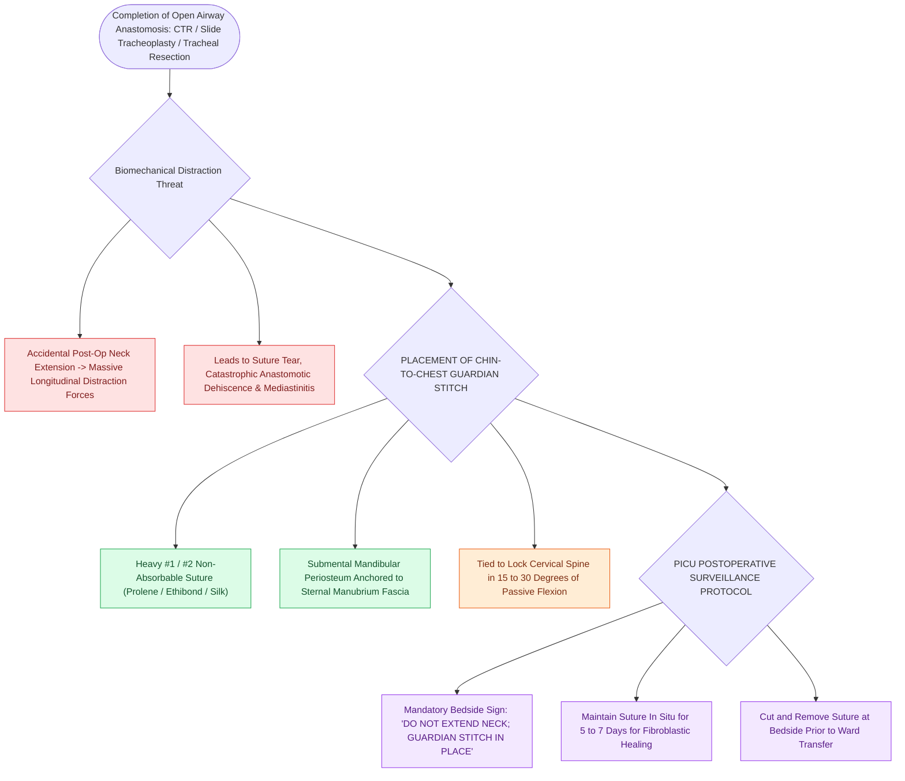

# Postoperative chin-to-chest flexion stitch prevents catastrophic neck extension and tracheal anastomotic dehiscence

## Active Recall

> [!question]- What is the primary purpose of a chin-to-chest 'guardian stitch' following tracheal resection?
> *Answer / Clinical Rationale*: To lock the neck in cervical flexion and **prevent accidental neck extension**, which would cause catastrophic tension-induced anastomotic dehiscence.

> [!question]- How long is the chin-to-chest flexion stitch typically maintained postoperatively?
> *Answer / Clinical Rationale*: For **$5\text{ to }7\text{ days}$**.

## Core Clinical & Mechanistic Principles
Following major open tracheal resection (CTR, [[Slide tracheoplasty expands complete tracheal rings by oblique division and sliding longitudinal reconstruction|Slide Tracheoplasty]], Tracheal Resection), a **chin-to-chest flexion suture ("Guardian Stitch")** is mandatory to prevent tension-induced anastomotic disruption:
- **Biomechanical Threat of Neck Extension**:
  - Tracheal resection and primary anastomosis eliminate intrinsic tracheal length.
  - Accidental postoperative neck extension exerts massive longitudinal distraction forces across the fresh suture line, leading to **mucosal tearing, suture pull-through, catastrophic anastomotic dehiscence, mediastinitis, and fatal loss of airway**.
- **Surgical Placement of the Guardian Stitch**:
  - Place a heavy, non-absorbable suture (**#1 or #2 Prolene / Silk / Ethibond**) through the subcutaneous tissue and periosteum of the **submental symphysis of the mandible**.
  - Pass the suture through the **presternal fascia / periosteum of the manubrium of the sternum**.
  - Tie the suture with the neck held in **$15\text{–}30^\circ$ of passive cervical flexion** (the "chin-to-chest" position).
- **Postoperative Management & Duration**:
  - The stitch is maintained for **$5\text{ to }7\text{ days}$** in the PICU until initial fibroblastic anastomotic tensile strength develops.
  - Removed at the bedside prior to transfer out of the intensive care unit.

### Surgical Technique & Critical Safety Checks
- **Nursing Protocol**: Strict sign above bed: "DO NOT EXTEND NECK; MAINTAIN GUARDIAN STITCH INTACT." 

## Connected Concepts & Graph Traversal
- **CTR Resection**: [[Cricotracheal resection CTR achieves primary end-to-end anastomosis for severe Grade III and IV subglottic stenosis|CTR Resection]]
- **Slide Tracheoplasty**: [[Slide tracheoplasty expands complete tracheal rings by oblique division and sliding longitudinal reconstruction|Slide Tracheoplasty]]
- **Laryngeal Release**: [[Suprahyoid and infrahyoid laryngeal release maneuvers reduce anastomotic tension in tracheal surgery|Laryngeal Release]]
- **Embryological & Sleep Foundation**: [[Thyroglossal duct cyst tract tracks from the foramen cecum through the hyoid bone to the anterior neck]]
- **Sleep Endoscopy & Airway Dynamics**: [[Drug-induced sleep endoscopy DISE evaluates dynamic multi-level upper airway collapse under sedation|Drug-Induced Sleep Endoscopy (DISE)]] [[VOTE classification standardizes drug-induced sleep endoscopy findings across velum, oropharynx, tongue base, and epiglottis]]
- **Congenital Airway Pathology**: [[Subglottic hemangiomas present as biphasic stridor in infants and respond to systemic oral propranolol]]
- **Open Airway Reconstruction**: [[Slide tracheoplasty achieves immediate vascularized mucosal lumen doubling with lowest restenosis rates]]
