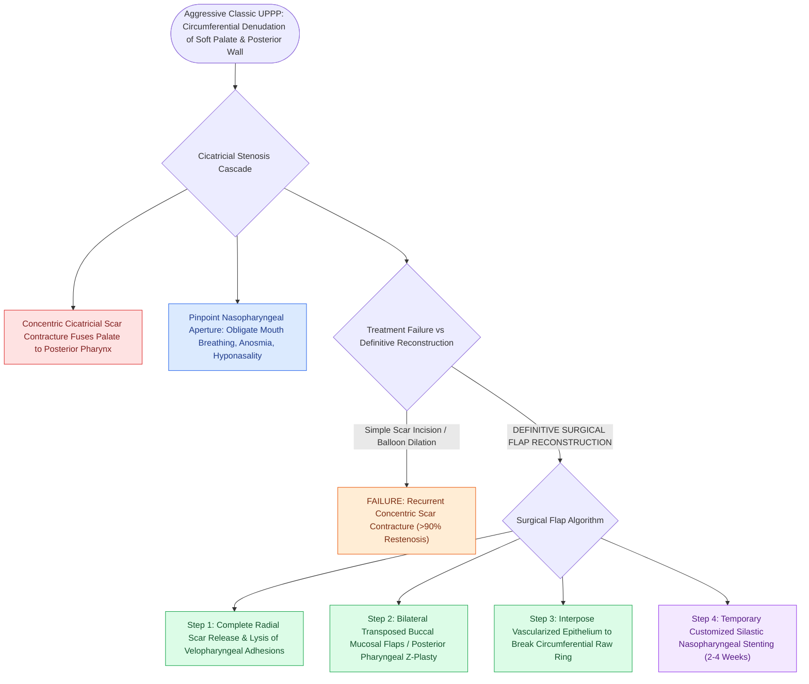

# Postoperative palatopharyngeal stenosis is a severe complication of over-resection managed with local flaps

## Active Recall

> [!question]- Why does simple scar incision or [[Endoscopic balloon dilation with steroid injection manages early, soft, non-circumferential subglottic stenosis|balloon dilation]] fail in palatopharyngeal stenosis?
> *Answer / Clinical Rationale*: Because the circumferential raw surfaces **inevitably undergo recurrent concentric cicatricial scar contracture ($>90\%$ failure)** without epithelial flap coverage.

> [!question]- What surgical technique provides definitive correction of severe palatopharyngeal stenosis?
> *Answer / Clinical Rationale*: Complete scar release combined with **transposition of vascularized mucosal flaps (buccal or pharyngeal flaps)** to line the raw defect $\pm$ temporary stenting.

## Core Clinical & Mechanistic Principles
**Palatopharyngeal (Nasopharyngeal) Stenosis** is one of the most debilitating late complications of aggressive, old-fashioned UPPP, occurring in **$1\text{–}3\%$ of classic resections**:
- **Pathophysiological Etiology**:
  - Caused by excessive mucosal stripping of the posterior tonsillar pillars, soft palate, and posterior pharyngeal wall.
  - Confluent circumferential raw surfaces heal by **concentric cicatricial scar contracture**, fusing the soft palate to the posterior pharyngeal wall and leaving a tiny pinpoint central opening into the nasopharynx.
- **Clinical Presentation**:
  - Severe obligate mouth breathing, complete nasal obstruction, anosmia, hyponasal speech, dysphagia, and worsening of obstructive sleep apnea.
- **Surgical Revision & Flap Reconstruction**:
  - Simple scar incision or dilation has a **$>90\%$ recurrence rate** due to re-scarring.
  - **Definitive Reconstruction Requires Tissue Interposition**:
    1. Complete scar release and contracture incision.
    2. **Bilateral Transposed Mucosal Flaps**:
       - **Bilateral Buccal Mucosal Flaps** or **Posterior Pharyngeal Mucosal Transposition Flaps** (e.g., Z-plasties or laterally based flaps).
       - Inset flaps into the raw mucosal bed to prevent circumferential contact and re-stenosis.
    3. Temporary placement of a **customized Silastic nasopharyngeal obturator stent** for 2–4 weeks.

### Surgical Technique & Critical Safety Checks
- **Prevention**: The best management is prevention: perform modern muscle-preserving [[Modified uvulopalatopharyngoplasty UPPP resects redundant palatal tissue while preserving muscular function|modified UPPP]] or expansion pharyngoplasty and avoid extensive posterior wall electrocautery.

## Connected Concepts & Graph Traversal
- **Modified UPPP**: [[Modified uvulopalatopharyngoplasty UPPP resects redundant palatal tissue while preserving muscular function|Modified UPPP]]
- **Velopharyngeal Incompetence**: [[Velopharyngeal incompetence following sleep surgery causes transient or permanent hypernasality and nasal regurgitation|Velopharyngeal Incompetence]]
- **Expansion Pharyngoplasty**: [[Expansion sphincter pharyngoplasty ESP rotates the palatopharyngeus muscle to stabilize lateral pharyngeal wall collapse|Expansion Pharyngoplasty]]
- **Embryological & Sleep Foundation**: [[Each branchial arch packages one nerve, one artery, one cartilage bar, and one muscle group]]
- **Sleep Endoscopy & Airway Dynamics**: [[Drug-induced sleep endoscopy DISE evaluates dynamic multi-level upper airway collapse under sedation|Drug-Induced Sleep Endoscopy (DISE)]] [[Rapid maxillary expansion widens the hard palate and nasal floor to improve pediatric nasal breathing and OSA]]
- **Congenital Airway Pathology**: [[Viral laryngotracheobronchitis croup presents with a barking cough and subglottic steeple sign on radiography]]
- **Open Airway Reconstruction**: [[Cricotracheal resection CTR achieves primary end-to-end anastomosis for severe Grade III and IV subglottic stenosis]]
