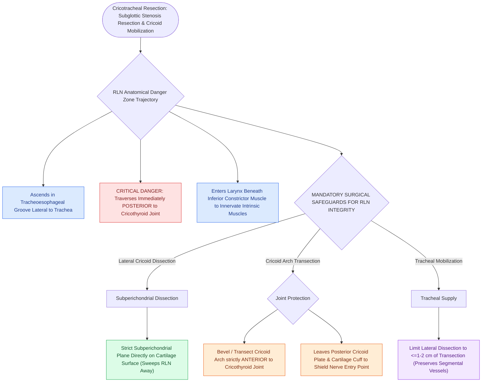

# Preserving the recurrent laryngeal nerves at the cricothyroid articulation is essential during cricotracheal resection

## Active Recall

> [!question]- Where does the recurrent laryngeal nerve enter the larynx relative to the cricoid cartilage?
> *Answer / Clinical Rationale*: Immediately **posterior to the cricothyroid articulation (cricothyroid joint)**, beneath the inferior constrictor muscle.

> [!question]- What surgical dissection plane must be maintained on the lateral cricoid to protect the recurrent laryngeal nerves?
> *Answer / Clinical Rationale*: The **strict subperichondrial plane** directly on the cartilage surface.

## Core Clinical & Mechanistic Principles
The **recurrent laryngeal nerve (RLN)** is at extreme risk of iatrogenic injury during [[Cricotracheal resection CTR achieves primary end-to-end anastomosis for severe Grade III and IV subglottic stenosis|cricotracheal resection]], which would cause bilateral vocal fold paralysis and permanent airway failure:
- **Critical Anatomical Course & Danger Zone**:
  - The RLN ascends in the **tracheoesophageal groove**.
  - At the level of the cricoid cartilage, the nerve passes immediately **POSTERIOR to the cricothyroid joint (cricothyroid articulation)** before entering the larynx beneath the inferior pharyngeal constrictor muscle.
- **Surgical Craft Nuances for RLN Preservation**:
  1. **Strict Subperichondrial Dissection**: When mobilizing the lateral and posterior cricoid, dissect strictly in the **subperichondrial plane** directly on the cartilage surface, sweeping the RLNs and soft tissues laterally without skeletonizing them.
  2. **Disarticulate Cricothyroid Joint Safely**: Divide the anterior and lateral cricoid arch **ANTERIOR to the cricothyroid articulation**, leaving a small cuff of posterior cricoid cartilage intact to shield the entry point of the nerve.
  3. **No Lateral Dissection Below Cricoid**: Limit lateral tracheal dissection to within $1\text{–}2\text{ cm}$ of the planned transection line to preserve lateral tracheal segmental blood supply and avoid wandering into the tracheoesophageal groove.

### Surgical Technique & Critical Safety Checks
- **Continuous Neuromonitoring**: Intraoperative nerve monitoring (NIM endotracheal tube) is utilized to verify RLN signal integrity throughout resection and anastomosis.

## Connected Concepts & Graph Traversal
- **CTR Resection**: [[Cricotracheal resection CTR achieves primary end-to-end anastomosis for severe Grade III and IV subglottic stenosis|CTR Resection]]
- **Laryngeal Release**: [[Suprahyoid and infrahyoid laryngeal release maneuvers reduce anastomotic tension in tracheal surgery|Laryngeal Release]]
- **Chin-to-Chest Stitch**: [[Postoperative chin-to-chest flexion stitch prevents catastrophic neck extension and tracheal anastomotic dehiscence|Chin-to-Chest Stitch]]
- **Embryological & Sleep Foundation**: [[Second branchial cleft anomalies represent the most common branchial anomaly situated anterior to the sternocleidomastoid]]
- **Sleep Endoscopy & Airway Dynamics**: [[Drug-induced sleep endoscopy DISE evaluates dynamic multi-level upper airway collapse under sedation|Drug-Induced Sleep Endoscopy (DISE)]] [[Concentric velopharyngeal collapse on DISE is a contraindication to hypoglossal nerve stimulation]]
- **Congenital Airway Pathology**: [[Inspiratory, biphasic, and expiratory stridor localize pediatric airway obstruction to supraglottic, subglottic, and tracheobronchial subsites]]
- **Open Airway Reconstruction**: [[Complete tracheal rings present with generalized tracheal stenosis and stovepipe appearance on imaging]]
