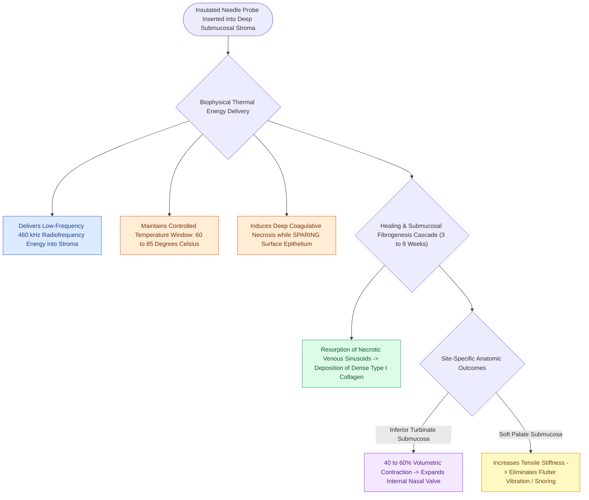

# Radiofrequency ablation of the inferior turbinates and soft palate stiffens tissue through submucosal fibrosis

## Active Recall

> [!question]- How does radiofrequency ablation reduce snoring without resecting palatal tissue?
> *Answer / Clinical Rationale*: It creates deep **submucosal coagulative necrosis and dense collagen fibrosis**, stiffening the soft palate and preventing flutter/vibration.

> [!question]- What is the target temperature range used during temperature-controlled radiofrequency ablation?
> *Answer / Clinical Rationale*: **$60^\circ\text{ to }85^\circ\text{C}$** (sufficient to induce coagulative necrosis while preventing tissue boiling and surface charring).

## Core Clinical & Mechanistic Principles
**Temperature-Controlled Radiofrequency Ablation (RFA / Somnoplasty / Coblation)** is a minimally invasive, office-based procedure designed to induce tissue volume reduction and submucosal stiffening:
- **Biophysical Mechanism**:
  - Low-frequency radiofrequency energy ($460\text{ kHz}$) is delivered through an insulated needle probe into the deep submucosal tissue.
  - Generates localized thermal energy (**$60\text{–}85^\circ\text{C}$**), inducing coagulative necrosis of venous sinusoids and submucosal stroma while **preserving the overlying respiratory or squamous epithelium**.
  - Over 3–8 weeks, the necrotic tissue is resorbed and replaced by **dense, contractive collagenous scar (fibrosis)**:
    - *Inferior Turbinates*: Shrinks mucosal volume by $40\text{–}60\%$, expanding the nasal valve and floor.
    - *Soft Palate*: Submucosal scarring stiffens the palate, **raising its mechanical flutter threshold and eliminating palatal vibration (snoring)**.
- **Clinical Role**:
  - First-line office therapy for benign primary snoring and mild upper airway resistance syndrome (UARS).
  - [[High-stakes pediatric and adult sleep airway complications require rapid structured algorithmic emergency rescue|Can]] be repeated in multiple sessions with minimal downtime and zero hospital admission.

### Surgical Technique & Critical Safety Checks
- **Safety Profile**: Rare complications include temporary mucosal ulceration, palatal fistula (if thermal energy delivered too superficially), or crusting.

## Connected Concepts & Graph Traversal
- **Nasal Surgery OSA**: [[Nasal surgery alone improves CPAP compliance and subjective daytime somnolence without normalizing AHI|Nasal Surgery OSA]]
- **Modified UPPP**: [[Modified uvulopalatopharyngoplasty UPPP resects redundant palatal tissue while preserving muscular function|Modified UPPP]]
- **Positional OSA**: [[Positional obstructive sleep apnea is treated with sleep position trainers and positional avoidance devices|Positional OSA]]
- **Advanced Mastercraft**: [[Palatal implants and radiofrequency stiffening induce submucosal fibrosis to dampen soft palate vibration in primary snoring and mild obstructive sleep apnea|Pillar Implants vs RF Palatoplasty]]
