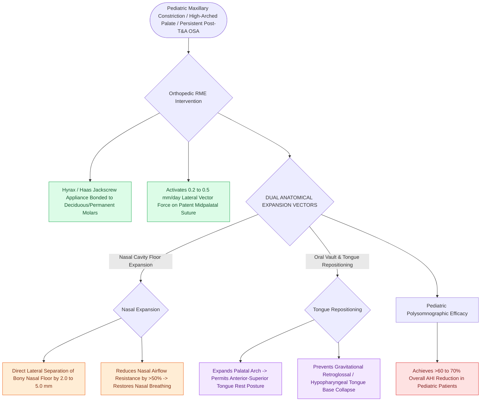

# Rapid maxillary expansion widens the hard palate and nasal floor to improve pediatric nasal breathing and OSA

## Active Recall

> [!question]- How does rapid maxillary expansion physically enlarge the nasal airway in children?
> *Answer / Clinical Rationale*: By separating the midpalatal suture, which **directly widens the bony floor of the nasal cavity**, lowering nasal airflow resistance.

> [!question]- Why does RME improve retroglossal tongue base airway collapse?
> *Answer / Clinical Rationale*: It expands the palatal vault, allowing the tongue to **posture naturally anteriorly and superiorly**, preventing posterior tongue prolapse.

## Core Clinical & Mechanistic Principles
**Rapid Maxillary Expansion (RME / Palatal Expansion)** is an orthodontic orthopedic intervention that widens the narrow maxilla and hard palate in growing children:
- **Biomechanical Mechanism**:
  - In children with high-arched, narrow hard palates and posterior crossbites, the midpalatal suture is open and cartilaginous (prior to pubertal fusion).
  - An orthodontic jackscrew appliance (Hyrax or Haas expander) bonded to the maxillary teeth applies lateral orthopedic forces ($5\text{–}10\text{ N}$), **separating the midpalatal suture by $0.2\text{–}0.5\text{ mm/day}$ over 2–3 weeks**.
  - **Nasal Cavity Widening**: Because the hard palate forms the floor of the nasal cavity, palatal expansion **widens the nasal floor by $2.0\text{–}5.0\text{ mm}$**, decreasing nasal airway resistance by $>50\%$.
  - **Tongue Posture Normalization**: Widens the oral cavity vault, allowing the tongue to rest anteriorly in the palate rather than collapsing posteriorly into the retroglossal airway.
- **Clinical Efficacy in Pediatric OSA**:
  - Reduces [[Pediatric polysomnography criteria define obstructive sleep apnea with an obstructive apnea-hypopnea index exceeding one|pediatric AHI]] by **$>60\text{–}70\%$**, particularly effective in non-obese children with high-arched palates, persistent OSA post-T&A, or maxillary constriction.

### Surgical Technique & Critical Safety Checks
- **Timing of Intervention**: Optimal before age 12–14 years, prior to complete interdigitation and ossification of the midpalatal suture.

## Connected Concepts & Graph Traversal
- **Adenotonsillectomy**: [[Adenotonsillectomy is the first-line surgical treatment for pediatric obstructive sleep apnea|Adenotonsillectomy]]
- **Pediatric DISE**: [[Pediatric DISE identifies persistent multi-level airway collapse following adenotonsillectomy|Pediatric DISE]]
- **DOME Expansion**: [[Distraction osteogenesis maxillary expansion DOME expands the palatal vault in adults with narrow maxillae and OSA|DOME Expansion]]
- **Embryological & Sleep Foundation**: [[Loop gain, arousal threshold, and muscle responsiveness represent the non-anatomical endotypes of obstructive sleep apnea]]
- **Adenotonsillar & Endoscopic DISE**: [[Drug-induced sleep endoscopy DISE evaluates dynamic multi-level upper airway collapse under sedation]]
- **Congenital Airway Pathology**: [[Type I through Type IV laryngeal clefts represent congenital tracheoesophageal communication defects]]
- **Open Airway Reconstruction**: [[Preserving the recurrent laryngeal nerves at the cricothyroid articulation is essential during cricotracheal resection]]
