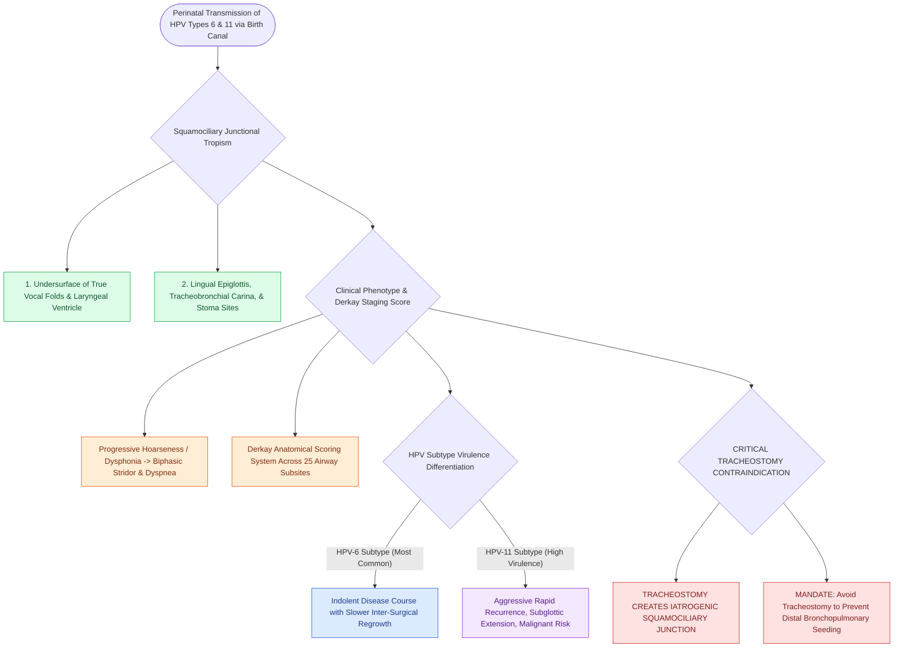

# Recurrent respiratory papillomatosis RRP is driven by HPV six and eleven causing recurrent laryngeal lesions

## Active Recall

> [!question]- Which two HPV subtypes are responsible for $>95\%$ of recurrent respiratory papillomatosis cases?
> *Answer / Clinical Rationale*: **HPV Type 6 and HPV Type 11** (with HPV-11 causing more aggressive disease).

> [!question]- Why is tracheostomy avoided in children with juvenile-onset RRP?
> *Answer / Clinical Rationale*: Because the tracheostomy stoma creates an iatrogenic squamociliary junction that **promotes distal dissemination of papillomas into the trachea and lungs**.

## Core Clinical & Mechanistic Principles
**Recurrent Respiratory Papillomatosis (RRP)** is the most common benign laryngeal neoplasm in children, characterized by recurrent exophytic squamous papillomas along the respiratory tract:
- **Virological Etiology**:
  - Driven by **Human Papillomavirus (HPV) Types 6 and 11** (low-risk, non-oncogenic types).
  - **HPV-11** is associated with more aggressive disease, higher recurrence rates, extensive subglottic/tracheal spread, and higher risk of malignant transformation.
  - *Transmission*: Vertical transmission from mother to infant during vaginal delivery in mothers with genital condylomata.
- **Predilection Sites & Squamociliary Junctions**:
  - Papillomas develop preferentially at **squamociliary junctional transitions**:
    1. Undersurface of the true vocal folds.
    2. Junction of the true and false vocal folds (ventricle).
    3. Lingual surface of the epiglottis.
    4. Carina and tracheostomy stoma sites.
- **Clinical Presentation & Derkay Staging**:
  - Progressive dysphonia / hoarseness, followed by biphasic stridor and life-threatening airway obstruction.
  - **Derkay Severity Score**: Standardized scoring system grading lesion extent across 25 anatomical airway sites, used to monitor disease trajectory.

### Surgical Technique & Critical Safety Checks
- **The Tracheostomy Seeding Hazard**: Tracheostomy is strictly avoided whenever possible, as the stoma creates a new squamociliary junction that promotes **distal tracheal and bronchopulmonary seeding** (see [[Microdebrider debulking and intralesional cidofovir provide surgical and adjuvant control of RRP|RRP Surgical Management]]).

## Connected Concepts & Graph Traversal
- **RRP Surgical Craft**: [[Microdebrider debulking and intralesional cidofovir provide surgical and adjuvant control of RRP|RRP Surgical Management]]
- **Stridor Localization**: [[Inspiratory, biphasic, and expiratory stridor localize pediatric airway obstruction to supraglottic, subglottic, and tracheobronchial subsites|Stridor Localization]]
- **Subglottic Stenosis**: [[Congenital subglottic stenosis results from incomplete recanalization of the laryngeal lumen during embryogenesis|Subglottic Stenosis]]
- **Embryological & Sleep Foundation**: [[Each branchial arch packages one nerve, one artery, one cartilage bar, and one muscle group]]
- **Sleep Endoscopy & Airway Dynamics**: [[Drug-induced sleep endoscopy DISE evaluates dynamic multi-level upper airway collapse under sedation|Drug-Induced Sleep Endoscopy (DISE)]] [[Adenotonsillectomy is the first-line surgical treatment for pediatric obstructive sleep apnea]]
- **Congenital Airway Pathology**: [[Acute epiglottitis causes rapid supraglottic swelling with thumbprint sign and mandates controlled operating room intubation]]
- **Open Airway Reconstruction**: [[Slide tracheoplasty expands complete tracheal rings by oblique division and sliding longitudinal reconstruction]]
