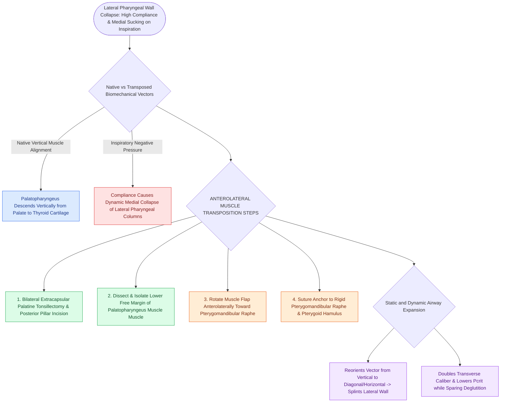

# Relocating the palatopharyngeus anterolaterally splints the lateral pharyngeal walls in expansion pharyngoplasty

## Active Recall

> [!question]- What rigid anatomical structure serves as the anterior anchoring point for the transposed palatopharyngeus muscle?
> *Answer / Clinical Rationale*: The **pterygomandibular raphe**.

> [!question]- How does reorienting the palatopharyngeus muscle from a vertical to a diagonal vector prevent sleep apnea?
> *Answer / Clinical Rationale*: It applies **continuous lateral traction on the lateral pharyngeal walls**, preventing them from collapsing inward under negative inspiratory pressure.

## Core Clinical & Mechanistic Principles
Relocating the **palatopharyngeus muscle** anterolaterally (as described in Cahali's lateral pharyngoplasty and Pang's ESP) physically transforms a collapsible, compliant muscular tube into a rigid, non-collapsible corridor:
- **Biomechanical Vector Transformation**:
  - In native anatomy, the palatopharyngeus muscle runs vertically from the soft palate to the thyroid cartilage, pulling the lateral pharyngeal walls inward and medially during swallowing.
  - In sleep apnea patients with lateral wall hypotonia, negative inspiratory intraluminal pressure sucks these vertical muscular columns inward.
  - **Anterolateral Transposition to the Pterygomandibular Raphe**:
    - Reorients the muscle vector from vertical to **diagonal / horizontal**.
    - Anchoring the muscle to the rigid, fixed **pterygomandibular raphe (and hamulus)** creates continuous static and dynamic lateral traction.
    - Splints the lateral pharyngeal walls outward, **lowering $P_{\text{crit}}$ and doubling the lateral retroglossal diameter**.

### Surgical Technique & Critical Safety Checks
- **Preservation of Deglutition**: Sparing the superior constrictor and superior palatal insertion preserves normal velopharyngeal sphincter competence during swallowing (see [[Expansion sphincter pharyngoplasty ESP rotates the palatopharyngeus muscle to stabilize lateral pharyngeal wall collapse|Expansion Pharyngoplasty]]).

## Connected Concepts & Graph Traversal
- **Expansion Pharyngoplasty**: [[Expansion sphincter pharyngoplasty ESP rotates the palatopharyngeus muscle to stabilize lateral pharyngeal wall collapse|Expansion Pharyngoplasty]]
- **Barbed Pharyngoplasty**: [[Barbed suture suspension pharyngoplasty achieves tension-distributed palatopharyngoplasty without mucosal resection|Barbed Pharyngoplasty]]
- **Modified UPPP**: [[Modified uvulopalatopharyngoplasty UPPP resects redundant palatal tissue while preserving muscular function|Modified UPPP]]
- **Embryological & Sleep Foundation**: [[Pediatric polysomnography criteria define obstructive sleep apnea with an obstructive apnea-hypopnea index exceeding one]]
- **Sleep Endoscopy & Airway Dynamics**: [[Drug-induced sleep endoscopy DISE evaluates dynamic multi-level upper airway collapse under sedation|Drug-Induced Sleep Endoscopy (DISE)]] [[Concentric velopharyngeal collapse on DISE is a contraindication to hypoglossal nerve stimulation]]
- **Congenital Airway Pathology**: [[Congenital bilateral vocal fold paralysis presents with severe inspiratory stridor requiring airway protection]]
- **Open Airway Reconstruction**: [[Postoperative chin-to-chest flexion stitch prevents catastrophic neck extension and tracheal anastomotic dehiscence]]
