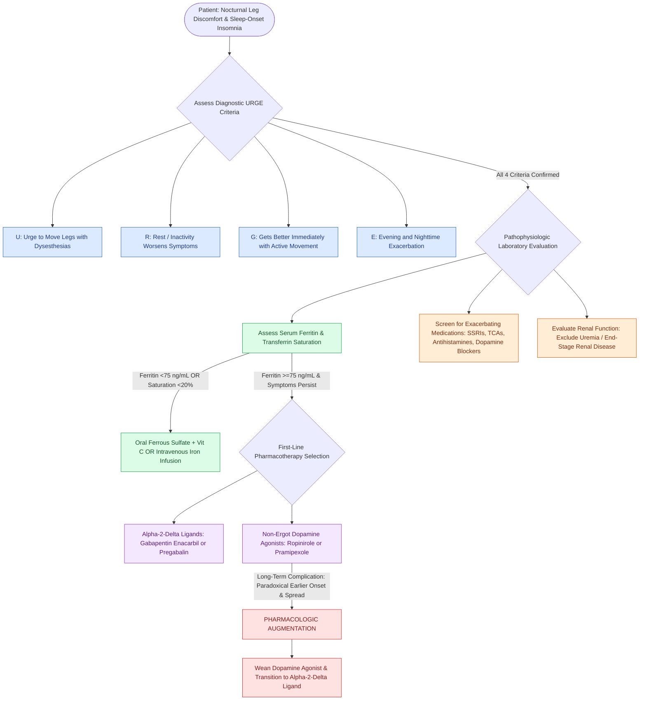

# Restless legs syndrome presents with nocturnal dysesthesias driven by central iron deficiency and dopamine dysregulation treated with dopamine agonists

## Active Recall

> [!question]- What four clinical criteria comprise the diagnostic 'URGE' mnemonic for Restless Legs Syndrome (Willis-Ekbom disease)?
> *Answer / Clinical Rationale*: The diagnosis of RLS is strictly clinical and defined by the four **URGE** features:
> 1. **U — Urge to move the legs**, usually accompanied by or in response to uncomfortable, creeping, or crawling dysesthesias deep within the calves or thighs.
> 2. **R — Rest induces or worsens symptoms**, precipitating during periods of physical inactivity such as sitting or lying down.
> 3. **G — Gets better with movement**, with immediate, partial, or complete relief achieved by motor activity such as walking, pacing, or stretching (persisting as long as activity continues).
> 4. **E — Evening and nighttime prominence**, with symptoms exclusively occurring or significantly worsening in the evening or night compared to daytime hours.

> [!question]- What neurochemical mechanism links systemic iron deficiency to striatal dopaminergic dysfunction in the pathogenesis of RLS?
> *Answer / Clinical Rationale*: **Iron is an essential cofactor for tyrosine hydroxylase**, the rate-limiting enzyme in the synthesis of dopamine from L-tyrosine. In RLS, a deficiency in cellular iron transport (manifesting as **decreased cerebrospinal fluid [CSF] ferritin and transferrin receptor dysfunction** in the substantia nigra) reduces striatal dopamine synthesis and downregulates postsynaptic dopamine D2 receptors. This diurnal hypodopaminergic state disrupts sensory-motor processing in the spinal cord and basal ganglia, creating nocturnal sensory dysesthesias and motor restlessness.

> [!question]- What is the serum ferritin threshold that mandates iron replacement therapy in RLS, and what major complication occurs with long-term dopamine agonist therapy?
> *Answer / Clinical Rationale*: An empty or subnormal central iron store is present when **serum ferritin is $<50\text{ to }75\text{ ng/mL}$** (or transferrin saturation $<20\%$); oral iron therapy (ferrous sulfate with vitamin C) or intravenous iron (e.g., ferric carboxymaltose) is mandatory before or alongside pharmacotherapy. The major complication of long-term dopamine agonist therapy (e.g., ropinirole, pramipexole) is **pharmacologic augmentation**—a paradoxical worsening of RLS where symptoms begin earlier in the afternoon, increase in anatomical extent (spreading to arms), and intensify in severity.

## Core Clinical & Mechanistic Principles

Restless Legs Syndrome (RLS), also known as Willis-Ekbom disease, is a sensorimotor sleep-related movement disorder characterized by an irresistible urge to move the lower extremities. It is frequently encountered in sleep clinics and otolaryngology practices during the workup of sleep fragmentation and daytime hypersomnolence.

### Etiology and Risk Factors

1. **Primary (Idiopathic / Familial) RLS**:
   - Onset before age 40; strong familial predisposition with autosomal dominant inheritance.
   - Strongly associated with genetic variants in the **BTBD9 gene**, as well as *MEIS1*, *MAP2K5*, and *PTPRD*.
2. **Secondary RLS Causes**:
   - **Iron Deficiency Anemia**: Depletes brain iron stores; serum ferritin $<50\text{--}75\text{ ng/mL}$.
   - **End-Stage Renal Disease / Uremia**: Affects up to $20\%\text{ to }50\%$ of hemodialysis patients.
   - **Pregnancy**: Particularly third trimester (resolves rapidly postpartum).
   - **Peripheral Neuropathy**: Diabetic neuropathy, radiculopathy.
   - **Medication Triggers**:
     - Antidepressants: SSRIs, SNRIs, TCAs.
     - Sedating antihistamines: Diphenhydramine, hydroxyzine (central H1 blockade).
     - Antiemetics & Neuroleptics: Metoclopramide, prochlorperazine, haloperidol (D2 dopamine receptor antagonism).
     - Lithium.

### Differential Diagnosis & Sleep Movement Disorders Ledger

| Condition | Clinical Hallmark | Polysomnographic Findings | Relationship to Motor Activity | First-Line Therapy |
| :--- | :--- | :--- | :--- | :--- |
| **Restless Legs Syndrome (RLS)** | Urge to move legs + nocturnal dysesthesias | Coexists with PLMD in $>80\%$ | **Relieved immediately** by walking/moving | Iron replacement (if ferritin $<75$); gabapentin / pramipexole |
| **Periodic Limb Movement Disorder (PLMD)** | Repetitive stereotypic leg jerks during sleep | Periodic runs of $\ge 4$ limb movements ($0.5\text{--}10\text{ s}$, separated by $5\text{--}90\text{ s}$) | Patient unaware; movements occur during sleep | Dopamine agonists; alpha-2-delta ligands |
| **Nocturnal Leg Cramps** | Painful, palpable, sustained involuntary muscle contractions | Sustained high-voltage burst EMG activity | **Relieved by passive muscle stretch**, not active walking | Calf muscle stretching; hydration |
| **Sleep-Related Bruxism** | Tooth grinding/clenching during sleep; jaw soreness | Sustained or phasic masseter EMG elevation for **$>2\text{ seconds}$** | Sleep-state dependent; often triggered by microarousals | Dental occlusal splints; biofeedback |
| **REM Sleep Behavior Disorder (RBD)** | Dream enactment behavior; loss of REM muscle atonia | Persistent muscle tone on chin/limb EMG during REM sleep | Violent dream-directed motor activity | High-dose melatonin; clonazepam |

Comprehensive anatomical and therapeutic integration links these principles directly to [[High loop gain causes ventilatory instability and periodic breathing in sleep-disordered breathing|Loop Gain Instability]].

## Connected Concepts & Graph Traversal
- **Sleep Architecture Foundations**: [[Non-rapid eye movement and rapid eye movement sleep architecture dictate pharyngeal muscle tone|Sleep Architecture & Pharyngeal Muscle Tone]]
- **Arousal Neurophysiology**: [[Low arousal threshold causes premature awakening before airway stabilization in obstructive sleep apnea|Arousal Threshold Mechanics]]
- **Daytime Somnolence Screening**: [[The Epworth Sleepiness Scale and Berlin Questionnaire screen for daytime somnolence and obstructive sleep apnea risk|Epworth Sleepiness Scale]]
- **Diagnostic Polysomnography**: [[Adult polysomnography criteria define obstructive sleep apnea severity by apnea-hypopnea index thresholds of five, fifteen, and thirty|Adult PSG Severity Metrics]]
- **Polysomnographic Criteria**: [[Polysomnographic event criteria differentiate obstructive, central, and mixed apneas through airflow sensors and thoracoabdominal effort monitoring|PSG Criteria & Limb Movement Monitoring]]
