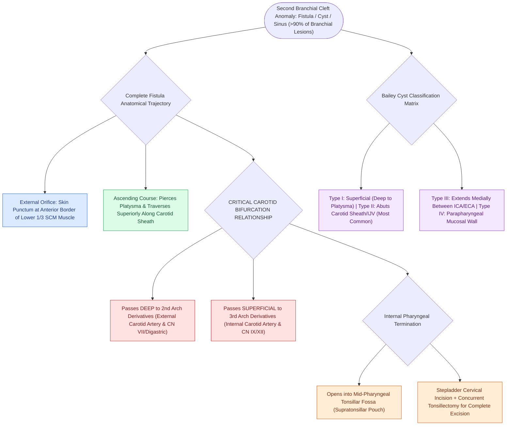

# Second branchial cleft anomalies represent the most common branchial anomaly situated anterior to the sternocleidomastoid

## Active Recall

> [!question]- Between which two major vascular structures does a complete second branchial cleft fistula tract course?
> *Answer / Clinical Rationale*: It passes **between the internal carotid artery (deep) and the external carotid artery (superficial)**.

> [!question]- Where is the internal pharyngeal opening of a complete second branchial fistula located?
> *Answer / Clinical Rationale*: In the **palatine tonsillar fossa (supratonsillar fossa)** (derived from the 2nd branchial pouch).

## Core Clinical & Mechanistic Principles
**Second branchial cleft anomalies** are the most common congenital branchial anomalies, accounting for **$>90\text{–}95\%$** of all branchial lesions:
- **Anatomical Course of the Complete Fistula**:
  - **External Opening**: Located along the **anterior border of the lower third of the sternocleidomastoid (SCM) muscle**.
  - **Ascending Course**: Penetrates the platysma, ascends along the carotid sheath, **passes DEEP to second arch derivatives (external carotid artery, stylohyoid muscle, posterior belly of digastric, CN VII)** and **SUPERFICIAL to third arch derivatives (internal carotid artery, CN IX, CN XII)**.
  - **Internal Opening**: Opens into the **palatine tonsillar fossa (supratonsillar fossa)**.
- **Bailey Classification of 2nd Branchial Cleft Cysts**:
  - **Type I**: Superficial; lies immediately deep to the platysma anterior to the SCM.
  - **Type II (Most Common)**: Abuts the carotid sheath and adheres to the internal jugular vein.
  - **Type III**: Extends medially between the internal and external carotid arteries to the pharyngeal wall.
  - **Type IV**: Lies deep to the pharyngeal wall in the parapharyngeal space abutting the tonsillar fossa.

### Surgical Technique & Critical Safety Checks
- **Stepladder Incision**: Complete tract excision often requires two parallel horizontal cervical incisions ("stepladder incisions") to trace the tract to the pharyngeal constrictor (see [[Each branchial arch packages one nerve, one artery, one cartilage bar, and one muscle group|Branchial Apparatus]]).

## Connected Concepts & Graph Traversal
- **Branchial Apparatus**: [[Each branchial arch packages one nerve, one artery, one cartilage bar, and one muscle group|Branchial Apparatus]]
- **First Branchial Cleft**: [[First branchial cleft anomalies present as periauricular cysts or sinus tracts parallel to the external auditory canal|First Branchial Cleft]]
- **Third and Fourth Clefts**: [[Third and fourth branchial pouch anomalies present as recurrent left thyroid bed abscesses and piriform sinus fistulas|Third & Fourth Clefts]]
- **Embryological & Sleep Foundation**: [[Pediatric polysomnography criteria define obstructive sleep apnea with an obstructive apnea-hypopnea index exceeding one]]
- **Sleep Endoscopy & Airway Dynamics**: [[Drug-induced sleep endoscopy DISE evaluates dynamic multi-level upper airway collapse under sedation|Drug-Induced Sleep Endoscopy (DISE)]] [[Extracapsular total tonsillectomy and intracapsular subtotal tonsillotomy differ in postoperative hemorrhage and recovery]]
- **Congenital Airway Pathology**: [[Endoscopic supraglottoplasty cold-steel and laser division of aryepiglottic folds relieves severe laryngomalacia]]
- **Open Airway Reconstruction**: [[Tracheomalacia causes dynamic expiratory tracheal collapse and is managed with posterior tracheobronchopexy]]
