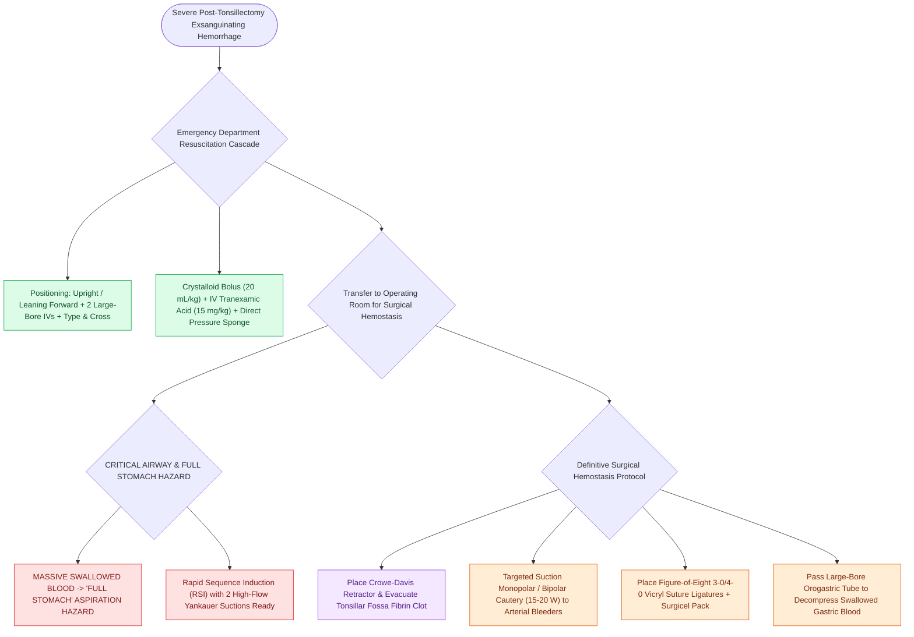

# Severe secondary post-tonsillectomy hemorrhage requires urgent airway stabilization and surgical electrocautery

## Active Recall

> [!question]- Why is every patient presenting with post-tonsillectomy hemorrhage considered to have a 'full stomach' during anesthesia induction?
> *Answer / Clinical Rationale*: Because swallowed blood accumulates silently in the stomach, creating a severe **aspiration hazard during intubation**.

> [!question]- What local chemical agents can be applied on a cotton sponge to achieve temporary hemostasis in the emergency department?
> *Answer / Clinical Rationale*: **$1:1,000\text{ Epinephrine}$**, **topical Tranexamic Acid (TXA)**, or oxymetazoline.

## Core Clinical & Mechanistic Principles
Severe [[Post-tonsillectomy hemorrhage is classified into primary within twenty-four hours and secondary beyond twenty-four hours|post-tonsillectomy hemorrhage]] is a pediatric airway and hemorrhagic emergency requiring immediate, structured multidisciplinary resuscitation and [[High-stakes pediatric and adult sleep airway complications require rapid structured algorithmic emergency rescue|emergency airway management]]:
- **Emergency Department Initial Resuscitation Protocol**:
  1. **Positioning & Airway Protection**: Sit patient upright leaning forward (or recovery lateral decubitus) to prevent blood aspiration into the trachea.
  2. **Vascular Access & Volume Resuscitation**: Place two large-bore IVs; draw Type & Crossmatch, CBC, PT/INR, PTT; infuse $20\text{ mL/kg}$ isotonic crystalloid bolus; transfuse packed RBCs if hemodynamically unstable.
  3. **Local Measures (In Cooperative Patients / Adolescents)**:
     - Clear large blood clots from oropharynx with Yankauer suction under direct headlight visualization.
     - Apply direct compression with a **cotton ball soaked in $1:1000\text{ epinephrine}$ or 4% lidocaine + epi / Tranexamic Acid (TXA)** for 10 minutes.
- **Operating Room Surgical Protocol**:
  - **Full Stomach Induction**: Every bleeding tonsil patient has swallowed massive amounts of blood (**"full stomach"**); perform rapid sequence induction (RSI) with two working suctions ready; immediate intubation with cuffed ETT.
  - **Gastric Decompression**: Evacuate blood from the stomach using a large-bore orogastric tube.
  - **Surgical Hemostasis**: Place Crowe-Davis mouth gag; irrigate and suction clot; achieve definitive hemostasis using **suction monopolar or bipolar electrocautery (15–20 W)**; place figure-of-eight **3-0 or 4-0 Vicryl sutures** around persistent arterial bleeders or pack with oxidized regenerated cellulose (Surgicel).

### Surgical Technique & Critical Safety Checks
- **Systemic TXA**: Intravenous Tranexamic Acid ($10\text{–}15\text{ mg/kg}$) reduces transfusion requirements and rebleeding rates.

## Connected Concepts & Graph Traversal
- **Post-Tonsillectomy Bleed**: [[Post-tonsillectomy hemorrhage is classified into primary within twenty-four hours and secondary beyond twenty-four hours|Post-Tonsillectomy Bleed]]
- **High-Risk Criteria**: [[High-risk pediatric criteria mandate overnight inpatient admission following adenotonsillectomy|High-Risk Criteria]]
- **Tonsillectomy Techniques**: [[Extracapsular total tonsillectomy and intracapsular subtotal tonsillotomy differ in postoperative hemorrhage and recovery|Tonsillectomy Techniques]]
- **Embryological & Sleep Foundation**: [[Each branchial arch packages one nerve, one artery, one cartilage bar, and one muscle group]]
- **Sleep Endoscopy & Airway Dynamics**: [[Drug-induced sleep endoscopy DISE evaluates dynamic multi-level upper airway collapse under sedation|Drug-Induced Sleep Endoscopy (DISE)]] [[Pediatric DISE identifies persistent multi-level airway collapse following adenotonsillectomy]]
- **Congenital Airway Pathology**: [[Recurrent respiratory papillomatosis RRP is driven by HPV six and eleven causing recurrent laryngeal lesions]]
- **Open Airway Reconstruction**: [[Complete tracheal rings present with generalized tracheal stenosis and stovepipe appearance on imaging]]
