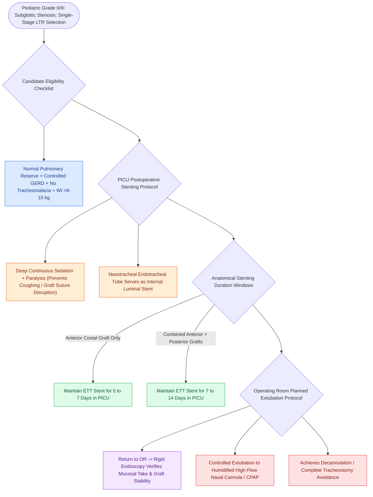

# Single-stage LTR utilizes an endotracheal tube as a temporary stent avoiding tracheostomy placement

## Active Recall

> [!question]- What is the typical duration of nasotracheal ETT stenting following single-stage LTR with an anterior-only graft vs. combined anterior-posterior grafts?
> *Answer / Clinical Rationale*: **$5\text{ to }7\text{ days}$ for anterior graft only**; **$7\text{ to }14\text{ days}$ for combined anterior and posterior grafts**.

> [!question]- Where and under what conditions should extubation take place following single-stage LTR?
> *Answer / Clinical Rationale*: In the **operating room under direct endoscopic visualization** with rigid airway equipment ready for immediate re-intubation if needed.

## Core Clinical & Mechanistic Principles
**Single-Stage [[Single-stage and double-stage laryngotracheal reconstruction LTR repair mature high-grade subglottic stenosis|Laryngotracheal Reconstruction]] (SSLTR)** eliminates the morbidity of prolonged tracheostomy dependence by utilizing a **nasotracheal endotracheal tube (ETT)** as an internal airway stent:
- **Core Patient Selection Criteria**:
  - Myer-Cotton Grade II or III subglottic stenosis.
  - Absence of severe [[Tracheomalacia causes dynamic expiratory tracheal collapse and is managed with posterior tracheobronchopexy|tracheomalacia]] or lower tracheal stenosis.
  - Normal pulmonary reserve (not ventilator-dependent).
  - Controlled gastroesophageal reflux disease.
  - Weight $>8\text{–}10\text{ kg}$ (typically $>12\text{–}18\text{ months}$ of age).
- **PICU Postoperative Airway Protocol**:
  1. **Sedation & Muscle Relaxation**: Deep continuous sedation (fentanyl + midazolam/dexmedetomidine $\pm$ neuromuscular blockade for first 48–72 hours) to **prevent accidental self-extubation or bucking on the ETT** (which would disrupt cartilage graft sutures).
  2. **Head Flexion**: Maintain neck in neutral-to-slight flexion; avoid extension.
  3. **Stent Duration**:
     - *Anterior Graft Only*: **$5\text{ to }7\text{ days}$**.
     - *Combined Anterior + Posterior Grafts*: **$7\text{ to }14\text{ days}$**.
  4. **Planned Extubation in the Operating Room**:
     - Child is returned to the OR; ETT is removed under direct visualization with a rigid telescope; graft stability, mucosal re-epithelialization, and airway patency are confirmed; child is extubated to humidified high-flow nasal cannula or CPAP.

### Surgical Technique & Critical Safety Checks
- **Accidental Extubation Crisis**: Immediate emergency re-intubation by an experienced pediatric airway team over an airway exchange catheter or emergent [[Airway foreign body aspiration mandates rigid bronchoscopy despite normal radiographs|rigid bronchoscopy]].

## Connected Concepts & Graph Traversal
- **LTR Reconstruction**: [[Single-stage and double-stage laryngotracheal reconstruction LTR repair mature high-grade subglottic stenosis|LTR Reconstruction]]
- **Double-Stage LTR**: [[Double-stage LTR maintains a tracheostomy and utilizes an endolaryngeal LT-Mold or Montgomery T-tube stent|Double-Stage LTR]]
- **Anterior Costal Graft**: [[Anterior costal cartilage grafts expand the thyroid and cricoid cartilage framework|Anterior Costal Cartilage Graft]]
- **Embryological & Sleep Foundation**: [[Adult polysomnography criteria define obstructive sleep apnea severity by apnea-hypopnea index thresholds of five, fifteen, and thirty]]
- **Sleep Endoscopy & Airway Dynamics**: [[Drug-induced sleep endoscopy DISE evaluates dynamic multi-level upper airway collapse under sedation|Drug-Induced Sleep Endoscopy (DISE)]] [[Post-tonsillectomy hemorrhage is classified into primary within twenty-four hours and secondary beyond twenty-four hours]]
- **Congenital Airway Pathology**: [[Microdebrider debulking and intralesional cidofovir provide surgical and adjuvant control of RRP]]
- **Open Airway Reconstruction**: [[Tracheomalacia causes dynamic expiratory tracheal collapse and is managed with posterior tracheobronchopexy]]
