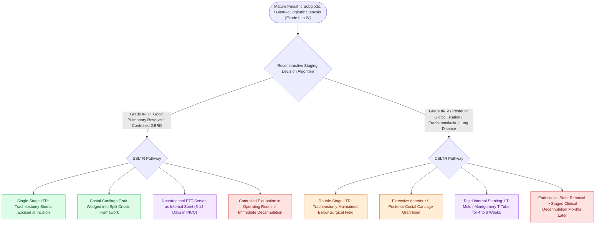

# Single-stage and double-stage laryngotracheal reconstruction LTR repair mature high-grade subglottic stenosis

## Active Recall

> [!question]- What serves as the temporary internal stent in a single-stage LTR (SSLTR), and for how long?
> *Answer / Clinical Rationale*: A **nasotracheal endotracheal tube (ETT)**, maintained for **$5\text{ to }10\text{ days}$** in the PICU.

> [!question]- When is a double-stage LTR (DSLTR) preferred over a single-stage procedure?
> *Answer / Clinical Rationale*: In **severe Grade III or IV stenosis**, significant pulmonary disease, severe tracheomalacia, posterior glottic stenosis requiring prolonged stenting, or revision cases.

## Core Clinical & Mechanistic Principles
**Laryngotracheal Reconstruction (LTR)** (pioneered by Robin Cotton in the 1970s) is the established open surgical procedure for expanding a stenotic subglottic or glottic airway using **autologous costal cartilage grafts**:
- **Core Surgical Mechanics**:
  - The rigid, narrowed cricoid ring and upper tracheal rings are split vertically in the anterior midline (and/or posterior midline).
  - An autologous cartilage graft harvested from the 5th, 6th, or 7th rib is carved and sutured into the split framework, acting as a wedge to permanently increase the luminal cross-sectional area.
- **Single-Stage LTR (SSLTR)**:
  - The pre-existing tracheostomy is excised at the start of surgery.
  - The airway is reconstructed, and a **nasotracheal endotracheal tube (ETT)** is placed across the reconstruction to serve as an **internal stent for $5\text{ to }14\text{ days}$** in the pediatric ICU.
  - Child is extubated in a controlled operating room setting, achieving immediate decannulation.
- **Double-Stage LTR (DSLTR)**: 
  - The tracheostomy is maintained (or newly placed) below the reconstruction.
  - A firm endolaryngeal stent (e.g., **LT-Mold, [[Double-stage LTR maintains a tracheostomy and utilizes an endolaryngeal LT-Mold or Montgomery T-tube stent|Montgomery T-tube]], or Aboulker stent**) is secured across the grafted airway for **$4\text{ to }6\text{ weeks}$**.
  - Stent is removed endoscopically; child is decannulated months later after endoscopic confirmation of a stable, mature airway.

### Surgical Technique & Critical Safety Checks
- **Candidacy for Single-Stage**: Patient must be free of significant pulmonary parenchymal disease, severe [[Tracheomalacia causes dynamic expiratory tracheal collapse and is managed with posterior tracheobronchopexy|tracheomalacia]], active uncontrolled GERD, or need for prolonged mechanical ventilation.

## Connected Concepts & Graph Traversal
- **Anterior Costal Graft**: [[Anterior costal cartilage grafts expand the thyroid and cricoid cartilage framework|Anterior Costal Cartilage Graft]]
- **Posterior Costal Graft**: [[Posterior costal cartilage grafts with a carved flange split the posterior cricoid lamina to expand the glottic lumen|Posterior Costal Cartilage Graft]]
- **CTR Resection**: [[Cricotracheal resection CTR achieves primary end-to-end anastomosis for severe Grade III and IV subglottic stenosis|CTR Resection]]
- **Embryological & Sleep Foundation**: [[Geniohyoid and genioglossus muscles are primary upper airway dilators maintaining pharyngeal patency]]
- **Sleep Endoscopy & Airway Dynamics**: [[Drug-induced sleep endoscopy DISE evaluates dynamic multi-level upper airway collapse under sedation|Drug-Induced Sleep Endoscopy (DISE)]] [[Coblation lingual tonsillectomy debulks tongue base lymphoid tissue while preserving the lingual neurovascular bundles]]
- **Congenital Airway Pathology**: [[Subglottic hemangiomas present as biphasic stridor in infants and respond to systemic oral propranolol]]
- **Open Airway Reconstruction**: [[Single-stage LTR utilizes an endotracheal tube as a temporary stent avoiding tracheostomy placement]]
